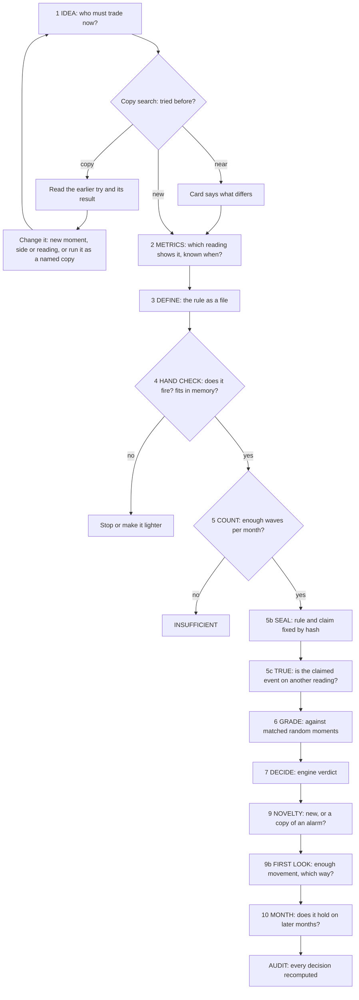
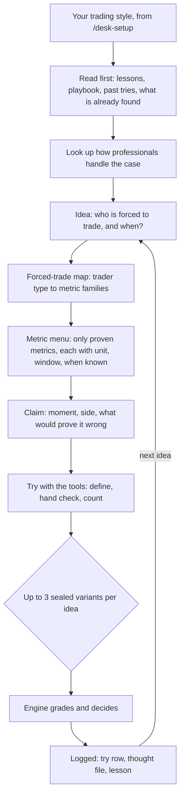
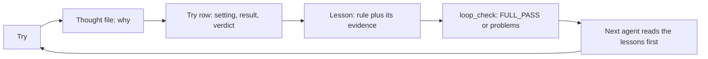
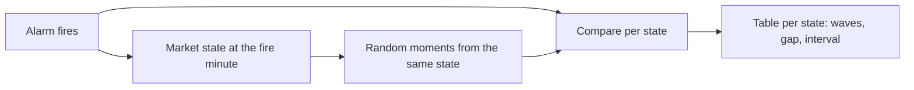
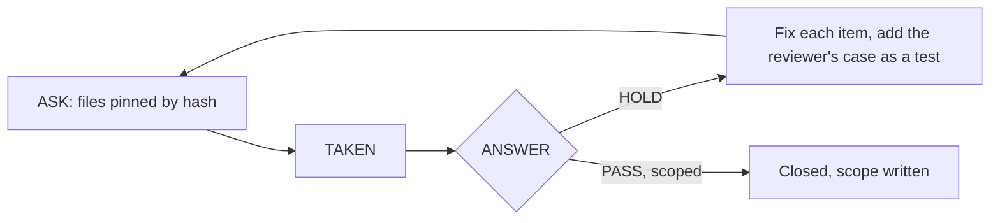
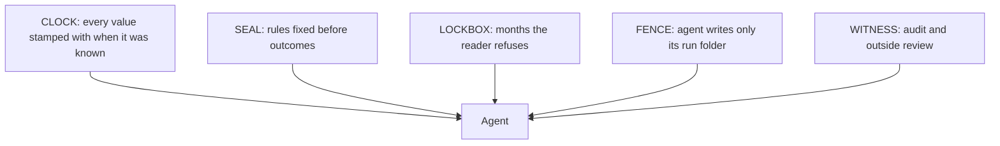
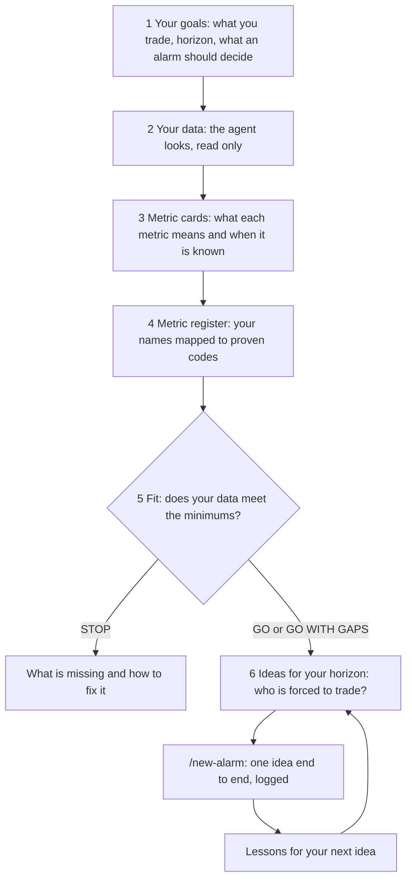

# Crypto Alarm Desk

**An agentic research desk for crypto alarms.** AI agents propose, test and judge *alarms*: rules that fire at the moment some traders are forced to trade. Every verdict comes from fixed tools, never from the agent. Every try is logged, so agents learn from earlier tries.

> An alarm is not a trading strategy. Nothing here claims money. Read [CLAIMS.md](CLAIMS.md) before reading any result.

**Contents**
1. [Overview](#1-overview)
2. [From idea to alarm](#2-from-idea-to-alarm)
3. [How an agent works](#3-how-an-agent-works)
4. [How agents learn](#4-how-agents-learn)
5. [How alarms are judged, and grouped by market context](#5-how-alarms-are-judged-and-grouped-by-market-context)
6. [An outside agent reviews the work](#6-an-outside-agent-reviews-the-work)
7. [How agents are kept from cheating](#7-how-agents-are-kept-from-cheating)
8. [How data is sealed](#8-how-data-is-sealed)
9. [How to: from your own data to your alarms](#9-how-to-from-your-own-data-to-your-alarms)
10. [Quick start](#10-quick-start)
11. [Status, limits and roadmap](#11-status-limits-and-roadmap)

---

## 1. Overview

| part | what it is |
|---|---|
| `alarm/` | the alarm engine: detection, counting, grading, decision, audit |
| `desk/` | `desk.py`, the one command; local job queue; tests |
| `loop/` | the learning loop: one row per try, lessons, checker |
| `plugin/` | Claude Code plugin: skills, `/desk-setup`, `/new-alarm`, a reviewer agent |

**What makes it different**
- **The agent never decides.** It writes ideas and rules; engine tools give every verdict.
- **Sealed before seen.** A rule is fixed by its hash (a fingerprint of the file's content) before any outcome is read.
- **Counted in waves, not fires.** Fires less than 30 minutes apart count once, so one busy hour can't fake a result.
- **Judged against chance.** Every alarm is compared with matched random moments.
- **Every try logged.** Failed tries stay on record; the next agent reads them first.

---

## 2. From idea to alarm

An idea starts with one question: *who must trade now, and why?* (a liquidated trader, a hedger, a forced seller). The copy search shows the closest earlier tries and why each matched, so a repeated idea becomes a better one instead of a dead end. The engine then takes the idea through fixed steps, and any later step can stop it.

The engine's verdicts are **PASS, NEEDS MORE MONTHS, STOP, INSUFFICIENT** and **INVALID**. An optional ENTRY step shows what an entry would have paid. It is information only and never decides.

---

## 3. How an agent works

The agent starts from your trading style. `/desk-setup` asks what you trade, at which horizon, and what an alarm should help you decide. It then checks your data against that.

| your style | V1 |
|---|---|
| under 1 second | out of scope |
| seconds to 15 min | partly: minute decisions only |
| 15 min to hours | supported |
| hours to days and longer | not in V1 |

- **Metrics are chosen from a menu.** Each metric on it is proven, with its unit, window and when its value is known. A metric off the menu is refused unless the agent writes and defends an exception.
- **A refusal ends the try.** The agent reports it word for word and never works around it.
- **Every number carries its source file**, or it is labelled an opinion.

---

## 4. How agents learn

Each try is one row with one format, written by one tool, after a "thought file" that says why the try was made. Lessons are rules with their evidence. A new agent reads them before its first try.

**The learning test** asks whether lessons make the agent better:
- A **frozen kit** (the V1 skills and lessons) runs a fixed set of tasks first.
- A separate **proposer** suggests at most 3 changes to the kit per round.
- A change is **kept** only if no task gets worse and the audit finds fewer warnings. Otherwise it is rolled back.
- V2 shows one round as a descriptive table and claims no improvement.
- V3 adds a placebo kit (as many changes, no real content) and proof on tasks the loop never saw.

---

## 5. How alarms are judged, and grouped by market context

| step | question |
|---|---|
| COUNT | enough waves in enough months? |
| TRUE | does the claimed event show on a reading the rule doesn't use? |
| GRADE | does it beat matched random moments? |
| NOVELTY | new, or 50% or more the same fires as an existing alarm on the same side? |
| FIRST LOOK | enough movement, and which way, against equally busy random moments? |
| MONTH | does it hold on later months? |

**Market context, the KIND step (V2, a pilot).** Each fire is tagged with its event kind and the market state at that minute. The alarm is then read per state, against random moments from **the same state**, so a calm or wild market can't fake an effect. KIND only describes: it never blocks an alarm and makes no money claim.

---

## 6. An outside agent reviews the work

Every tool edition and document goes to a reviewer running on a different model, through a shared board.

- **Must-fix only.** Each item gives the file, its hash, the line, a counterexample and the smallest fix.
- **A PASS says what it covers**, and what it doesn't.
- **Limit:** models share some blind spots, so a second model catches part of what the author misses, not all of it.

---

## 7. How agents are kept from cheating

| guard | what it does |
|---|---|
| engine verdicts only | the agent never computes or edits a verdict |
| seal before read | the rule is fixed by hash before outcomes; a changed rule is a new variant |
| 3 variants per idea | each graded once; no fishing |
| trial fence | engine files hashed before and after each trial |
| hidden markers | planted strings in sealed tables catch copied answers |
| grader-only records | grades are kept outside the agent's reach |
| audit | recomputes every decision from its records |

**Known limit:** in trials, the agent and the grader run as the same computer user. Today a read of a hidden file is neither prevented nor always detected. A separate machine and user is planned.

---

## 8. How data is sealed

Five layers, called **BLINDFOLD**:

- **CLOCK.** One reader answers "what was known at time t". Three look-ahead guards are required in every tool.
- **LOCKBOX.** Rules are designed on Sep to Dec 2025. Jan to Apr 2026 opens only through the MONTH step. Data from May 2026 onward is never read. The queue refuses any window outside these dates.
- **Honest limit:** Jan to Apr 2026 is a later period with its own exposure history, not a never-seen holdout.

---

## 9. How to: from your own data to your alarms

The agent guides you one question at a time, and your data is only read, never changed. Run `/desk-setup`, then `/new-alarm`.

| step | what the agent does | status |
|---|---|---|
| 1 goals and timeframe | asks venues, coins, horizon and the decision; maps them to a supported style | works |
| 2 your data | lists your folders, file kinds, columns and time stamps, then follows the data guide to convert public or your own files to the engine's format | works; the guide ships in V2, no ready-made converter |
| 3 metric cards | one card per metric: meaning, unit, window, when known, how proven | planned for your data |
| 4 metric register | maps your metric names to the engine's proven codes; anything else is UNPROVEN until proven | mapping works; your own register planned |
| 5 fit | checks the minimums below; ends GO, GO WITH GAPS or STOP | works |
| 6 your alarms | suggests ideas that fit your horizon, then runs each with `/new-alarm` | works |

**Minimums your data must meet**

| need | minimum |
|---|---|
| price | trades or 1-minute bars |
| coins | 10 |
| history | 4 months to build on, plus later months kept closed |
| an independent reading | open interest, funding or liquidations |
| time stamps | when each value was known |

**GO WITH GAPS** means it runs and names each gap. Every later result then carries the gap it ran with.

---

## 10. Quick start

1. Python 3.10 or 3.11, then `pip install -r alarm/settings/PYTHON_PACKAGES.txt`.
2. `cp settings/desk.env.example settings/desk.env`, then set `DATA_ROOT`, `OUTPUT_ROOT` and `PYTHON`.
3. `python3 -B desk/desk.py setup`, then `python3 -B desk/desk.py check`.
4. In Claude Code: `/plugin marketplace add ./`, then `/plugin install crypto-alarm-desk@crypto-alarm-desk`.
5. `/desk-setup`, then `/new-alarm <your idea>`.

**No market data ships with this repo.** The engine reads one-format day folders. The onboarding agent converts your files by following `docs/CONVERT_YOUR_DATA_V2.md`; the format is in `docs/DATA_FORMAT_V2.md`. No converter ships.

---

## 11. Status, limits and roadmap

| version | what |
|---|---|
| V1 | the desk, the engine, the learning loop, the plugin |
| V2 | a packaged desk any computer can download; the agent runs the onboarding and guides data conversion; KIND and one learning round, descriptive |
| V3 | placebo controls, proof on unseen tasks, KIND checks, trial isolation on a second machine |

- **Tested:** three fresh agents each took a task end to end, and every audit finished.
- **Not yet tested:** an install by a stranger on another machine.
- **Never claimed:** that an alarm makes money; that the agent improves (V2); that trials are isolated (V3).

**More:** every command, check and folder in [docs/DESK_REFERENCE.md](docs/DESK_REFERENCE.md); what runs today in [STATUS.md](STATUS.md); what is and is not claimed in [CLAIMS.md](CLAIMS.md).

License: MIT.
