# An agentic research system for crypto markets

This project is a research system in which AI agents study the cryptocurrency futures market: they record it, turn the records into defined readings, look for moments worth trading, and get better at that work from one run to the next, while staying honest about what they have and have not proven. People set the goal, the rules and the limits; agents do the daily research inside tools built so that every step can be checked by someone other than the agent that did it. This repository holds the first two parts that others can use: the alarm design (how a rule that marks unusual moments is built, graded and filed) and the learning loop (how each research run is checked, and how only checked lessons reach the next run). Strategy design, which turns a proven alarm into entries, exits and sizes, will be added in a later edition. It is paper research only: nothing here trades, and no result here is a claim of profit.

## What is in this repository

| folder | what it holds |
|---|---|
| `alarm/` | the alarm engine: the tools that turn a written idea into fires, count them in waves, seal the claim, grade it against matched random moments, check the claimed event and its novelty, and write the alarm card |
| `alarm_design/` | the alarm design process: the steps, gates and rules an agent follows to take one idea through the engine |
| `alarm_pipeline/` | the step-by-step pipeline that runs those steps in order and refuses any step whose inputs are not sealed |
| `loop/` | the learning loop: `generic/` (the cycle for any kind of research: rules page, sealed forecasts, the scoring and knowledge steps, the knowledge store and its one writing tool, the brief) and `packs/alarm/` (the alarm design pack) |
| `desk/` | the research desk: one command and a local job queue that run the alarm and loop steps on your own data, with their tests |
| `plugin/` | a plugin for an AI coding assistant: the skills each role loads, a setup command, a new-alarm command and a reviewer agent |
| `docs/` | the documentation; the full chapters are in `docs/system/`, one file per chapter, with the file names linked below |

No market data ships with the repository. The data licences allow methods, metric definitions and tools to be shared, never the data itself.

## Contents

0. [What the system is](#0-what-the-system-is)
1. [The challenges of working with agents](#1-the-challenges-of-working-with-agents)
2. [Information recording](#2-information-recording)
3. [Metric production and maintenance](#3-metric-production-and-maintenance)
4. [Metric cards](#4-metric-cards)
5. [Market analysis tools](#5-market-analysis-tools)
6. [Meta-labelling](#6-meta-labelling)
7. [The learning loop](#7-the-learning-loop)
8. [Roles and skills](#8-roles-and-skills)
9. [Prompting](#9-prompting)
10. [Truthfulness](#10-truthfulness)
11. [Measuring learning](#11-measuring-learning)
12. [Methodology: learning, check and never-seen months](#12-methodology-learning-check-and-never-seen-months)
13. [Alarm design](#13-alarm-design)
14. Strategy design: coming in a later edition.
15. [Infrastructure and runs](#15-infrastructure-and-runs)
16. [Releases and versioning](#16-releases-and-versioning)
17. [Process improvement](#17-process-improvement)
18. [Owner and governance](#18-owner-and-governance)
19. [Costs and realism](#19-costs-and-realism)
20. [Glossary](#20-glossary)

---

## 0. What the system is

The goal is a fully agentic trading research system: AI agents that record the market, turn it into trusted readings, find moments worth trading, explain why they exist, and later turn them into strategies run on paper under a manager.

People set the goal, the rules and the money limits; agents do the daily work in an environment built so it can be checked. Four rules hold everywhere. Every data step is done by a released tool: one that is installed, tested and listed in an index. Every number has a receipt: the saved tool output it came from. Every forecast and claim is sealed before its result exists: written down and fingerprinted, so any later change shows. And every lesson is checked by a separate agent before the next agent learns it.

A moment counts as good only when it has a written cause, pays more than the yardstick (the plainest alarm of the same kind and side, with no extra condition, graded the same way after the same costs), and holds on months nobody looked at.

Chapter 1, how agents fail, comes first; then the data: recording, metrics and metric cards (2 to 4), market tools and meta-labelling (5 and 6); the agentic layer (7 to 11); the research method: months (12), alarm design (13) and strategy design (14, later edition); operations: infrastructure, releases, process improvement, owner and costs (15 to 19); and the glossary (20). The live side, user interface, licences and results come later.

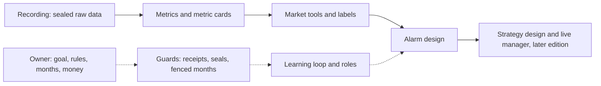

Full chapter: [docs/system/00_WHAT_IT_IS.md](docs/system/00_WHAT_IT_IS.md)

---

## 1. The challenges of working with agents

An AI agent is a language model that runs in a loop: it reads files, calls tools, reads their output and decides the next step, until it stops. Such agents fail in known ways, and the research literature has names for them.

This chapter lists seventeen of them in six classes: integrity (the result is not what it claims), memory (what the agent knows), control (keeping the agent on the task and alive), environment (tools, machine, files), coordination between agents, and statistics (fooling ourselves with many looks). For each one it gives how often it happened here, counted from the system's own registers, the guard that answers it, and whether that guard is itself tested.

The guards come from eight design rules: released tools do every data step; every number has a receipt; seal before you see; months are fenced; one role per agent; memory only through the knowledge tool; learning counts only against a control; and the owner decides what cannot be undone. A rule enforced in code, where a tool refuses to go on, is stronger than one written in text and checked afterwards. Two challenges, wandering off the task and an agent going silent, still have no rule enforced in code behind them, and the chapter names them as the first places to add one.

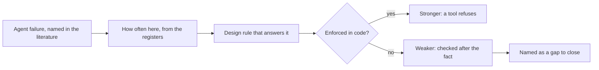

Real counts from the system's registers:

| challenge | how often here |
|---|---|
| saying more than the numbers show | claims stronger than their numbers in 15 of 16 assessed runs |
| re-finding the known | a rediscovery in 9 of 21 runs, and in every one of the last 8 |
| seeing data it must not see | 1 hidden-month breach in 14 scanned runs |
| one line read two ways | about 2,400 unclear lines registered, about 1,000 of them readable two ways |
| no tool used where one should be | 0 steps done by hand in all 21 runs |

Full chapter: [docs/system/01_CHALLENGES_OF_AGENTS.md](docs/system/01_CHALLENGES_OF_AGENTS.md)

---

## 2. Information recording

Everything starts from the system's own recorders: services that keep a connection open to an exchange and write every message they receive to disk. They capture Binance futures (trades, order book, prices, funding, open interest and liquidations for the week's list of about 85 coins), Hyperliquid (trades, order book and funding for about 74 coins), the Deribit volatility index and 48 public news sources.

While an hour runs, each stream is appended to a live file. Once the hour is over it is sealed: written into one fixed file per stream and hour, read back and compared, fingerprinted, and never changed again. Every row carries two clocks, the exchange's time and our receive time, so a value is known only from when it arrived. Holes are found from ids the exchange numbers without gaps, marked with their range, and refilled from the exchange's public daily files into a separate store, never by a guess.

A nightly build waits for all 24 sealed hours of a day, then builds the day; a day missing any expected part is never shown to readers. Raw data is never edited or deleted, on any drive. Three facts travel with every reading built on the record: a liquidation sum is a lower bound, an empty value means "not seen", never zero, and a value is known only from its arrival time.

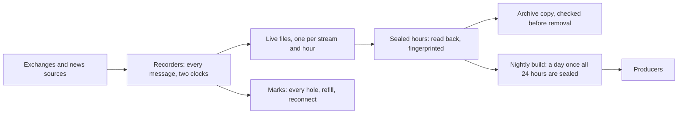

Real counts for one recorded day, 8 November 2026:

| stream | rows recorded | rows expected for 85 coins |
|---|---|---|
| prices, every second | 7,344,000 | 85 x 86,400 = 7,344,000 (exact) |
| one-minute candles | 122,400 | 85 x 1,440 = 122,400 (exact) |
| open interest, every 30 seconds | 242,952 | 244,800 (99.2 percent) |
| top-trader long-short ratio, every 5 minutes | 24,221 | 24,480 (98.9 percent) |

Full chapter: [docs/system/02_INFORMATION_RECORDING.md](docs/system/02_INFORMATION_RECORDING.md)

---

## 3. Metric production and maintenance

An agent cannot look at a screen and form an impression; it needs the market as defined numbers it can read, compare and test. A metric is one named number, computed by a program from recorded data, for one coin or for the whole market, at every step of a fixed clock, with a written definition and the time it became known.

About 90 small programs called producers compute about 4,000 metrics, one family each: liquidations, flows, positions and funding, prices and ranges, volatility, breadth, order book and trading cost, market context, a second exchange, calendar and news.

Three rules govern every value. It is read at its own update interval and may be no older than that interval, so a five-second metric is at most five seconds old, and no coarse common grid is allowed. It uses only inputs that had arrived by the moment it describes. And a hole gives an empty value with a reason word, never zero and never an old value carried forward.

Each producer is built in the same order: name the need, write the architecture, write the cards before the code, review the design, code from the cards with five tests, review the release with one outside reviewer, add it to the day check that can recompute any metric on any day, and keep it only if it adds information to a decision.

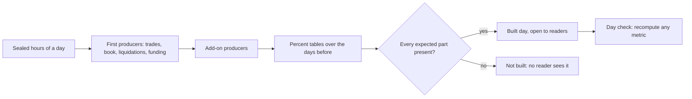

The chapter's worked example, one metric from raw data to its value:

| step | the bad-minute half spread of a coin for the hour of day |
|---|---|
| raw data | every change of the best bid and best ask, with the exchange's time and our receive time |
| every 5 seconds | the bid and ask in force at that moment |
| half spread | half of ask minus bid, over the mid price, in basis points; for BTC about 0.0075 at a price of 67,000 |
| hour-of-day value | the 90th percentile for that UTC hour over the 14 whole days before |
| known at | 00:00 of the day, fixed before the day begins |
| empty value | a hole in the order book gives "book hole", never zero |

Full chapter: [docs/system/03_METRIC_PRODUCTION.md](docs/system/03_METRIC_PRODUCTION.md)

---

## 4. Metric cards

An agent does not remember earlier sessions; it knows only what it reads. If the meaning of a number lives in someone's head or in a code comment, the agent guesses, and a guessed meaning is the most common way a correct number leads to a wrong conclusion. A number called "big traders", for example, may count big single fills, so an order split into small pieces counts as small.

A metric card is the one written definition of a metric, kept in a file an agent reads in one step, and read before the metric is used for anything. It answers eight questions in order: which code, what it is in plain words, how it is computed, its unit, its window and clock, its scope, when it was known, and what an empty value means, together with what it may and must never be used as. One command prints the card with a status word first: stop, use only by its rule, use with caution, or none when proven.

Cards are written before the code and refused by a checker when any field is missing. Their proof status is filled in by the checking tools, never by the author. A gate in the research tools refuses a design built on a metric not marked usable.

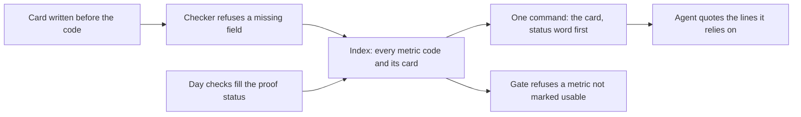

The card of the metric from Chapter 3, as an agent reads it:

| field | value |
|---|---|
| means | the 90th percentile of the coin's half spread at this UTC hour over the 14 days before the day |
| unit | basis points of the mid price |
| clock | a value every 5 seconds, 17,280 a coin a day |
| known at | 00:00 of the day |
| empty means | no file, a hole in the book, a bad input or too little history; never 0 |
| never use as | the cost on another exchange, the cost of a trade larger than the best level, or today's spread |
| proof status | proven |

Full chapter: [docs/system/04_AGENTIC_METRIC_CARDS.md](docs/system/04_AGENTIC_METRIC_CARDS.md)

---

## 5. Market analysis tools

A moment means little without the market around it: a coin falling 3 percent while every other coin rises is a different event from the same fall in a market-wide crash. The market tools describe the market and the coin at any moment, in numbers, in buckets with words, as change since a lag, and as a daily picture, each read at that moment's own time.

Five tools answer five questions. The context tool gives every coin, market and alarm reading known at a fire's minute, about 230 in all. The market classification gives the market's state in 10 dimensions (market move, breadth, BTC, volatility, spread, depth, funding, positions, forced selling and forced buying) in about 190 parts, each placed in a bucket with fixed edges and written in words. The market curves, inside the classification, show how the market got here. The market dials place each UTC day among all earlier days, with a turbulence score. The state judge tests whether a market state chosen on earlier months still holds on later months kept aside, under a sealed plan and thirteen machine checks.

An input older than its own update interval is written as unknown, with its reason, never guessed.

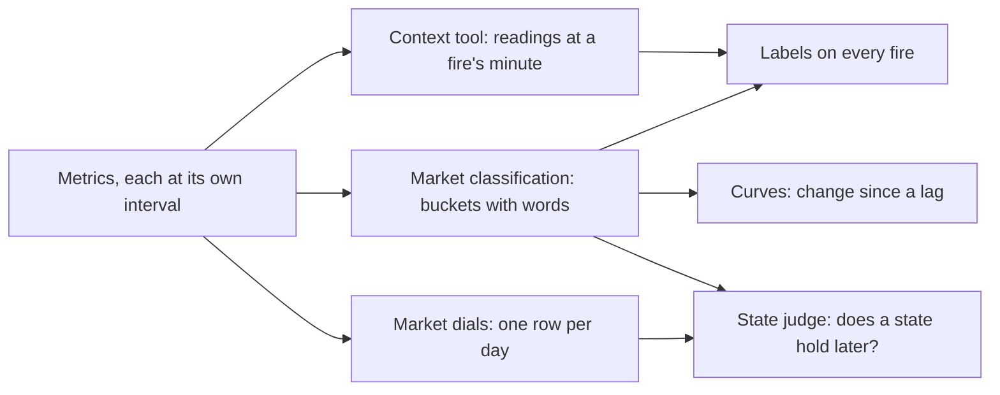

Real output of the classification for one alarm fire, 12 January 2026 at 19:44 UTC, every reading 6 seconds old:

| dimension | what the classification wrote |
|---|---|
| BTC, last 24 hours | +1.10 percent: the high band |
| order book depth, last 5 minutes | 1.19 times usual: the middle band; 4 of 52 coins had thin books |
| forced selling, last hour | long positions forced out on 34 of 52 coins |
| forced selling, size against open positions | unknown: the open-positions input was not fresh enough at this minute |
| funding | 37 of 52 coins paying positive funding |

Full chapter: [docs/system/05_MARKET_ANALYSIS_TOOLS.md](docs/system/05_MARKET_ANALYSIS_TOOLS.md)

---

## 6. Meta-labelling

The system produces many designs: an alarm marks unusual moments on a coin, a strategy decides when to enter and leave, a live manager takes decisions as the market moves. Each marked moment, called a fire (one coin at one second), is a chance to learn why one paid and another did not. That learning needs every fire described in the same terms, by the same programs, and only with what was known at that second.

Meta-labelling is what the tools do to each fire: they attach the same six groups of labels to it, whatever design made it. Market labels describe the whole market; coin labels the fire's own coin; context labels the design's own history and recent readings; shape labels the move that led to the fire; an event check tests, on a reading the rule does not use and never on price, whether the claimed event happened; and outcome labels say what the price did afterwards, after trading costs, written only once each time span has ended.

Every label is read as of the fire's second, each reading no older than its own update interval, and unknown stays unknown. Matched ordinary moments on the same coin get exactly the same labels, and fires within 30 minutes of each other count as one wave.

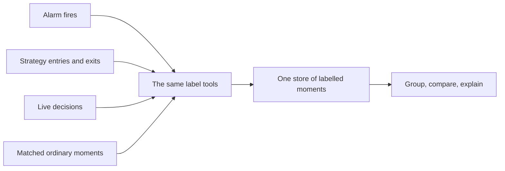

Real labels on three fires of one alarm on the same coin (XMR), each read at its own minute; three fires prove nothing, but show what can be compared across hundreds:

| label | 3 Nov 2025, 13:57 UTC | 11 Jan 2026, 23:47 UTC | 12 Jan 2026, 19:44 UTC |
|---|---|---|---|
| BTC over the last 24 hours | down 2.3 percent | up 0.4 percent | up 1.1 percent |
| share of the selling that was forced | all of it | 92 percent | almost all |
| change in open positions, last 10 minutes | up 0.3 percent | down 0.05 percent | down 1.8 percent |
| outcome after 15 minutes, after costs | the bet lost | no result either way | the bet paid |

Full chapter: [docs/system/06_METALABELLING.md](docs/system/06_METALABELLING.md)

---

## 7. The learning loop

An agent remembers nothing between sessions, and a written lesson can be wrong. The learning loop solves both problems: it is a fixed cycle in which one agent does a piece of research, a second checks it from its evidence, a third files what was learned, and the next research agent starts from that filed knowledge.

A run is one idea taken by one fresh agent through three rounds: does the idea work, when does it work, and does one change, chosen only from round 2's evidence, make it better. Before each round the agent seals a forecast with a range. The run ends with a card in which every number points to its receipt.

The scoring agent recomputes every number with its own code and records each mistake under a fixed key, so repeats can be counted. The knowledge agent writes to the shared store only through one tool, which refuses a row that fails its checks; a claim marked too strong becomes an open question, never a finding. Findings move from hypothesis to supported, confirmed or refuted by fixed rules, and a refuted one goes on a do-not-retry list in the brief. The cycle is the same for every kind of research; only the pack changes: its rules page, rounds and pass rules.

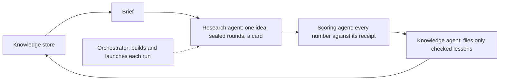

A real study, four versions of a filter that drops the bad fires of an alarm by reading the market, tested month by month against dropping the same number of fires at random:

| version | what the run tried | result against random dropping |
|---|---|---|
| first version, before the loop | one set of market readings for every alarm family | did not pass |
| loop run 1 | readings chosen separately for falls and for rises | passed in round 3, but not in both halves of the period |
| loop run 2 | each family judged by the side of the market its own rule does not fix | passed and stable; average gain +2.80 |
| loop run 3 | the same, with one reading no longer counted twice | passed and stable; average gain +3.20 |
| control run, no brief | the same task without the knowledge store | did not pass; average gain +0.18 |

Full chapter: [docs/system/07_LEARNING_LOOP.md](docs/system/07_LEARNING_LOOP.md)

---

## 8. Roles and skills

Many agents work on the system every day, most for less than an hour, and none remembers an earlier session. Two problems follow: an agent that checks its own work shares the blind spots that made it, and an agent told only "check this run" checks it differently from the next one.

The answer is roles and skills. A role is one fixed job with a fixed list of what it may read and write. A skill is the short written procedure an agent loads before taking the role: when to load it, what to read first, the steps, the rules never to break, the checks, and how to end. Every role is held by its own fresh agent, and every agent holds exactly one role, so the research agent never scores its own run and the scoring agent never files knowledge.

The roles include the orchestrator, the research agent, cold readers, the scoring agent, the knowledge agent, tool builders, a data keeper, a disk keeper, a release manager and outside reviewers on a different model family. Work passes between roles in files, never in conversation. Every agent ends with the same report block: the lines it could read two ways, the time it lost, and at most one proposed change, which is adopted only after a fair test.

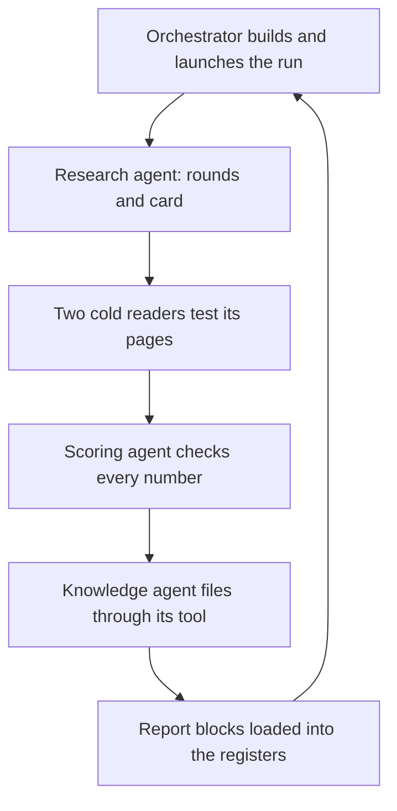

One real memory run, role by role:

| order | role | what it wrote |
|---|---|---|
| 1 | orchestrator | the run folder, the pinned rules page, the job sheet, the brief |
| 2 | research agent | 10 sealed forecasts, three rounds and a placebo; best round +2.15 points over the standard rule, t-statistic 3.89, on 319 waves |
| 3 | two cold readers | 28 and 29 lines that could be acted on two ways |
| 4 | scoring agent | 46 check rows; 8 mistakes, 3 of them claims stronger than their numbers |
| 5 | knowledge agent | 12 evidence rows, 3 new findings, 4 new questions |

Full chapter: [docs/system/08_ROLES_AND_SKILLS.md](docs/system/08_ROLES_AND_SKILLS.md)

---

## 9. Prompting

A fresh agent knows nothing when it starts; everything it does comes from the few pages it is given. If a line can be read two ways, it does not stop to ask: it picks one reading and carries on. Long pages make this worse, because models use long inputs less reliably than short ones.

So every agent starts from a few short, fixed pages, each with one job. The rules page holds the only rules and wins over any other page. The brief, given only to memory runs, summarises what earlier runs learned. The job sheet writes out every command in full, so the agent copies instead of composing. The launch prompt adds the role, the run, the reading order and facts about the machine, never a rule.

Each page is copied into the run's folder with a fingerprint, so every run in a series reads the same words, and fixes wait until the series ends. Pages are tested before use. Two cold readers, fresh agents with no context, list every line they could act on two ways, and only lines both name count. Then a drill has fresh agents do one step of the real work on a prepared kit, graded by two blind scorers against a key sealed in advance.

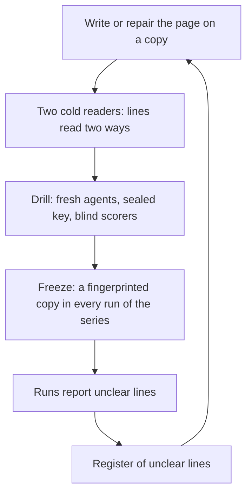

Two real lines from the rules page of the alarm-design runs, each marked by cold readers on several runs:

| line on the rules page | reading A | reading B | fix proposed by the readers |
|---|---|---|---|
| "Two failed tries on one step: stop" | counted inside one working folder | counted across all of a round's working folders | "two stops on the same step of the same round, counted across its working folders" |
| "at least 300 waves in each of the two states" | counted on the 15 minute result only | counted at 15 minutes and at 1 hour | "in each of the two states on the 15 minute line" |

Full chapter: [docs/system/09_PROMPTING.md](docs/system/09_PROMPTING.md)

---

## 10. Truthfulness

Every later stage is built on what the agents report, so it must be true. An agent can be wrong in ways it cannot see, such as a value read a few minutes too late; it can fool itself by trying many versions and keeping the luckiest; and it can be tempted to look better than its numbers allow. A warning in a prompt is not enough: agents told not to cheat often cheat anyway.

Truthfulness is a set of guards built into the tools and the order of work, so that the honest path is the only one that works. Released tools do every data step. Every number has a receipt. Forecasts, definitions and claims are sealed first, and at most three graded variants are allowed per idea. Months are fenced in the shared reader code. Agents who do or judge the research never see held-out numbers, and a leak scan searches every file they read or wrote. Nobody scores their own work. At a decision a reading may be no older than its own update interval, and its age is written beside it. Unknown stays unknown. A claim stronger than its numbers is counted and filed as an open question, never as a finding.

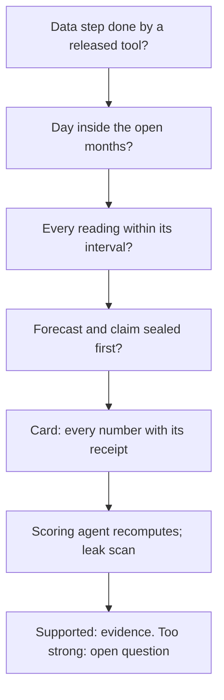

A real catch. The market classification once read every value on a 15 minute grid. The age guard found it over 12 alarms and about 71,500 fire moments, and the results built on it were set aside and redone:

| measure | on the 15 minute grid | at the fire's own minute |
|---|---|---|
| median age of a reading at the fire | 7 minutes | 6 seconds or less |
| oldest reading | 14 minutes | 6 seconds |
| share older than one minute | 88 percent | none |

Full chapter: [docs/system/10_TRUTHFULNESS.md](docs/system/10_TRUTHFULNESS.md)

---

## 11. Measuring learning

A run that reads the brief may do better because of it, or because of a lucky idea or a calmer month. So "the agents learn" is tested like any other claim.

The same research task is run many times in a planned series: ten runs, six memory runs that read the brief and four control runs with an empty knowledge page, alternated in a fixed order, with the process frozen throughout. Five things are measured from receipts: the margin, a run's best lead minus the yardstick's lead (the lead: how much more often the alarm's side wins the race, two trading costs its way before one against, than matched random moments, minus the same difference for the opposite side, in percentage points; the yardstick: the plainest alarm of the same kind and side, with no extra condition, graded the same way after the same costs); repeated mistakes; forecast calibration; reasoning scored blind by two scorers who must agree; and rediscoveries of old alarms, measured by shared waves.

The difference is judged by an exact permutation test over the 210 ways to choose four controls from ten runs; the bar asks for p below 0.10. Every bar must hold together, and each is reported as three answers: what was computed, what it means, and whether it is stable.

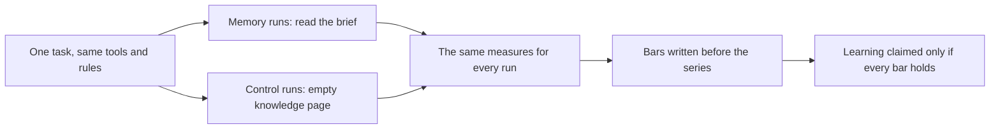

The real series so far, three memory and four control runs of the planned ten; a reading of an unfinished series, not proof (permutation p about 0.29, far from the bar):

| measure | memory runs (3) | control runs (4) |
|---|---|---|
| average margin over the yardstick, points | +3.21 | -0.31 |
| repeated mistakes per run | 3.3 | 2.5 |
| forecast error of the predicted lead, points | 3.00 | 4.42 |
| final alarm re-found an old alarm | 3 of 3 | 4 of 4 |

Full chapter: [docs/system/11_MEASURING_LEARNING.md](docs/system/11_MEASURING_LEARNING.md)

---

## 12. Methodology: learning, check and never-seen months

The only evidence is history, about a year of market data, and history can be used up. Each time an agent tries a rule on some months, sees the result and tries again, those months teach it their own noise; after enough tries, the best rule fits them because it was chosen on them. In the first series of alarm runs, 15 alarms passed on the months they were chosen on, and only 5 held on later months.

So before any study starts, time is split three ways. Learning months may be read freely to design and choose. Check months are kept aside and opened once, for one rule frozen beforehand, by the orchestrator only; the result is final, and a rule that fails is not repaired and checked again. Never-seen months are read by no study; only the owner can open them, once, for the best result of a whole series.

The split is enforced in code: every shared reader refuses closed days, a guard in every program of a run refuses files and rows past the run's limit day, and a sandbox refuses reads past the check window. Inside the learning months, rotation judges each month by a rule fitted on the others. Every try is counted, and every result is compared with random choices of the same size.

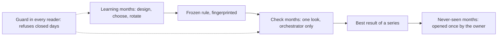

The real split for the alarm work:

| window | months |
|---|---|
| learning months | 10 September 2025 to 31 January 2026 |
| each memory run's own check | February and March 2026, read once by the orchestrator |
| check months for a series' best ideas | April to July 2026 |
| never seen | August to November 2026 |

Full chapter: [docs/system/12_METHODOLOGY.md](docs/system/12_METHODOLOGY.md)

---

## 13. Alarm design

An alarm is a written rule that marks moments on a coin, using only what was known at that second, and says which way the price should go next: the move comes back (a fade) or it goes on (a follow).

Every alarm starts from a sealed mechanism: who was forced to trade, and why the price should still move. Fires within 30 minutes of each other count as one wave.

A pipeline of tools then searches the known alarms, checks fires by hand, counts waves without reading any outcome, seals the plan and grades. The grade is a race against three matched random moments per fire: does the price move two trading costs the alarm's way before one cost against it, within 15 minutes or one hour? The lead is how much more often the alarm's side wins than at the random moments, minus the same difference for the opposite side, in percentage points. A pass needs a lead of at least 3 points in two of every three months, a t-statistic of at least 3, and a win over the yardstick: the plainest alarm of the same kind and side, with no extra condition, graded the same way after the same costs. A truth check, a novelty check and the alarm card follow; money is tested later.

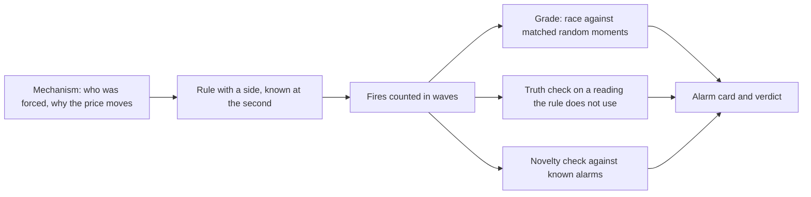

A real alarm: it fades a sharp fall in which leveraged long holders are forced out:

| line | value |
|---|---|
| side | fade: the fall should come back |
| fires and waves | about 6,800 fires on 52 coins, in about 1,300 waves |
| lead at 15 minutes | +11.93 points (t 4.97) on 1,127 waves |
| months passing | 7 of 7 |
| yardstick (for this alarm, the plain fall alone) | +5.88 points (t 3.42), 5 of 7 months |
| truth check | open interest fell at 29.5 percent of fires, against 5.2 percent of random moments |
| novelty | a copy: 64 percent of its fires are fires of an alarm already kept |

The claim is true and the side wins, but it mostly repeats a kept alarm.

Full chapter: [docs/system/13_ALARM_DESIGN.md](docs/system/13_ALARM_DESIGN.md)

---

**14.** Strategy design: coming in a later edition.

---

## 15. Infrastructure and runs

Everything runs on one research computer: the recorders day and night, the nightly builds, every agent's research jobs, the tests and the releases. Sharing one machine has three dangers: one heavy job starves the rest, and a recorder that falls behind loses data for good; an agent does something it should not, such as deleting a file or reading closed days; and work disappears quietly.

The answer is to put the rules into the machinery. Every piece of data work is a written job that declares its minutes, its peak memory and the megabytes it writes. It passes door checks (a valid header, no banned command such as a delete or an administrator action, enough free disk, normal memory pressure, a free slot for heavy jobs), waits in one of about 38 queues, and is started, limited and stopped by a runner, never by the agent that wrote it.

The recorders run as system services, ahead of any job. A watchdog stops any job after four hours, and every stop is checked to have really ended the job. One date guard tells every research reader which days it may return. Raw data is write-once; scratch files live on an archive drive, and each agent cleans only its own finished files. The orchestrator checks every running agent every three minutes.

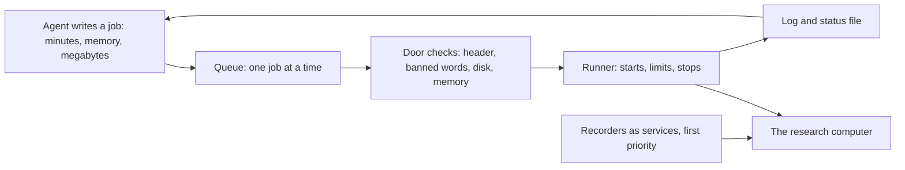

One real research job, from filing to result:

| step | real values |
|---|---|
| declare | 15 minutes, 3,000 MB of memory, 50 MB written, one core |
| door checks | 153,849 MB free, far above the 11,264 MB floor; memory pressure normal; under the 4,096 MB heavy line, so no heavy slot needed |
| run | started below the recorders' priority; ran 9 seconds |
| status file | written by the runner: exit 0, 9 seconds, not stopped |

Full chapter: [docs/system/15_INFRASTRUCTURE.md](docs/system/15_INFRASTRUCTURE.md)

---

## 16. Releases and versioning

Every number comes from a tool, so everyone must agree on which tool, in which edition, produced it. Early on, an agent spent about two hours building a tool that already existed, because two pages said it had not been released; the folder was right and the pages were wrong.

The rule since then: a tool counts as released only when it is installed in the release area with its tests passing from the installed copy, its pages updated in the same edition, and its row in the release index. An edition is a complete, numbered, read-only copy; a change is always a new edition. Each tool has a current link that points at one edition. Old editions stay as history, with more than 250 dated records of which edition was current when.

Install, tests and the move of current run as one job. Two gates guard the move: the document gate refuses it when any page is behind the code, and the loop gate refuses it when any try in the learning loop, anywhere in the system, ran without a logged row. Services name an exact edition, so moving current restarts nothing. Research calls only released editions; any exception is written into the run.

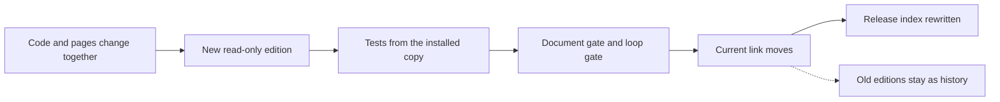

A real release blocked by the loop gate (times UTC):

| time | what happened |
|---|---|
| 08:39 | the move of current is refused: two earlier tries, by a different agent, had no logged row |
| 08:41 | the releasing agent names the two tries and asks whoever ran them to log them |
| 08:45 | both rows are added, and the loop's check on each passes |
| 08:46 | the release is filed again; current moves; the index is rewritten |

Full chapter: [docs/system/16_RELEASES.md](docs/system/16_RELEASES.md)

---

## 17. Process improvement

The learning loop improves the research, but the loop is itself made of parts: a rules page, step pages, templates, launch prompts and tools. A weak part teaches the wrong thing very reliably, and a change that looks like an improvement can make things worse without anyone noticing. Process improvement treats every part as something to test, score and change only on evidence, separately from the research itself.

The process is split into 34 parts. Each is tested by a drill: fresh agents do a real task of the role on a kit, a fixed set of material with an answer key sealed before any agent runs. Two blind scorers grade the answers shuffled, together with one good and one bad planted answer of known score; the scoring counts only if both planted answers land within one point and the scorers agree at an alpha of 0.80 or more.

A proposed change is checked by an agent other than its author, drafted on a copy, and drilled old against new on the same kit. It is adopted only if the draft does at least as well, the defect is gone and no other part scores lower. Every change to every file gets a ledger row with fingerprints before and after, and a ledger check runs before every run and release.

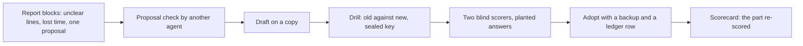

A real drill of the forecast step, after three lines were found to teach the wrong starting point for a forecast probability (scorer agreement alpha 0.96):

| | old pages | new pages |
|---|---|---|
| fresh agents | 4 | 4 |
| scorer one, total over the four answers | 83 of 88 | 88 of 88 |
| scorer two, total over the four answers | 84 of 88 | 88 of 88 |
| agents that started the probability from a count of past rounds | 0 of 4 | 4 of 4 |

Full chapter: [docs/system/17_PROCESS_IMPROVEMENT.md](docs/system/17_PROCESS_IMPROVEMENT.md)

---

## 18. Owner and governance

One person, the owner, sets the goal and carries the consequences of anything the system does in the world; many agents do the work. Two opposite failures threaten this: an agent acts alone on something that cannot be taken back, or every agent waits for an owner who is often away and is not an expert in the research.

Governance draws the line with one test: can the effect be undone by running a program again? If not, the owner decides: which months may be read, money and live trading, deletes outside an agent's own working files, publishing, and the goal and rules that define success. Everything else has a deciding agent, who rules and reports; an ask between agents is answered or picked up within 15 minutes, then climbs a fixed ladder. Repeated owner decisions become standing approvals with a stated scope.

An owner question is put in plain words, one at a time, with the options, a recommendation and the exact words to approve, and the answer is logged in the owner's own words. Every tool and method is reviewed by an inside checker and by an outside reviewer who never builds. A review may block only for a wrong number, a false label, a look into the future, a skipped gate or a missing step, in at most two rounds.

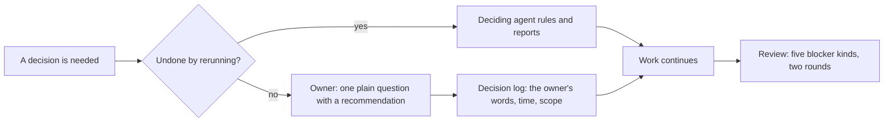

Who decides what:

| decision | who decides | why |
|---|---|---|
| which months a study may read | owner | a month once read cannot be unread |
| money, live trading, going live | owner | a trade cannot be taken back |
| deletes outside an agent's own files | owner, or a standing rule the owner set | deleted raw data cannot be rebuilt |
| publishing and sharing outside | owner | a published file cannot be recalled |
| which test or run goes next | the research lead agent | a wrong choice costs one run |
| a tool fix, a rerun, a setting | the tools lead agent, or the agent doing the work | checkable and repeatable |

Full chapter: [docs/system/18_GOVERNANCE.md](docs/system/18_GOVERNANCE.md)

---

## 19. Costs and realism

Trading is never free: a fee on each side, half the spread on each side, and slippage through deeper levels of the book. Here costs are large next to the moves: a round trip costs about 0.13 percent on the largest coins and up to about 0.5 percent on the thinnest, while a usual one-hour move is about 0.3 to 0.5 percent.

So every result is measured after the costs of the coin it trades, in a cost unit equal to that coin's round-trip cost: the published taker fee with no discount, the book cost of a 10,000 dollar buy and sell (the dearer of two exchanges), and the measured price gap between the exchange studied and the one traded. A coin with no measured cost is kept out of every after-cost result.

The grade enters 6 seconds after the fire and races two cost units in the bet's favour against one against, month by month. The lead is how much more often the bet's side wins the race than matched random moments, minus the same difference for the opposite side, in percentage points; it must beat the yardstick, the plainest alarm of the same kind and side, with no extra condition, graded the same way after the same costs. A strategy reaches paper trading only when every month holds at full cost, funding included, and at stressed cost.

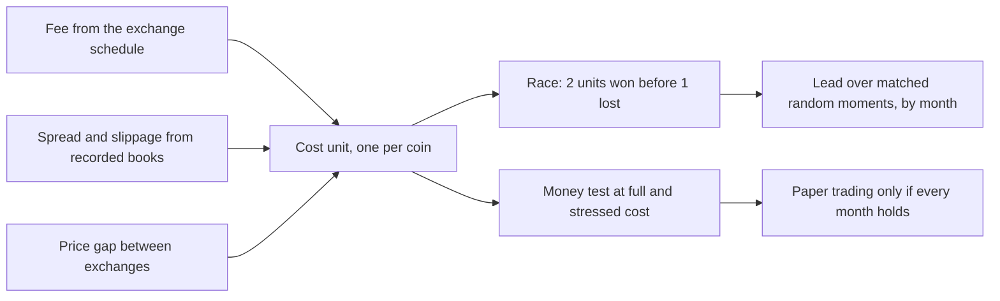

Real cost units: the same 0.4 percent move is more than three costs on BTC and less than one on VVV.

| coin | cost unit | usual 1 hour move | a 0.4 percent move, in cost units |
|---|---|---|---|
| BTC | 0.126 percent | 0.28 percent | 3.2 |
| AAVE | 0.179 percent | 0.52 percent | 2.2 |
| XMR | 0.220 percent | 0.49 percent | 1.8 |
| VVV | 0.522 percent | 0.56 percent | 0.8 |

Full chapter: [docs/system/19_COSTS.md](docs/system/19_COSTS.md)

---

## 20. Glossary

The full glossary gives every term the chapters define, in plain words, grouped by theme: data and recording, market words, metrics and cards, market description, labels and fires, the learning loop and roles, prompting and truthfulness, agent failures, methodology, alarms, costs, infrastructure, releases, process improvement, and governance. Each term lists the chapters where it is defined or mainly used. Where one word has more than one meaning in the system, such as card, brief or lead, each meaning has its own row, named by the thing it belongs to.

The terms below are the ones a first reader meets most often. The diagram shows how the grading terms fit together.

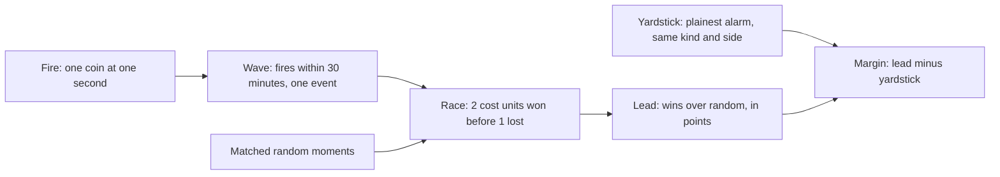

| term | meaning |
|---|---|
| fire | one moment a design marks: one coin at one second |
| wave | fires on any coins within 30 minutes of each other, counted as one event |
| receipt | the saved tool output a number came from |
| fingerprint | a short code computed from a file's bytes; it changes if a single byte changes |
| seal | writing a forecast or claim down before its result exists and recording its fingerprint |
| update interval | how often a new value of a reading exists; at a decision a reading may be no older than its own update interval |
| run | one idea taken by one fresh agent through fixed rounds, ending in a card |
| memory run and control run | a run that reads the brief, and the same task with an empty knowledge page |
| brief | a short summary of the knowledge store, read by memory runs before they start |
| pack | the part of the loop specific to one kind of research: its rules page, rounds and pass rules |
| learning, check and never-seen months | months read freely; months opened once for one frozen rule; months only the owner opens |
| cost unit | one round trip on a coin, with fee, book cost and price gap together |
| lead | how much more often the alarm's side wins the race (two trading costs its way before one against) than matched random moments, minus the same difference for the opposite side, in percentage points |
| yardstick | the plainest alarm of the same kind and side, with no extra condition, graded the same way after the same costs; a new alarm must beat it |
| orchestrator | the agent that builds, launches and watches runs, and the only one that opens check months |

Full chapter: [docs/system/20_GLOSSARY.md](docs/system/20_GLOSSARY.md)

---

Further reading: each full chapter ends with its own list of the published sources its methods rest on.
