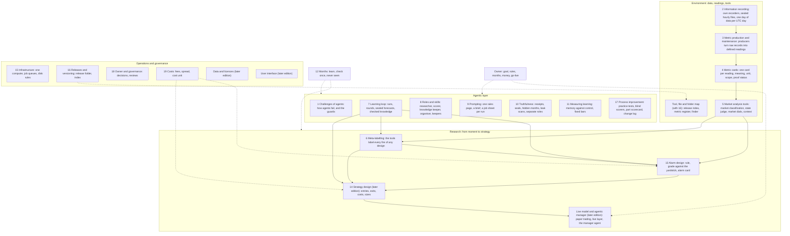

# 0. What the system is

## 0.1 The goal in one paragraph

The goal is a fully agentic trading system: AI agents that record the market, turn it into trusted readings, find moments worth trading, explain why those moments exist, turn them into strategies, run them live under a manager, and get better at every one of these jobs from one run to the next, while staying honest about what they have and have not proven. Humans set the goal, the rules and the money limits. Agents do the daily research and operations inside an environment built so that their work can be checked: every data step is done by a released tool (one installed, tested and listed in the release index), every number has a receipt (a saved file or tool output that shows where the number came from), every claim is sealed before its result exists (written down and fingerprinted so it cannot be changed afterwards), and every lesson is checked by a separate agent before the next agent learns it.

## 0.2 What the system has to do

The system has several jobs, and each is a goal of its own, not a step toward one question:

- **Record the market truthfully:** capture what happened, keep it, and never change it.
- **Turn records into readings people and agents can trust:** defined metrics, each with a card and a proof.
- **Understand the market:** describe its state at any moment, and how it got there.
- **Find and prove trading moments:** alarms (rules that mark moments on a coin), with every fire labelled by the tools so it can be analysed. A fire is one moment an alarm marks: one coin at one second.
- **Turn proven moments into strategies, and run them live:** under a manager, in paper mode first.
- **Make the agents better at every one of these jobs, and keep them honest while they do it:** the learning loop, the process improvement, and the truthfulness guards.
- **Keep the whole thing runnable and findable:** infrastructure, releases, a map of every tool and metric, and the owner's decisions.

Each block in 0.4 says which job it serves and what counts as success for it. For the research blocks (alarm design, strategy), a moment is good when it has a written cause, pays more than the yardstick (the plainest alarm of the same kind and side, with no extra condition, graded the same way after the same costs), and holds on months nobody looked at. Those blocks' chapters define each test.

## 0.3 The system on one page

## 0.4 The blocks, one paragraph each

**1. The challenges of working with agents.** The ways AI agents fail at research, in the words the research literature uses (cheating on the scorer, saying more than the numbers show, seeing data they must not see, forgetting, re-finding the known, luck read as skill and others): how often each happened here, the guard against each, whether that guard is itself tested, and the eight design rules the guards come from.

**2. Information recording.** Our own recorders capture exchange feeds (Binance, Deribit, Hyperliquid) and write sealed hourly files (closed at the end of each hour, with a fingerprint so any later change shows); a nightly build turns them into one day of data per UTC day, checked before anything reads it. Raw data is never edited or deleted.

**3. Metric production and maintenance.** Producers turn raw records into named readings with fixed definitions: liquidations, flows, positions, funding, prices, volatility, breadth. A producer is a program that computes a family of readings from raw data. Each producer is designed, proven on real days and released through one procedure, and any day can be rechecked by a day check.

**4. Metric cards.** Every reading has a card: what it means, its unit, its scope (one coin or the whole market), what an empty value means, what it may and must never be used as, and its proof status. Agents read the card before using a reading.

**5. Market analysis tools.** Tools that describe the market at any moment: the market classification (every market and coin reading, with its sign and its bucket, a band such as low, usual or high, at any second), the state judge (does a declared market state hold on its own cut months), the daily market dials, and the context tools.

**6. Meta-labelling.** Meta-labelling is what the tools do to each fire: they attach labels to it, so that everything can be analysed afterwards. A fire of any design (an alarm fire, a strategy's entry or exit) gets the same labels: the market's state and the coin's state from the market tools, the context readings, and the outcome, each read at that fire's own moment, every reading at its own update interval. Because every design's fires carry the same labels, the same analysis works for alarms, strategies and the live manager: group the fires, compare them, explain them.

**7. Agentic learning loop.** Research happens in runs. In each run a fresh agent takes one idea through rounds (numbered steps of one study, each starting with a sealed forecast), writes a card with a receipt for every number, and is scored by a separate agent; a third agent turns what was learned into shared knowledge for the next run. The loop is generic: the same loop drives alarm design, meta-labelling and strategy design, each with its own pack (the rules page, step pages and tools for that kind of work).

**8. Agentic roles and skills.** One agent per role, one role per agent: the researcher (does the research), the scorer (checks every number against its receipt), the knowledge keeper (files knowledge only through the knowledge tool), the organiser (builds and launches runs, reads the hidden months, keeps the books), tool builders, a data keeper and a disk keeper. Each role has a skill: a written procedure the agent loads first.

**9. Agentic prompting.** A fresh agent starts from three documents: one rules page (the only rules), a knowledge brief (what earlier runs learned; given only in memory runs, see block 11) and a job sheet (the exact commands). Pages are tested before they are used, by fresh agents reading them for the first time and by practice tests (a small task whose answer is kept hidden from the agent), and nothing changes them during a run.

**10. Agentic truthfulness.** Agents can be wrong, can fool themselves, and can be tempted to look better. The guards: released tools do every data step; every number has a receipt; forecasts and claims are sealed before results; the researcher is never given the hidden months, and its files are scanned for any leak of them; roles are separated so nobody scores their own work.

**11. Measuring learning.** Learning is claimed only when a memory run (an agent given the knowledge brief from earlier runs) beats a control run (the same task, given no memory) on bars written before the runs: better alarms, fewer repeated mistakes, better forecasts, better reasoning scored by blind scorers (scorers who do not know which run had memory).

**12. Methodology: learning, checking and never-seen months.** Every study names its months before it starts: learning months (for the alarm work Sep 2025 to Jan 2026, for the round-2 filter study, a second pass that keeps only the better moments of an alarm, Sep 2025 to Mar 2026), check months opened once for one frozen rule (Apr to Jul 2026), and never-seen months opened only by the owner (Aug to Nov 2026). Inside the learning months, rotation (each month judged by a rule picked on the others) gives an honest first check.

**13. Alarm design.** An alarm is a rule that marks moments on a coin, known at the second they happen, with a side (the move comes back, or it goes on). A 22-step procedure grades it against matched random moments and against the yardstick (the plainest alarm of the same kind and side, with no extra condition, graded the same way after the same costs), which every alarm must beat, checks the claimed event on independent data, and files an alarm card.

**14. Strategy design (later edition).** A strategy takes a proven alarm and decides when to enter (maybe not at the fire), when to exit, how much to risk, and whether it still pays after full costs, month by month.

**15. Infrastructure and runs.** Everything runs on one computer. Data work is filed as jobs into queues run by a job runner; each job declares its time, memory and disk, and the runner refuses or stops a job that breaks its limits. Each agent role has a budget of disk space for its working files. Disk rules: raw data is never deleted or edited, run outputs live on the large drive, and each agent cleans only its own finished working files.

**16. Releases and versioning.** A tool counts as released only when it sits in the release folder with its tests passing from the installed copy, its card, readme and changelog updated in the same release, and its row in the release index. "Released" means installed, whatever a readme says. Old editions stay in the folder as history; the current edition is a link. Agents find everything through one map: the release index of every tool (with its card and tests), the metric register with each metric's card and proof status, and a finder command that answers "where is" and "who owns".

**17. Process improvement.** The process itself is improved the way the research is, but separately from the learning loop. Every part of the process (rules page, step pages, tools, prompts) is tested by fresh agents on practice tasks whose answers are sealed beforehand, scored by two blind scorers who must agree, and given a score on a part scorecard. A change is drafted on a copy, tested old against new, and adopted only with a backup and a row in the log of every file change.

**18. Owner and governance.** Some decisions belong only to the owner: which months may be read, anything with money or live trading, deletes outside an agent's own working files, publishing, and going live. Those decisions are logged with the owner's own words. Outside reviewers check methods and tools, and a review can block only for a wrong number, a false label, a look into the future, a skipped gate or a missing step.

**19. Costs and realism.** Every result is measured in the coin's own trading cost: fees and the spread, in a cost unit (one unit is what one trade in that coin costs), so a lead means a lead after costs. A strategy must also pass with full costs, month by month, before it reaches paper trading.

**Live model and agentic manager (covered in a later edition).** The live side runs a frozen strategy on live data in paper mode first: the live feed and inputs, the live layer, paper trading and a watch. An agentic manager reads what the live side does, compares it with what the research promised, and raises a flag when the market changes.

**Results, failures and limits (covered in a later edition).** What the system has found so far (the forced-selling alarms, the first round-2 filter versions), what failed and why (each failure changed a rule or a tool), and what is not yet proven, said plainly.

**Data and licences (covered in a later edition).** The sources: our own recorders, Binance and Hyperliquid public data, and a vendor's history (Tardis) from before our recorders started. Each source has its own licence, and the licence decides what may be published (for example derived readings in reports, never a raw data feed).

**The user interface (covered in a later edition).** A local interface where a person sees the system: runs, alarms, the market state, paper trading, and a chat tab to talk to the agents.

**20. Glossary.** Every term with the chapter that defines it or mainly uses it, in plain words, grouped by theme, and the abbreviations.

## 0.5 How to read this document

Chapters follow the blocks above. Chapter 1 comes first: the ways agents fail, which every later guard answers. Then the data flow: recording, metric production and metric cards (Chapters 2 to 4), the market tools and meta-labelling (Chapters 5 and 6); then the agentic layer: learning loop, roles, prompting, truthfulness and measuring learning (Chapters 7 to 11); then the research method: months (Chapter 12), alarm design (Chapter 13) and strategy design (Chapter 14, in a later edition); then operations: infrastructure, releases, process improvement, the owner and costs (Chapters 15 to 19); and the glossary (Chapter 20). The live side, the user interface, data licences and results come in a later edition. A reader interested only in the agents can read this chapter, Chapter 1 and Chapters 7 to 11, and come back to the alarm chapter when a term is unclear.
