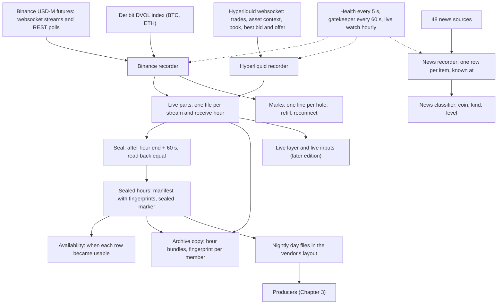
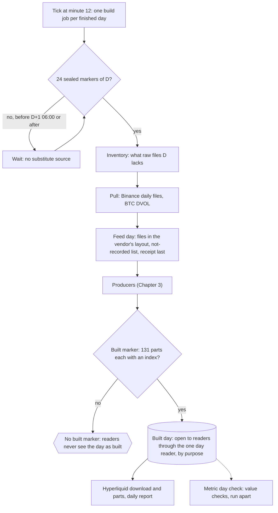

# 2. Information recording

A **recorder** is a service that keeps a connection open to a data source and writes every message it receives to disk. A **stream** is one kind of message from one source (Binance trades, Hyperliquid order book). A **live part** is the file a recorder appends to while an hour runs. A **sealed hour** is the fixed file per stream and hour written once the hour is over, never changed afterwards. A **mark** is a line that names something the record must explain: a hole, a refill, a reconnect, a load shed (rows dropped on purpose under load). The **coin list** is the week's list of coins the recorders follow. A **fingerprint** is a short code computed from a file's bytes; it changes if a single byte changes, so two files with the same fingerprint are the same. An **archive bundle** is a single file that holds many files, with a list of every member and its fingerprint.

This chapter describes what each of our recorders captures, how it stores and fingerprints it, which clocks every row carries, how holes are named, how a UTC day is built and checked before any reader opens it, how all of this is watched, where it is kept, and what is still open.

## 2.0 How to read this chapter

- **Practice** means a published source in 2.16. Each section ends with how our recorder compares with it and where it falls short.
- Numbers describe the record as it was on 8 and 9 November 2026.

## 2.1 The recorders on one page

| recorder | captures | stored as |
|---|---|---|
| the Binance recorder | Binance USD-M futures: 11 streams for the 85 coins of the coin list plus all-market liquidations; Deribit's volatility index DVOL (BTC, ETH) | live parts by receive hour, sealed hours by exchange hour, a manifest with fingerprints, marks |
| the hourly seal (a child process of the Binance recorder) | seals every block of hour H | one sealed file per stream and hour, and a marker file once the whole hour is sealed |
| the Hyperliquid recorder | Hyperliquid trades, asset context (funding, open interest, mark, oracle), order book, best bid and offer, for 74 coins | the same layout and seal as the Binance recorder |
| the news recorder | 48 public news, venue, policy and calendar sources | one row per item; a sealed day with a manifest |
| the news classifier | not a recorder: classes each news item (coin, kind, level) | its own store |
| health, gatekeeper, availability | judge both recorders, hold batch jobs, write when each row became usable to research | a health page, a gate file, availability side files |
| the archive copy | copies every closed hour to the archive drive, then frees the main computer | archive bundles |
| nightly history downloads | Binance public daily files, BTC DVOL, Hyperliquid node files, GDELT news rows | the archive drives |
| the old recorder | Binance, Deribit (the edition before the current recorder) | day bundles on the archive drive; stopped on 22 Oct 2026 |
| Tardis history | Binance futures and Hyperliquid history from a vendor | a pull store, read by exact file name; our access ends 9 Dec 2026 |

## 2.2 The Binance recorder: Binance USD-M futures and Deribit DVOL

**What it captures.** One row per stream in the recorder's stream registry. The coins are the week's coin list: 85 coins, carried forward unchanged from the week of 26 October 2026.

| stream | source | cadence or trigger | key, and how a hole is seen | rows on 8 Nov | expected for 85 coins |
|---|---|---|---|---|---|
| trade | `<symbol>@trade` | every trade | trade id `t`, gap-free per coin | 35,811,587 | event driven |
| aggTrade | `<symbol>@aggTrade` | every aggregated trade | aggregate id `a`, gap-free per coin | 10,955,743 | event driven |
| depth | `<symbol>@depth@100ms` (diff book) | every 100 ms with a change | update ids U, u, pu: pu must equal the previous u | 43,391,271 | event driven |
| depthSnapshot | REST depth snapshot, 1,000 levels | first after 300 s, then every 3,600 s per coin, and on every broken depth chain | `lastUpdateId` | 2,060 | 2,040 hourly + resyncs |
| bookTicker | `<symbol>@bookTicker` | every best bid or ask change | update id `u` | 163,221,163 | event driven |
| markPrice | `<symbol>@markPrice@1s` | every second: mark, index, settle price, funding rate, next funding time | time | 7,344,000 | 85 x 86,400 = 7,344,000 (exact) |
| kline1m | `<symbol>@kline_1m` | one-minute candles, with first and last trade id of the minute | candle open time | 122,400 | 85 x 1,440 = 122,400 (exact) |
| ticker | `<symbol>@ticker` | rolling 24 h statistics, pushed when Binance sends them | time | 2,403,355 | event driven (about 0.33 a coin a second on 8 Nov) |
| openInterest | REST open interest | every 30 s per coin | server time | 242,952 | 85 x 2,880 = 244,800 (99.2%) |
| topLongShort | REST top-trader long-short position ratio, 5 minutes | every 300 s per coin | timestamp | 24,221 | 85 x 288 = 24,480 (98.9%) |
| forceOrder | `!forceOrder@arr` (all markets) | at most one print per symbol per second | none (a snapshot, see 2.5) | 59,322; 366 symbols in hour 12 | lower bound |
| dvol | Deribit `deribit_volatility_index.btc_usd`, `.eth_usd` | about every second | timestamp | 172,570; 2 indexes | about 2 x 86,400 |

Three more long-short ratios (top-trader account ratio, global account ratio, taker buy and sell ratio) are health rows only: no service records them. Binance's daily "metrics" files carry those ratios at 5 minutes and arrive through the nightly download (2.10).

**How it receives.** One process with threads: aggTrade, trade and forceOrder are recorded on two connections, A and B, and merged, so a drop on one connection does not lose rows; bookTicker has its own 30 s merge window; depth is kept as ONE chain from the primary connection, never a union of two. Connections rotate every 82,800 s with 60 s of overlap. All REST calls share one weight budget (hold at 1,200, ceiling 1,300). Guards (automatic checks that stop or pause the recorder) run on a timer: disk (alarm under 100 GB free, stop under 20 GB: writers closed, the lock held, a clean exit when space returns), memory (a clean exit at the 4,096 MB ceiling), and a new coin list (marked, then a clean exit so the service manager restarts the recorder on the new list).

**Exact numbers.** Prices and sizes are never floats: the exchange's decimal text becomes an integer mantissa and a power of ten (`'65432.10'` is `(6543210, -2)`), so the text can be rebuilt byte for byte.

## 2.3 The Hyperliquid recorder

**What it captures.** Four channels per coin: `trades` (side, price, size, fill time, trade id, transaction hash, buyer and seller addresses), `activeAssetCtx` (hourly funding rate, open interest, mark, oracle, mid, premium, price 24 h ago, 24 h volumes as exact text), `l2Book` (bid and ask levels with price, size and order count per level) and `bbo` (the best bid and offer, sent by Hyperliquid only when it changes on a block). The coins are the coin list mapped to Hyperliquid names and kept only where Hyperliquid lists them, plus a short keep list: 74 coins in a sealed hour of 8 Nov. One connection, four subscriptions a coin, a ping every 30 s; the process refuses to start above Hyperliquid's limit of 1,000 subscriptions.

| stream | rows on 8 Nov | exchange time column |
|---|---|---|
| trades | 1,716,659 (312 of them late) | `T`, fill time |
| asset context | 6,234,168 | none: `T` is OUR receive time in ms, because the message carries no exchange time |
| order book | 1,188,890 | `T`, book time |
| best bid and offer | 10,705,784 | `T`, block time |

**Limits.** The Hyperliquid trade id is "unique, not gap-free", so a missing trade cannot be seen from the ids; the only hole marks the Hyperliquid recorder writes are reconnect lines (231 in 17 days, 23 Oct to 8 Nov). The number of book levels per side is set by Hyperliquid's default and is not checked in our code. The complete record of Hyperliquid fills, liquidations and funding events comes the next day from Hyperliquid's own node files (2.10), and that is the second source against which the live record can be compared.

## 2.4 Clocks

Every row carries two kinds of time:

| column | meaning |
|---|---|
| the block's exchange time (`T`, `E`, `t_open`, `time` or `timestamp`) | the time the exchange put on the event, in ms, as sent |
| `recv_wall_ns` | our receive time of the frame, UTC wall clock, ns |
| `recv_mono_ns` | the same moment on the monotonic clock, so a delay survives a clock step |
| `write_wall_ns` | when the batch holding the row was written |
| `conn`, `frame_seq`, `arrival_seq`, `other_recv_mono_ns` | which connection delivered the kept copy, its frame number, the global arrival order, and when the other connection's copy arrived (streams on two connections) |
| `src`, `req_sent_ns`, `used_weight` | websocket or REST; for REST rows when the request was sent and the weight header of the answer |
| `raw` | the payload bytes as received (always in live parts; in sealed files only for low-volume streams) |

**Two hours, two clocks.** A live part belongs to a RECEIVE hour. A sealed file belongs to an EXCHANGE hour: the main file of hour H holds the rows whose exchange time is in H and that were received by the cutoff, H end + 60 s (a fixed time, so the output does not depend on when the sealer ran). Rows of an earlier hour that arrive after its cutoff go into a separate late file, never into a main file. On 8 Nov 25 of 409 manifest rows were late files: 312 Hyperliquid trade rows, 3 open interest rows and 244 long-short rows.

**Clock discipline.** The health service measures the computer's clock offset against an internet time server at most once a minute; its clock check is AMBER over 50 ms and RED over 250 ms. On the morning of 9 Nov the offset was 2.9 ms.

**Receive delay.** Receive time minus exchange time is measured per stream and hour, with a fingerprint of each hour's file (329 hour files on 9 Nov). For hour 12 of 8 Nov the p99 was: trade 416 ms, aggTrade 319, depth 147, bookTicker 449, markPrice 206, forceOrder 217, kline1m 165, ticker 2,119. The Hyperliquid streams show 0 rows in these files: their delay is not measured.

**When a row was usable.** The availability service re-seals each signed hour and writes side files with the time each row became usable to research; the signed file is fingerprinted again first, and a different file marks that stream-hour FAILED. The receive-delay files are read by the build's clock step, which may use an hour's file only if its fingerprint was committed by the end of the step.

**Practice.** A production crypto recorder keeps both stamps: the exchange's, and its own receive time at 100 ns precision; it orders replay by its own monotonic receive time because exchange times can go backward between connections (Tardis.dev data FAQ). A backtest engine needs both, since feed latency is local time minus exchange time (hftbacktest). Regulated trading firms must keep business clocks traceable to UTC within 1 ms for algorithmic trading (MiFID II RTS 25, as summarised by secondary sources; primary text not read). We keep both stamps and a monotonic copy, and we cut hours by exchange time with a fixed cutoff. We fall short in two places: our wall clock is disciplined by internet time and checked against a 50 ms bar, not traceable to 1 ms, which we judge acceptable for decisions measured in seconds to hours; and Hyperliquid's context stream has no exchange time at all, so its rows can only be placed on our receive clock.

## 2.5 Holes: how they are found and named

**The marks file.** The Binance recorder writes one line per event the record must explain, with its time, kind, stream, coin, first and last id, count and detail. Kinds: GAP, FILLED, PARTIAL, UNFILLABLE, RESYNC, SHED, SPOOL, ROSTER (a new coin list), DISK, RAM, RECONNECT, THREAD, SEAL, SILENT, EXIT, DOWNTIME. From 22 Oct to 8 Nov (17 days):

| kind | lines | ids named | meaning |
|---|---|---|---|
| GAP | 35,582 | trade 18,641,599; aggTrade 5,007,085; kline1m 19,181 | a jump in a gap-free id, by coin, with the first and last missing id |
| FILLED | 16,352 | aggTrade 4,584,018; kline1m 19,181 | the recorder fetched the missing ids the same day through the exchange's REST interface |
| RESYNC | 7,663 | | a broken depth chain (pu not equal to the previous u); a REST snapshot was taken |
| SILENT | 366 | | a stream with no message for longer than its bar |
| SHED | 44 | | rows dropped under load, in the fixed order ticker, depth, bookTicker, markPrice; aggTrade, trade and forceOrder are never shed (they spool to disk) |
| EXIT | 18 | | a clean exit (coin list change, guard, planned switch) |
| DOWNTIME | 17 | | a closed stretch with the recorder down, with its reason (for example a planned switch to a new recorder edition whose behaviour was checked to be equal) |
| SEAL, ROSTER | 2 each | | a seal problem; a new coin list |

There is no marks file for 7 Nov; the cause is not known.

**The ids in the sealed day.** The manifest row of every trade and aggTrade file carries, per coin, the first id, the last id and the number of holes. On 8 Nov: aggTrade 0 holes in 85 coins; trade 1,127,921 missing ids in 85 coins. The trade stream has no same-day refill: its holes wait for the next-day refill.

**The next-day refill.** A refill tool reads Binance's public daily trade and aggTrade files for the ids the marks name, and writes them as hour parts with an extra column saying when the refill knew them, in a separate refill store, never among the sealed files. Its reports:

| day | trade ids named | rows found | unfillable |
|---|---|---|---|
| 26 Oct | 382,090 | 381,602 | 488 |
| 27 Oct | 5,661,788 | 5,656,195 | 5,593 |
| 28 Oct | 994,962 | 993,881 | 1,081 |
| 29 Oct | 2,879,176 | 2,871,575 | 7,601 |
| 30 Oct | 510,958 | 505,520 | 5,438 |
| 31 Oct | 2,233,505 | 2,230,464 | 3,024 |
| 1 Nov | 40,775 | 40,736 | 39 |

There is no refill report for 2, 3, 4, 5, 6 or 8 Nov, although each of those days has a marks file. This is open (2.15).

**Depth.** The chain rule is Binance's own: every diff event's `pu` must equal the previous event's `u`; if not, the local book is out of sync and a new REST snapshot is needed (Binance, "How to manage a local order book correctly"). The recorder checks it on every event, marks RESYNC and asks for a snapshot; it also takes one snapshot per coin per hour, so a reader can rebuild the book from any hour. 2,060 snapshots on 8 Nov = 85 x 24 hourly + 20 after breaks.

**Liquidations.** Binance sends at most one liquidation per symbol per 1,000 ms ("only the latest one liquidation order within 1000ms will be pushed as the snapshot"; Binance, All Market Liquidation Order Streams; a search snippet of Binance's changelog says "latest" was changed to "largest", which the page itself did not show on 9 Nov 2026). Two connections cannot add the prints Binance never sent. So any sum of recorded liquidations means "at least this much", and a missing value means "not seen", never zero.

**Practice.** Sequence numbers are the standard way to see a lost message, and a gap is never filled by a guess (Tardis: "gaps from outages are permanent"; their payloads are "stored exactly as received"). We follow both: gap-free ids are checked per coin, holes are marked with their id range, a refill is kept in its own store with its own known time, and nothing is interpolated. We fall short where the source has no sequence (Hyperliquid trades, every polled value), where the refill has stopped running (trades since 2 Nov), and in that no tool yet counts expected rows per stream and day (the table in 2.2 was done by hand from the counts).

## 2.6 Storage, fingerprints and archive copies

**Live parts.** An Arrow IPC stream of record batches for one stream and one receive hour, a batch every 100 ms or 1 MB, an `fsync` every 0.8 s logged beside it; a new part at every start and every hour, never appended to.

**The seal.** For each hour a child process at low priority, from H end + 60 s plus a grace, reads the receive hours H-1, H and H+1 one batch at a time, splits the rows by coin, sorts each coin by (exchange time, key, arrival order), writes one row group, reads it back and compares it with what it meant to write (READ BACK EQUAL), then the next coin. Files are Parquet with zstd level 3 and a fixed writer, so the same input gives the same fingerprint. An hour already in the day's manifest is skipped, never rewritten. The sealed marker of an hour is written only when every registered block of the hour sealed without an error; its first field is the time the hour counts as sealed. On 8 Nov all 24 markers exist, written 10.0 to 19.9 minutes after each hour's end, median 13.6.

**The manifest.** One row per sealed file: stream, exchange hour, kind (main or late), file, fingerprint, rows, ids per coin, late rows, the fingerprint of the sealer's code and of its settings, the schema, and the live parts it read, with their sizes, so a seal can be redone while they are kept. 409 rows on 8 Nov. Sizes on 8 Nov: 8.07 GB in all, of which depth 3.80 GB, bookTicker 2.31, trade 0.44, aggTrade 0.29, markPrice 0.29, Hyperliquid best bid and offer 0.25.

**The one reader.** Every tool reads the record through one reader with four calls: read a sealed hour (with or without late files), read a live hour, follow a live hour as it is written (for the live layer), and read the marks.

**Archive copies.** The archive copy runs every hour. It copies each closed hour to the archive drive as two bundles, one of the live parts and one of the sealed files, each with a list of every member's size and SHA-256, and each sealed day as one bundle. A live hour leaves the main computer only when it is at least 3 hours old, BOTH its bundles read back GOOD, every file equals its list entry by size and SHA-256, and no file changed in the last 60 minutes; each file is fingerprinted again just before it is removed, and any difference keeps the whole hour. A sealed day leaves the main computer when it is at least 2 days old, its built marker exists (2.9), and every file is in a bundle on the archive drive that reads back GOOD. The tools can also write a second copy of every sealed-hour bundle to another drive, but the owner chose one copy. Counts to 8 Nov: 416 live-hour bundles and 416 sealed-hour bundles from 22 Oct 16:00 to 8 Nov 23:00, no hour missing; 13 sealed-day bundles from 25 Oct to 7 Nov, with 31 Oct missing (its 24 hours are in the hour bundles); two half-written temporary files left from 22 Oct. Sealed days still on the main computer on 9 Nov: 8 and 9 Nov.

| storage | holds |
|---|---|
| the main computer's internal disk | the running record: live hours for at least 3 hours, the last sealed days, all marks, health, the news store |
| an 8 TB archive drive | every archived recorder hour, the old recorder, the nightly downloads |
| a 2 TB research drive | the day files in the vendor's layout, availability side files, refill parts |
| a 6 TB history drive | Tardis history, Binance daily files |
| a store on the main computer | history links, one-minute candles, the built days |

Free space on the morning of 9 Nov: main computer 148.2 GB (under the disk keeper's 150 GB alarm), archive drive 2,389.9 GB, research drive 418.7 GB.

**Practice.** Regulated broker-dealers must keep electronic records either in a non-rewriteable, non-erasable (WORM) format or in a system with an audit trail that can rebuild the original after any change or delete (SEC Rule 17a-4, 2022 amendments, from a law-firm summary; rule text not read). Lineage is described as entities (files), activities (a seal, a build) and agents (a tool or person), linked by "used" and "was generated by" (W3C PROV). We fingerprint every sealed file and every archive member, record the code and settings that made each file and the live parts it used, and compare copies before anything leaves the main computer; that is an audit trail of content, and it maps onto PROV. We fall short of the regulated standard: nothing is write-once, the archive sits on one physical drive by the owner's choice, and the missing 31 Oct day bundle and two half-written files show that the copy step is not checked for completeness by any tool. We judge a second physical copy to be good practice (not a sourced rule); it matters more after 9 Dec 2026, when no vendor copy of new days exists.

## 2.7 News: the news recorder and the news classifier

**What the news recorder captures.** 48 free public sources, one row per item, recorded once:

| kind (trust) | sources |
|---|---|
| desk (B), 20 | ambcrypto, beincrypto, bitcoinist, bitcoinmag, blockworks, bloomberg, cnbc, coindesk, cointelegraph, cryptoslate, decrypt, dlnews, investing, marketwatch, newsbtc, protos, seekingalpha, theblock, utoday, zerohedge |
| venue (A), 5 | binance_cms, bybit_announce, kucoin, okx_announce, upbit_notice |
| list_diff (A), 4 | binance_funding, binance_futures, coinbase_products, hyperliquid (a new or removed product in a venue's list) |
| policy (A), 17 | cal_bea, cal_bls, cal_boj, cal_census, cal_ecb, cal_fomc, cftc_press, ecb_press, fed_press, fedreg, kraken_status, nyfed_repo, nyfed_tsy, sec_press, treasury, wh_actions, wh_news |
| policy (B), 1; policy (C), 1 | reuters_proxy; gdelt_lastupdate |

Columns of each sealed item: `item_id, source, source_kind, trust, published_utc, published_conf, known_at_utc, first_poll_after_start, title, url, symbols, body_hint`. `published_utc` is the source's own claim with a confidence word (for example PUBLISHER); `known_at_utc` is the microsecond we first saw the item; `first_poll_after_start` flags items seen on the first poll after a restart, whose real arrival time is unknown. It runs on the Python standard library only, at most 100 KB a second, at low priority, and waits on the recorder's gate. A sealed day is one item file with a manifest (rows and fingerprints of the items, the sources, the code and the segments read).

**Example days.** 17 sealed days, 23 Oct to 8 Nov, none missing; items per day from 719 (8 Nov) to 3,028 (5 Nov). On 8 Nov the 719 items came from 25 sources: desk 284, policy 433, list_diff 2. On the morning of 9 Nov 33 sources were GREEN and 15 RED: 14 for "no new item" past their bar (blockworks and dlnews for 203.6 h, against a 6 h bar; okx_announce 139.6 h against 24 h) and cal_bls for 8 failed polls in a row (HTTP 403 Forbidden).

**What the news classifier adds.** For each item, at the second we first knew it: which of our coins it is about (or MARKET, or OTHER), its kind (listing, delisting, contract, security, regulation, trade policy, macro and others), its level P0 to P1 and the rule that gave it; a macro calendar; a current-state page for the live tab; a sealed day of classes with 24 columns. It is a derived reading, not a recording: its output can be rebuilt from the items with a history job.

**GDELT.** The nightly build has a GDELT step that writes the matched rows of GDELT's news graph (filtered, macro and political files per day) to the archive drive: 39 days, 1 Oct to 8 Nov. Its job runs development code, not a released tool.

**Practice.** A news item has four clocks: publication (the source's claim), discovery (when the collector first saw it), indexing (when it became usable) and delivery (when it reached the system that acts), and what was knowable is decided by the later ones (Webz.io, a vendor write-up). A study of a commercial news-analytics feed found its back-filled history differs from what was live at the time (NBER paper on RavenPack, snippet only). We keep publication with a confidence word and discovery as `known_at_utc`, and we seal each day with a fingerprint, so our history is what was live. We fall short in three ways: 15 of 48 sources are RED with no tool raising them to a person; the classifier's own time of delivery is not a column of the item file; and the GDELT step runs development code.

## 2.8 Health and gap watching

| watcher | runs | judges | writes |
|---|---|---|---|
| health | every 5 s | PROCESS DOWN (no sign of life for 30 s AMBER, 90 s RED; Hyperliquid recorder 90 and 180 s), MEMORY (60 and 80% of the ceiling), STREAM DEAD, LAG, CLOCK (50 and 250 ms), SEAL (AMBER from hour end + 15 min, RED from + 30 min), DISK, receive delay | a current health page, an alerts list per day, the receive-delay files |
| gatekeeper | every 60 s | the recorder's write lag p99 on trade, aggTrade and depth, and the computer's load | a gate file (RUN or PAUSE, read by every batch job), the recorder's state |
| live watch | hourly at minute 5 | every live service: same process, which release it runs, what it reads outside its own folders, and how fresh its output is | a report |
| news health | every pass | each source GREEN, AMBER or RED with reasons | a current health page |

**What they said on the morning of 9 Nov 2026.**
- Health: overall RED, because the seal of hour 06 was not done (the child had run 33 minutes; hour 05 sealed 17 minutes after its end); both recorders GREEN; every stream GREEN except ticker AMBER.
- Gate: the recorder's state was PAUSE since 06:01:55 ("write lag p99 514 ms > 500 (heavy streams)"), but the gate file read RUN because two override flags were set (research always runs; ignore receive lag). So batch jobs are not held while the recorder is under load.
- Live watch: RED, 14 RED lines. For the recorder: the Binance recorder reads its coin list from outside its own release, which live watch flags under the rule that live services are independent of the research folders; the Binance recorder and the news recorder each run an older edition than the one marked current. Freshness: the newest sealed hour was 3,908 s old (GREEN; AMBER from 4,800 s).

**Practice.** Feed checks look for gaps by sequence and by expected message frequency, flag stale values, and keep scheduled breaks apart from losses (practitioner sources only). Our health judges liveness by seconds since the last proof of life and lag by p99, which covers "stale" and "dead"; it does not compare a day's rows with the rows its cadence implies (2.5).

## 2.9 How a day is built and checked before anything reads it

**The machinery.** A daily chain runs every hour at minute 12; it files one build job per finished day, and that job runs the unit tests, installs every tool once from its current release, waits for the 24 seals of day D, and then builds the day. A day the recorder has not sealed by D+1 06:00 UTC waits; the vendor fallback is retired. The state of each day and its log are kept beside it.

**The steps of 8 Nov:**

| step | what it does | what it makes |
|---|---|---|
| inventory | finds which raw files day D still lacks | a list of what to fetch; read only |
| pull daily files | Binance daily aggTrades and metrics archives from data.binance.vision | raw daily files |
| pull fill | the trades fill from Binance's daily files, then the BTC DVOL of D from Deribit | raw daily files |
| feed day | our sealed day written in the vendor's (Tardis) file layout, so the same producers read our days and the vendor's history: trades, book_ticker, liquidations, derivative_ticker, book_snapshot_25, quotes per Binance coin; Hyperliquid derivative_ticker; aggTrades; long-short metrics | the day files, with their receipt written last |
| GDELT | the GDELT job (2.7) | GDELT rows of D |
| producers | the first layer of producers, the price bins, then the remaining producers (Chapter 3) | the parts of the built day |
| after the built marker | the Hyperliquid download and the Hyperliquid and daily-report steps | Hyperliquid node files of D and D+1; the Hyperliquid parts |

**The checks a day passes before readers open it.**
1. All 24 sealed markers of D exist (the chain waits for them; the feed-day step stops without them).
2. The feed-day step's own unit tests (red: nothing made) and its receipt written last; coins and kinds the recorder did not record are listed, and so are hours missing from the manifest.
3. The built marker: written only when every expected part (131) has its index file, naming the parts whose reasons say NO_FILE. On 6, 7 and 8 Nov it named four parts.
4. The one day reader refuses days outside the window of the caller's purpose.

What the nightly does NOT do is compare values with their raw source. That is the metric day check (meaning, computation and outside data for any metric at any moment), which runs apart from the build, not as a gate on it. The first edition of this document described raw checks as if they ran on every day; they do not.

**Built days.**
- Built markers: 18, one for every day from 22 Oct to 8 Nov. The day state of the last 11 days says BUILT for 9 and FAIL for 2 (2 Nov and 7 Nov), yet both have a built marker; how they were completed after the FAIL is not recorded (the 7 Nov log ends "NOT BUILT: the filer waits for parts of the day", after two failed inventory jobs).
- Built days: 434, 1 Sep 2025 to 8 Nov 2026; 132 entries on 8 Nov.
- Our days in the vendor's layout: 12 days, 28 Oct to 8 Nov (539 Binance files and 74 Hyperliquid files on 8 Nov). Not recorded: 12 rows a day from 28 Oct to 1 Nov (two coins, six kinds each), none from 2 Nov. Missing hours: hour 18 of 31 Oct for depth snapshots, open interest and long-short.

## 2.10 History sources

**Tardis.** A commercial archive of exchange feeds recorded by its own collectors. Our pull store is opened by exact file name only. The 2026 part is linked on the main computer: 43,281 Binance futures files of six kinds (book_snapshot_25 5,992; book_ticker 5,992; quotes 5,992; derivative_ticker 7,798; trades 7,110; liquidations 10,397) over 120 days, 30 Jun to 27 Oct 2026, plus 7,254 Hyperliquid derivative_ticker files. From 28 Oct the nightly reads our own days instead (2.9). Our Tardis access ends on 9 Dec 2026; after that the recorder is the only source, so a recorder hole can no longer be repaired from a second source.

**Binance public daily files** (data.binance.vision). Downloaded by the nightly (2.9) and by the refill: daily trades, aggTrades, metrics with open interest and long-short ratios, and one-minute candles (BTCUSDT has 174 day files from 10 Sep 2025 to 31 Oct 2026, not continuous; other coins not counted). A price-only fill for August and 1 to 9 Sep 2025 (before the Tardis history starts) was made from these candles.

**Hyperliquid node files.** A download tool copies Hyperliquid's own hourly files of fills and of other events including funding, for D and D+1, to the archive drive, with a manifest listing 48 hour files with their size and fingerprint or MISSING. 23 Oct to 8 Nov: 17 days, every one with 48 files and 0 MISSING. It waits while its gate reads PAUSE.

**Deribit DVOL.** Recorded live by the Binance recorder (2.2) and pulled for BTC each night to the archive drive. A DVOL hole from 10 to 28 Sep 2025 is named in a note but not confirmed.

**The old recorder.** Its last day bundles (21 and 22 Oct) and copy receipts are on the archive drive; it stopped when the current recorder took over on 22 Oct (16:33 UTC start of the current recorder; the first archived hour is 22 Oct 16:00).

## 2.11 Raw data rules

- **Never edited, never deleted.** This is the owner's standing rule: raw is untouchable, and a folder is looked inside before any list of it is made. It covers our record, every downloaded file and every file used to build anything, on every drive.
- **How the code keeps it.** The seal skips an hour already in the manifest; the refill never writes inside the recorder's store or among the sealed files; downloads skip a file that exists and never write over it; the feed-day step writes a new day and its receipt last; Tardis files are read by exact name only.
- **Moving off the main computer is not deleting.** A live hour is removed from the main computer only after its two archive bundles read back GOOD and every file is fingerprinted again; a sealed day only after it is built and its files are in bundles that read back GOOD (2.6).
- **What is not enforced.** Nothing is write-once: one shared user can still delete a file, and the rule is held by the tools and by text. The archive is one drive, by the owner's choice.

## 2.12 Licences: what may be published

| source | what we keep | terms | what may go out |
|---|---|---|---|
| Binance websocket and REST | every stream in 2.2 | not read (the general and API terms pages did not load on 2 Nov 2026) | not confirmed |
| Binance public daily files (data.binance.vision) | trades, aggTrades, metrics, candles; refill parts | Binance Vision Terms of Use v1.0 (26 Aug 2026), CC BY-NC-SA 4.0, clauses 3.4 and 4.1 to 4.5; clauses 4.3 and 4.5 rule out shipping even a small real-data sample; that the terms also bar live trading use is from a note, not confirmed | no data; until checked, the live side should not depend on these files |
| Tardis | history to 27 Oct 2026 | terms of service: no data feed, API or backtesting platform on their data; derived data only in reports or at 10 minutes or longer; clauses 9.2 to 9.4; that own trading and internal models are allowed, and that clause 9.5(b) bars publishing a model trained on their data, is from a note, not confirmed | reports with derived values; never the data |
| Hyperliquid websocket and node files | 2.3, 2.10 | public data in a requester-pays bucket; no licence found; the terms page returned 404 | not confirmed |
| Deribit DVOL | 2.2, 2.10 | not read | not confirmed |
| news sources and GDELT | titles, links, a body hint, GDELT rows | not read | not confirmed |

The owner's rule: producers, methods, metric definitions and timeframes may be shared, never the data; fitted numbers inside cards count as data. A licence check per published value is still open (Chapter 0, the data and licences block).

## 2.13 What the producers read from the record (Chapter 3)

| producer or live tool | reads | from |
|---|---|---|
| live layer (later edition) | live parts as they are written, and the marks | the recorder's store, through the one reader's follow and marks calls |
| live inputs and paper trading | live parts, the live layer's exports | the recorder's store, the live layer's store |
| price bins | trades of D-1 and D | our days in the vendor's layout (since 28 Oct) |
| first layer and add-on producers | trades, book, quotes, liquidations, derivative ticker, aggTrades and metrics in the vendor's layout | our days in the vendor's layout, plus the Tardis history |
| Hyperliquid day producer | Hyperliquid node fills and events | the Hyperliquid node files |
| daily report | built days, Hyperliquid parts, classed news | the built days, the live Hyperliquid store, the news classes |
| news classifier | news items | the news store |

Three facts from this chapter travel with every reading built on the record: a liquidation sum is a lower bound; an empty value means "not seen", never zero; and a value is known only from its row's receive or availability time, never from its exchange time alone.

## 2.14 Where we fall short of practice

| practice (source) | ours | short of it |
|---|---|---|
| keep exchange and receive time (Tardis, hftbacktest) | both, plus monotonic and write time; hours cut by exchange time with a fixed cutoff | Hyperliquid context has no exchange time; Hyperliquid receive delay not measured |
| clock traceable to UTC within 1 ms for algorithmic trading (RTS 25) | internet time, bar 50 ms, offset 2.9 ms on 9 Nov | not traceable; we judge it acceptable for paper research |
| gaps by sequence number, never filled by guessing (Tardis, Binance) | id holes per coin, depth chain, marks, refill kept apart | no sequence for Hyperliquid trades or polls; trade refill not run since 2 Nov; no marks file for 7 Nov |
| expected-frequency checks (practitioner) | proof-of-life seconds and lag p99 | no rows-per-day check against cadence |
| WORM or full audit trail (SEC 17a-4) | fingerprints of every file and archive member, read-back before removal | not write-once; one archive drive (owner's choice); 31 Oct day bundle missing, two half-written files |
| lineage of every derived value (W3C PROV) | code and settings fingerprints and source parts per sealed file; day receipt; built marker | no single chain from a metric value back to its sealed files |
| news clocks: discovery and delivery, no back-fill (Webz.io, NBER) | published, discovered, sealed daily | 15 of 48 sources RED; classifier delivery time not a column; GDELT step on development code |
| a check of values before readers (our judgement of practice) | presence and structure checks in the nightly | value checks run apart |

## 2.15 What is open

1. **Trade refill since 2 Nov.** No refill report for 2, 3, 4, 5, 6 or 8 Nov; on 8 Nov alone 1,127,921 trade ids are missing from the sealed files. Run the refill for each day. Whether refilled trades reach the built days (through the feed-day step or the build's trades fill) is not confirmed.
2. **Recorder on an old edition and an outside read.** The Binance recorder runs an older edition and reads its coin list from outside its release; the current edition reads the coin list from its own release table. Switching it is the owner's step, because the service needs administrator rights. The news recorder also runs an older edition than the current one.
3. **The gate does not hold research.** Two override flags are set, so batch jobs run while the recorder's write lag is over its bar (PAUSE since 06:01:55 on 9 Nov). The seal of hour 06 ran over 30 minutes at the same time.
4. **One archive drive and an incomplete copy.** The owner chose one copy; with Tardis ending on 9 Dec that choice may deserve a second look (an owner decision). The 31 Oct sealed-day bundle is missing; two temporary files are left. Free space on the main computer was 148.2 GB, under the 150 GB alarm.
5. **No marks file for 7 Nov**, while the Binance recorder ran all day. Cause not known.
6. **Hyperliquid holes are invisible live.** Compare Hyperliquid trades with the node fills per hour, and measure Hyperliquid receive delay.
7. **A rows-per-day check** of every sealed day against its cadence (2.2 table) as one more check of the metric day check; long-short at 98.9% of expected on 8 Nov would be the first finding.
8. **News sources down.** 15 of 48 RED on 9 Nov, two of them silent for 203.6 hours.
9. **Licences.** Binance API, Deribit, Hyperliquid, news and GDELT terms are unread; the Binance Vision terms bar sharing the daily files (and, by a note not yet confirmed, live trading use), and the nightly build and the refill read them.
10. **Before 9 Dec 2026.** Fill the raw holes that still have a second source (notes name Tardis for 30 Oct 2026 and DVOL for 10 to 28 Sep 2025; neither confirmed), because after that date nothing can be repaired.
11. **Two build days marked FAIL then BUILT** (2 and 7 Nov): the record of how they were finished is not in their day state.

## 2.16 Sources

Practice (L live production or official documentation, M method or rule, P practitioner or vendor):

- Binance. *How to manage a local order book correctly* (USD-M futures). L. https://developers.binance.com/docs/derivatives/usds-margined-futures/websocket-market-streams/How-to-manage-a-local-order-book-correctly
- Binance. *All Market Liquidation Order Streams* (USD-M futures). L. https://developers.binance.com/docs/derivatives/usds-margined-futures/websocket-market-streams/All-Market-Liquidation-Order-Streams
- Hyperliquid. *WebSocket subscriptions*. L. https://hyperliquid.gitbook.io/hyperliquid-docs/for-developers/api/websocket/subscriptions
- Tardis.dev. *Data FAQ* (local and exchange timestamps, completeness, data stored as received). L. https://docs.tardis.dev/faq/data
- hftbacktest. *Latency models* (feed latency from local and exchange timestamps). M. https://hft.readthedocs.io/en/latest/latency_models.html
- Sidley Austin. *SEC modernizes broker-dealer recordkeeping requirements* (Rule 17a-4, October 2022; secondary, rule text not read). M. https://www.sidley.com/en/insights/newsupdates/2022/10/sec-modernizes-broker-dealer-recordkeeping-requirements
- MiFID II RTS 25, Commission Delegated Regulation (EU) 2017/574, clock synchronisation (summarised by secondary sources; primary text not read). M. https://safran-navigation-timing.com/mifid-ii-clock-sync-requirements
- W3C. *PROV Model Primer* (2013). M. https://www.w3.org/TR/prov-primer/
- Webz.io. *Latency in news APIs: publication vs discovery vs indexing vs delivery time*. P. https://webz.io/blog/news-api/latency-in-news-apis-publication-time-vs-discovery-time-vs-indexing-time-vs-delivery-time/
- NBER conference paper on RavenPack news analytics latency (pointer; snippet only). M. https://conference.nber.org/conf_papers/f69879.pdf
- GDELT Cloud. *As-of and latency* (pointer; snippet only). P. https://docs.gdeltcloud.com/data/as-of-and-latency
