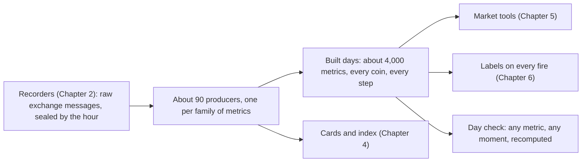
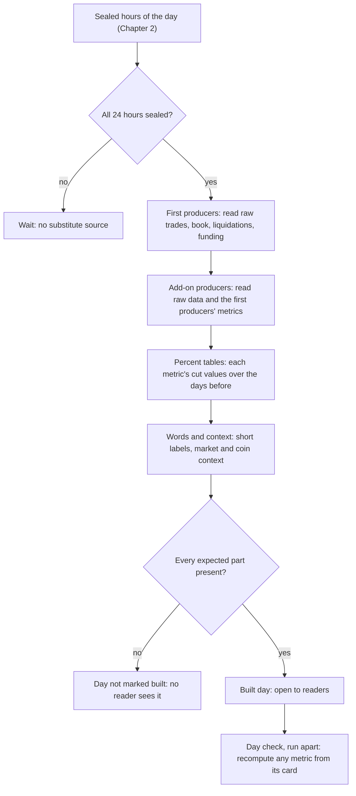
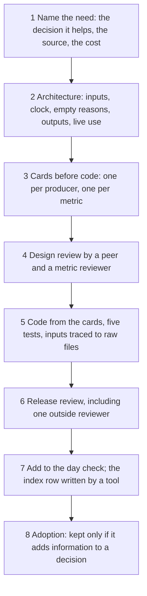

# 3. Metric production and maintenance

## 3.1 Introduction

This system is a set of computer programs and AI agents that study the cryptocurrency market and look for good moments to trade. Metric production is one of its parts. In plain words, it turns the raw messages the system records from exchanges (Chapter 2) into numbers that describe the market at every moment: for example, how many long positions were closed by force on a coin in the last minute, or what it cost to cross the order book on that coin five seconds ago.

Why this matters: a trader looks at a screen and forms an impression; an agent needs the same impression as defined numbers it can read, compare and test. If two studies compute "volatility" in two different ways, their results cannot be compared. If a number uses data that arrived after the moment it describes, a study learns from the future and its results will not hold in real trading. And if a number is computed by hand, nobody can check it.

This chapter defines what a metric is in this system, explains how metrics are produced and kept fresh, and sets out how to build the same thing.

## 3.2 The concept

**A metric is one named number, computed by a program from recorded data, for one coin or for the whole market, at every step of a fixed clock, with a written definition and the time it became known.**

A few terms are used throughout:

- **Producer:** a small program that computes one family of metrics, for example all the liquidation metrics, or all the order-book metrics.
- **Update interval** (or cadence): how often a new value of a metric is written: every 5 seconds, every minute, once a day.
- **Window:** the stretch of time a metric sums or compares over, for example the last 60 seconds or the 14 days before.
- **Scope:** whether a metric describes one coin, the whole market, BTC only, or one alarm fire.
- **Card:** the written definition of a metric (Chapter 4).
- **Built day:** the set of files the producers write for one UTC day.

Three properties follow from the definition. Every value carries two times: the moment it describes, and the moment its inputs were known; the second is never later than the first, so no value reads anything that happened after its own moment. An empty value is marked with a reason word (for example "no file" or "a hole in the order book"); it is never written as 0, and never an older value carried forward past the metric's age limit. And every metric is computed by a released program, the same way for every day. Together with the cards and the index of Chapter 4, this is the shape of a feature store, which registers every feature with its definition and its sources [5].

The producers fall into a few kinds:

| kind | what the producers compute |
|---|---|
| liquidations | positions closed by force, per coin and for the market |
| flows | who crossed the spread to trade, buyers or sellers, and in what size |
| positions and funding | open interest, funding rates, the premium of the futures price over the index |
| prices, returns and ranges | moves over many windows, and each coin against the market |
| volatility and activity | how wild and how busy the market is |
| breadth | how many coins move the same way at once |
| order book and trading cost | the depth of the book and what a trade costs |
| market context | market-wide and per-coin readings, one row a minute |
| Hyperliquid | the same kinds of readings for a second exchange, from its own daily files |
| calendar and news | funding times, trading sessions, counts of news items |

## 3.3 How it works

Every night, a build runs the producers in order for each finished UTC day. The picture below shows one day passing through them.

Three rules govern how metrics are written.

**Each metric at its own update interval.** A metric that updates every 5 seconds may be at most 5 seconds old when it is read; one that updates every minute may be up to 59 seconds old; a daily metric is known only once its day has ended. A stored value older than its own update interval is treated as stale, a freshness rule of the kind data-quality suites check [4]. Reading every metric on one common coarse grid, for example every 15 minutes, would make fast metrics many steps old, so it is not allowed. The store writes each metric at its own steps, and a reader asking for a time gets the last value at or before that time [1].

**Known at its moment, never after.** A value may use only inputs that had arrived by the moment it describes. A metric that compares with the past (for example a percentile over the 14 days before) is computed from those days only, and is fixed before the day begins.

**Empty stays empty.** A hole in the data gives an empty value with its reason. A late file can fill a cell, but it never makes a value known earlier than it really was.

### A worked example

One metric, from raw data to its value: the half spread of a coin, and its bad-minute value for the hour of day.

| step | what happens |
|---|---|
| raw data | the recorder keeps every change of the best bid and the best ask on Binance futures, with the exchange's time and our receive time |
| value every 5 seconds | the producer takes the best bid and ask in force at that moment (the last change that had arrived by then) |
| half spread | half of ask minus bid, divided by the mid price, in basis points of the mid [2]; for BTC the spread is usually one price step of 0.1 USDT, which at a price of 67,000 is a half spread of about 0.0075 basis points |
| hour-of-day value | for each UTC hour, the 90th percentile of the half spreads of that hour over the 14 whole days before the day: what the spread is in a bad minute at this hour |
| known at | 00:00 of the day: the hour table is fixed before the day begins |
| empty value | a hole in the order book at a step gives an empty value with the reason "book hole", never zero |
| card | states all of the above, what the number may be used for (this coin's usual and bad-minute cost at this hour) and what it must never be used as (the cost on another exchange, or the cost of a trade larger than the best level); Chapter 4 shows it |

## 3.4 How to build it

The same procedure is used for every producer, in the order below. No step starts before the one above has passed its check.

1. **Name the need.** Write down the decision the new metrics would help, the source data and the cost. Look first for an existing metric that is close, and extend its producer if there is one.
2. **Write the architecture.** A short document: the question, each input and the one reader that reads it, the clock, the reasons a value can be empty, the outputs, and how it will run live.
3. **Write the cards before the code.** One card for the producer and one per metric. A checker refuses any card with a missing field [3].
4. **Review the design** with a research peer and a metric reviewer, never the person who drafted it.
5. **Write the code from the cards**, never the cards from the code, and pass five tests: unit tests with planted mistakes that a named test must catch; a day check (layout, order, row count, and the known time never after the moment described); a recompute by a different agent from the card's words alone; a meaning check (a value planted in the future must never change today's output); and speed and memory within budget. Trace each input back to its raw files.
6. **Review the release** with research, the metric reviewer and one outside reviewer, all on the same released copy.
7. **Add the producer to the day check**, so any metric on any day can be recomputed later from its card, from stored inputs and, where one exists, from an outside source, without importing the producer's code. Let a tool, not a person, write the metric's row in the index.
8. **Decide adoption.** A test of whether the metrics add information to a decision decides whether they are kept.

When a source breaks or changes later, a hole becomes an empty value with its reason, and a changed source gets a new producer edition beside the old one, never an edit in place.

## 3.5 What the metrics make possible

Because every metric is defined once, computed by one program, read at its own update interval and stamped with the time it became known, every later part of the system can use the same numbers: the market tools describe the market from them (Chapter 5), the label tools describe every fire with them (Chapter 6), and alarm and strategy research test ideas on them, on any day, with the same result every time.

## 3.6 Conclusion

Metric production turns raw exchange messages into about 4,000 defined numbers, computed by about 90 small producers. Each producer is written from its cards, tested by a second agent and released through one procedure; each value is read only at its own update interval, says when it was known, and says why when it is empty. Built in the order above, it gives every agent in the system numbers it can trust, without learning from information that arrived too late.

## References

1. Feast. *Point-in-time joins*. Feast documentation. https://docs.feast.dev/getting-started/concepts/point-in-time-joins
2. Goyenko, R. Y., Holden, C. W., and Trzcinka, C. A. (2009). Do liquidity measures measure liquidity? *Journal of Financial Economics*, 92(2), 153-181.
3. dbt Labs. *About MetricFlow*. dbt documentation. https://docs.getdbt.com/docs/build/about-metricflow
4. Great Expectations. *Freshness*. Great Expectations documentation. https://docs.greatexpectations.io/docs/reference/learn/data_quality_use_cases/freshness
5. Hopsworks. *Feature group API*. Hopsworks documentation. https://docs.hopsworks.ai/feature-store-api/3.5/generated/api/feature_group_api
