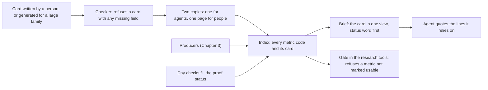
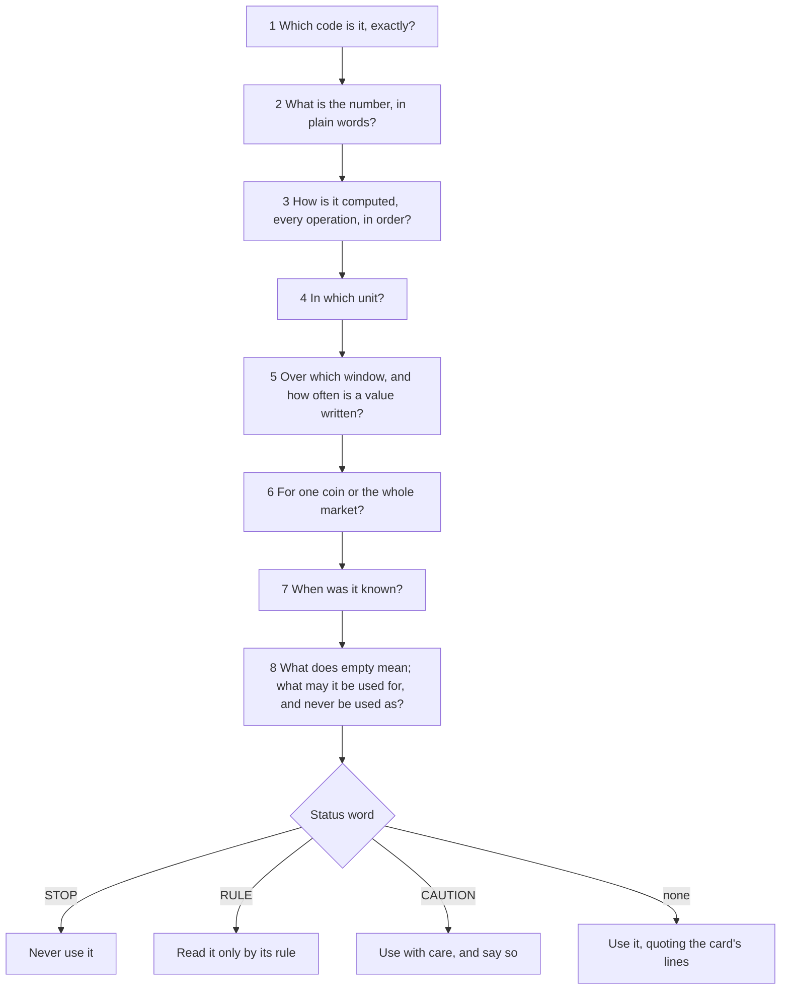
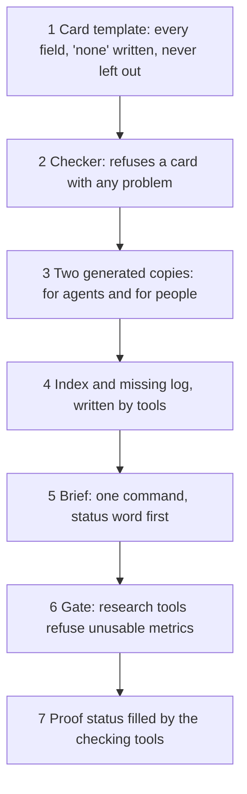

# 4. Metric definitions for agents: the metric cards

## 4.1 Introduction

This system is a set of computer programs and AI agents that study the cryptocurrency market and look for good moments to trade. It computes about 4,000 numbers that describe the market (Chapter 3). The metric cards are the part that tells an agent what each of those numbers means. In plain words, a card is a short written definition of one number: what it is, how it is computed, in which unit, over which stretch of time, for one coin or for the whole market, when it was known, what an empty value means, and what the number may and must never be used for.

Why this matters: an AI agent does not remember earlier sessions. Each time it starts, it knows only what it reads. If the meaning of a number lives in someone's head, or in a comment inside the code, the agent will guess, and a guessed meaning is the most common way a correct number leads to a wrong conclusion. A number named "big traders", for example, may really count big single fills, so an order split into small pieces counts as small. Only a written definition, read before use, prevents that.

This chapter defines the card, explains how agents find and read cards, and sets out how to build them.

## 4.2 The concept

**A metric card is the one written definition of a metric, kept in a file an agent can read in one step, and read before the metric is used for anything.**

A few terms are used throughout:

- **Metric:** one named number the system computes (Chapter 3). Each has a code and a plain name.
- **Index:** one table with a row for every metric code, pointing to its card.
- **Brief:** one command that prints a metric's card in one view, with a status word first.
- **Status word:** STOP (never use it), RULE (the name misleads: read it only by its rule), CAUTION (not yet tested, or a candidate), or nothing when the metric is proven.
- **Proof status:** what the checks found: whether the value was recomputed independently and agreed, and whether it means what its name says.

Three properties follow from the definition. There is one definition per metric, so every agent and every tool reads the same meaning. The card is written before the code that computes the metric, so the code is checked against the card, not the other way round. And the card is the gate to use: a metric with no card, or with a STOP word, is not used.

## 4.3 How it works

Before a metric enters any rule, grouping, label, chart or claim, the agent answers eight questions from the card, in this order. The brief prints all eight answers at once.

The agent quotes the lines it relied on in its design, so a reviewer can see which definition it used. A code the brief cannot find is not used.

Each card is three files side by side: the source, written in a structured text format, and two copies a checker writes from it only when the card has no problems, one for agents and tools and one page for people that says "do not edit here, edit the source". A new edition of a card is a new set of files; the old one is kept. Besides the answers to the eight questions, a card holds what a second person needs to check the metric: the source of the definition (a paper, a document, or our own rule), every input with its own card, coin cases and time cases (price steps, funding times, the first day of the data, crash days), planted test cases with exact answers and planted mistakes the tests must catch, named points where another agent recomputes the value from the card's words alone, and a meaning check (what would show that the value does not mean what its name says). The proof status is not written by the card's author; the checking tools fill it in the index.

Cards also carry warnings wherever a reading is easy to misread:

| reading | the warning on its card |
|---|---|
| a coin against the median coin | assumes the coin moves one for one with the market; real coin betas run from 0.04 to 3.04 |
| liquidations | a lower bound (the exchange sends at most one print per coin per second); empty means "not seen", never zero |
| "big traders" | big single fills, so an order split into small fills counts as small |
| a percent cut | in the metric's own unit, never on a 0 to 100 scale |

### A worked example

The trading-cost metric from the worked example of Chapter 3, as an agent reads it. The full cards are in the project's repository.

| field | value for this metric | what the field means |
|---|---|---|
| name | half spread for this hour of day, bad-minute value | what the number is, in plain words |
| means | the 90th percentile of the coin's half spread (half of ask minus bid, over the mid) at this UTC hour, over the 14 days before the day | how it is computed, in one sentence |
| unit | basis points of the mid | the unit of every value |
| clock | a value every 5 s, 17,280 a coin a day | how often a new value is written |
| window | the 14 whole days before the day | the stretch of time it reads |
| scope | one coin, Binance USDT-M futures | one coin or the whole market, and which exchange |
| known at | 00:00 of the day: the table is fixed before the day begins | when the value was available, so it never reads its own future |
| empty means | no file, a hole in the book, a bad input, too little history, too few values; never 0 | why a value can be missing |
| may use | this coin's bad-minute half spread for this hour; a coin against itself across hours and days | what a reader may conclude |
| never use as | the cost on another exchange; the cost of a trade larger than the best level; today's spread | what a reader must never conclude |
| source | the quoted spread of Goyenko, Holden and Trzcinka [6] | where the definition comes from |
| proof status | proven; the card was signed after review | what the checks found |

An agent designing an alarm that only trades when costs are low would read this card, see that the number describes a bad minute at this hour over the past two weeks and not today's spread, and quote the "never use as" line in its design.

## 4.4 How to build it

The components below are listed in the order they are best built, because each depends on the ones before it.

1. **A card template** with every field of 4.3, where a missing answer must be written as "none", never left out [1, 2, 3].
2. **A checker** that refuses a card with a missing field, a reviewer who is also the drafter, a known time that can be later than the moment described, fewer than three tests or two planted mistakes, or a recompute point in a month the research may not read.
3. **Two generated copies** of each card, for agents and for people, written from the source only when the checker passes.
4. **The index**, one row per code pointing to its card, written by a tool, and a **missing log** that lists every gap: a metric built but not indexed, a row with no card, a card that changed since the row named it, a card that never names its code [4].
5. **The brief**: one command that prints a metric's card in one view with a status word first, and a rule that it is read before any use.
6. **A gate** in the research tools that refuses a design built on a metric not marked usable.
7. **Proof status** filled in the index by the checking tools, never by the card's author [5].

## 4.5 What the cards make possible

Because every metric has one card, an agent that has never seen the system before can use any of about 4,000 metrics correctly, and refuse the ones it must not use. A reviewer can check which definition an agent relied on. A new metric can be added without anyone explaining it in a conversation: its card says everything. And a misreading found once becomes a warning on the card, so the next agent does not repeat it.

## 4.6 Conclusion

A metric card answers, in one file, every question an agent must ask before it uses a number, and the index makes every card one command away. Written before the code, checked by a tool, recomputed by a second agent and read before every use, the cards let agents work with thousands of numbers without guessing what any of them means.

## References

1. Mitchell, M., et al. (2019). Model cards for model reporting. *Proceedings of the Conference on Fairness, Accountability, and Transparency*. https://arxiv.org/abs/1810.03993
2. Gebru, T., et al. Datasheets for datasets. https://arxiv.org/abs/1803.09010
3. Pushkarna, M., Zaldivar, A., and Kjartansson, O. (2022). Data cards: purposeful and transparent dataset documentation for responsible AI. *FAccT 2022*. https://arxiv.org/abs/2204.01075
4. dbt Labs. *About MetricFlow*. dbt documentation. https://docs.getdbt.com/docs/build/about-metricflow
5. Bitol. *Open Data Contract Standard* (as documented by datacontract.com). https://docs.datacontract.com/open-data-contract-standard
6. Goyenko, R. Y., Holden, C. W., and Trzcinka, C. A. (2009). Do liquidity measures measure liquidity? *Journal of Financial Economics*, 92(2), 153-181.
