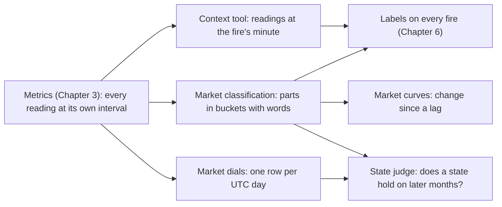
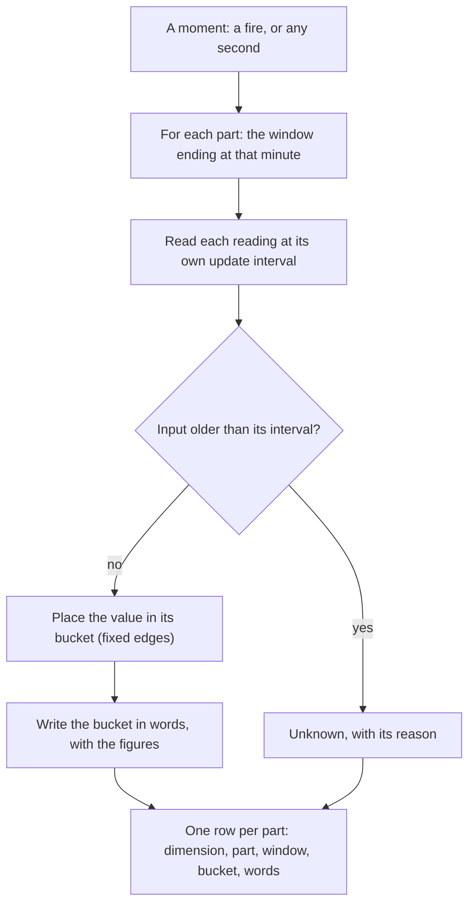
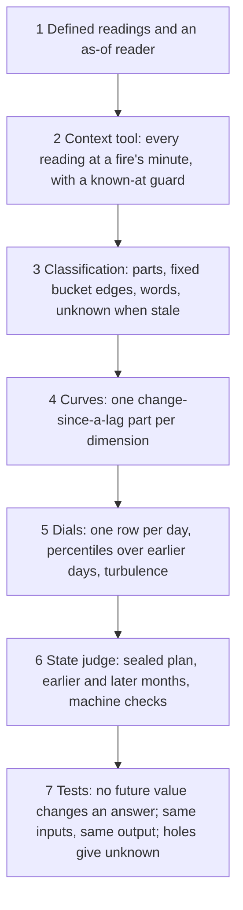

# 5. Market analysis tools

## 5.1 Introduction

This system is a set of computer programs and AI agents that study the cryptocurrency market and look for good moments to trade. The market analysis tools are the part that describes the market around any moment. In plain words, they answer the questions a trader asks before acting: what does the market look like right now, what does this coin look like, how did they get here, what kind of day is it, and does a market condition I believe in still hold on months I have not looked at?

Why this matters: a trading moment means little without the market around it. A coin falling 3% while every other coin rises is a different event from the same fall in a market-wide crash. An agent that studies thousands of moments needs the market described for each of them in the same words, from the same numbers, and only with what was known at that moment. If the description of a moment used a value from fourteen minutes later, or one from fourteen minutes earlier when a fresher one existed, the agent would learn from a market that was not there.

This chapter defines the market tools, explains how they work, and sets out how to build them.

## 5.2 The concept

**The market analysis tools turn the system's metrics into a description of the market and the coin at any moment: in numbers, in buckets with words, as change since a lag, and as a daily picture, each read at that moment's own time.**

A few terms are used throughout:

- **Reading:** one defined value about the market or a coin, for example the median coin's move over the last 24 hours. Each reading has a card (Chapter 4) and an **update interval**: how often a new value exists, from 3 seconds to one day.
- **Part:** one reading over one window, placed in a bucket with fixed edges and written in words, for example "volatility, 15 minutes: from 0.32% to under 0.71% minute-end range".
- **Dimension:** a question about the market built from its parts: how far it moved, how wild it is, how thin the order books are, how crowded the positions are.
- **Curve:** a part that gives the change of a reading since a lag (15 minutes, an hour, a day ago).
- **Fire:** one moment an alarm marks: one coin at one second (Chapter 6).
- **Market state:** two or more readings combined into a condition, for example "24-hour volatility above its past-month median and the market not changed".

There are five tools, each answering one question:

| question | tool |
|---|---|
| What did the market, the coin and the alarm look like at this fire, at the fire's minute or any minute around it? | context tool |
| What state is the market in at this moment, dimension by dimension? | market classification |
| How did the market get here? | market curves, inside the classification |
| What was the market like on this UTC day, against all earlier days? | market dials |
| Does a declared market state hold on months it was not chosen on? | state judge |

The market description of an event always comes from the classification; the context tool's readings are used for the coin, the alarm and grading.

## 5.3 How it works

The classification is the centre of the market description. The picture below shows how it describes one moment.

**The market classification** covers 10 dimensions of the market (market move, breadth, BTC, volatility, spread, depth, funding, positions, forced selling and forced buying) in about 190 parts. For a moment, each part's window ends at that minute, the decision is taken a few seconds later (the time a value takes to arrive), and no input may be older than its own update interval [1, 2]. Reading every part on a coarse common grid, for example every 15 minutes, would make one-minute readings up to fourteen of their own steps old, so it is not allowed. An input that cannot meet its bound comes out unknown, with its reason.

**The market curves** are parts of the classification. Each prints both figures, the change and a fixed bucket, without words such as "recovering" that would claim more than the numbers show; there is at most one curve over time per dimension. On the months from September to December 2025, an outside reviewer found that curves added information beyond the level buckets for 9 of 11 dimensions, but not for positions or forced selling; the curves count 11 because they split breadth into rises and falls.

**The context tool** writes, for one alarm and one minute around its fires (any whole minute from a day before to an hour after), every fire's readings known at that minute: about the alarm and its history, the whole market and the coin, about 230 in all, most of them also cut into labels (low, middle, high, or a percentile band). Every value is read at the last minute end at or before the decision, and a guard in the code proves it was already known. A price is the last 3-second bin before the minute end, and is empty if that bin is more than 60 seconds old. Percentile bands use only the 14 whole days before the fire's day, and the alarm's history only earlier fires.

**The market dials** describe each UTC day with 32 daily market readings. Each is placed among all earlier days (its percentile), among the 90 days before, and as a 7-day median, with a flag when it sits at an extreme for three days running. Each day also gets a turbulence score: how far the day's readings sit from the 90 days before, measured as a Mahalanobis distance [3]. A day's row is known only at its end, so a fire reads the dials of the day before. Each series is read on its own release calendar, as nowcasting does with economic data [4].

**The state judge** tests whether a market state, chosen event by event on earlier months, still holds on later months kept aside for the check. Before any result exists, the plan is sealed: written down and fingerprinted so it cannot change. Thirteen machine checks refuse a test that is not clean: a look into the future, one reading alone, too few events, or a second look at the later months. The verdicts are: the state holds; it fails; no state was found; or the test was invalid, which says nothing about the state. Market regimes have no ground truth, so they are judged on later data, as regime research recommends [5, 6].

### A worked example

The market at one moment: parts as the classification wrote them for an alarm fire on 12 January 2026 at 19:44 UTC. Every window ends at the fire's minute, and every reading was 6 seconds old, inside its one-minute update interval.

| dimension | part | what the classification wrote |
|---|---|---|
| BTC | move over the last 24 hours | +1.10 percent: the high band |
| BTC | move over the last 14 days | +5.0 percent: the high band |
| order book depth | top of the book over 5 minutes, against usual | 1.19 times usual: the middle band; only 4 of 52 coins had thin books |
| forced selling | coins with long positions forced out | 34 of 52 coins over the last hour (a high count); 3 of 52 in the last 5 minutes |
| forced selling | size against open positions | unknown: the open-positions input is not fresh enough at this minute |
| funding | coins paying positive funding | 37 of 52 positive, 15 negative |

Read together, these say: BTC had been rising for two weeks and over the last day, order books were normal, a wide wave of forced selling had hit most coins over the last hour but was fading, and most of the market still paid to hold long positions. The size of the forced selling is written as unknown rather than guessed, because its input could not meet its update interval.

The same picture for a whole day, from the dials, and for one coin at one fire, from the context tool:

| tool | moment | what it wrote |
|---|---|---|
| market dials | 10 October 2025 | the median coin's 24-hour move at 23:59 UTC was -23.1%, lower than on every earlier day; long liquidations, as a share of open interest summed over the day, higher than on every earlier day |
| market dials | 11 October 2025 | the median coin's move back near zero; long liquidations still higher than on 97% of earlier days |
| context tool | a forced-selling alarm on the coin TAO, 10 October 2025, 13:16 UTC | BTC's 24-hour move +1.20%; a basket of coins flat over 15 minutes and -0.53% over one hour; 36% of the last minute's market volume from forced liquidations; minutes since the market's liquidation wave began: empty, with its reason |

## 5.4 How to build it

The components below are listed in the order they are best built, because each depends on the ones before it.

1. **Defined readings** (Chapters 3 and 4), each with its update interval, and one reader that returns the last value known at or before a given time, within a maximum age [1, 2].
2. **The context tool**: for a list of fires and a minute, read every coin, market and alarm reading at that minute through the reader, with a guard that fails if any value was not yet known.
3. **The classification**: for each dimension, choose a few parts (size, count of coins, curve), fix their bucket edges in advance, and write each bucket in words with its figures. Read every part at the moment's own minute, and write unknown when an input is older than its interval.
4. **The curves**: one change-since-a-lag part per dimension, printed as both figures and the change, never as a word.
5. **The dials**: from the daily market row, one value per dial per day, its percentile among earlier days only, and a turbulence score [3].
6. **The state judge**: a sealed plan, earlier and later months fixed before the test, machine checks that refuse an unclean test, and one look at the later months. Compare each state with a simple baseline rule and check how long states last [5, 6].
7. **Tests** for every tool: a value planted after the moment must change nothing; the same inputs twice must give the same output, cell for cell; a planted hole must give unknown, with its reason.

## 5.5 What the tools make possible

Because the market at every moment is described the same way, from the same metrics, at that moment's own time, every fire of every design carries the same market description (Chapter 6). An agent can then ask whether an alarm works better in a broad fall than when the coin falls alone, whether a strategy loses in high-turbulence days, or whether a market state it found on one set of months holds on another, and get an answer that does not depend on which study described the market.

## 5.6 Conclusion

The market analysis tools turn about 4,000 metrics into a few answers an agent can use: the market and the coin at a fire, the market's state in words, how it got there, what kind of day it is, and whether a market state holds on months nobody looked at. Each answer is read at the moment's own time, each reading at its own update interval, so the tools describe what a trader could have known then, and nothing later.

## References

1. Feast. *Point-in-time joins*. Feast documentation. https://docs.feast.dev/getting-started/concepts/point-in-time-joins
2. KX. *aj, aj0: as-of join*. kdb+ and q reference. https://code.kx.com/q/ref/aj/
3. Kritzman, M., and Li, Y. (2010). Skulls, financial turbulence, and risk management. *Financial Analysts Journal*, 66(5), 30-41.
4. Giannone, D., Reichlin, L., and Small, D. (2008). Nowcasting: the real-time informational content of macroeconomic data. *Journal of Monetary Economics*, 55(4), 665-676.
5. Shu, Y., Yu, C., and Mulvey, J. M. (2024). Downside risk reduction using regime-switching signals: a statistical jump model approach. arXiv 2402.05272. https://arxiv.org/abs/2402.05272
6. QuantStart. *Hidden Markov Models for Regime Detection using R*. https://www.quantstart.com/articles/hidden-markov-models-for-regime-detection-using-r
