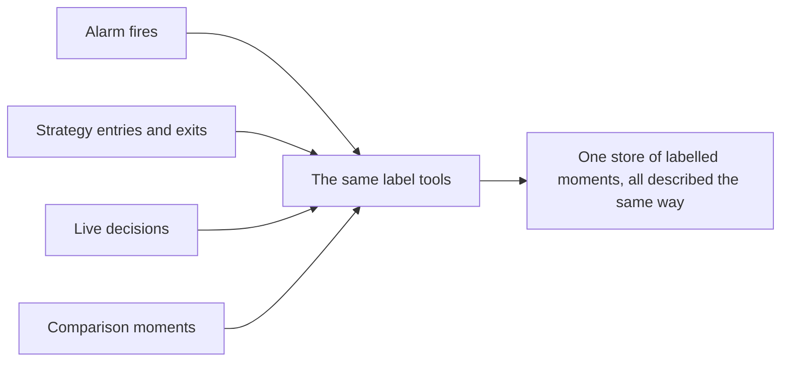
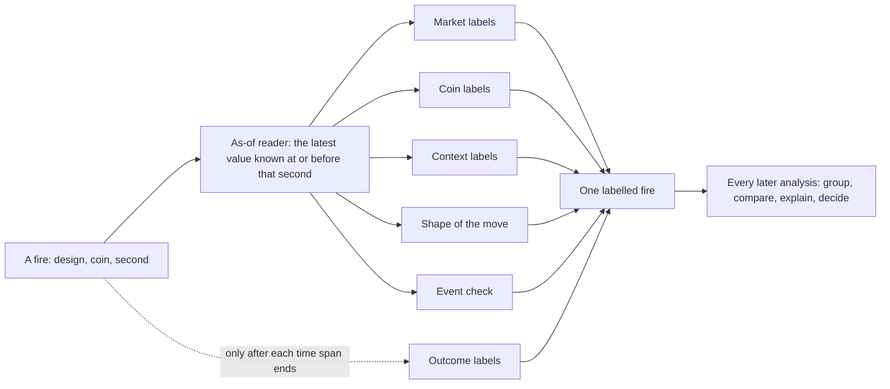
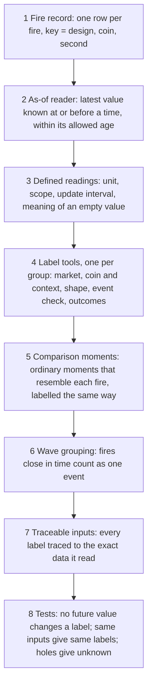

# 6. Meta-labelling

## 6.1 Introduction

This system is a set of computer programs and AI agents that study the cryptocurrency market and look for good moments to trade. Meta-labelling is one of its parts. In plain words, it is a description written on every moment the system marks as interesting: what the market looked like at that moment, what the coin looked like, what happened just before, and what happened afterwards. Programs write these descriptions, the same way every time, so that thousands of moments can be compared with each other.

Why this matters: the system produces many designs. A design is any rule that marks moments. An alarm marks moments on a coin where something unusual happens; a strategy decides when to enter and when to leave a trade; a live manager takes decisions as the market moves. Each marked moment is a chance to learn: why did this one pay and that one not, in which markets does the design work, does a new design repeat an old one?

That learning is only possible if every marked moment is described in the same terms, by the same programs, and only with what was known at that moment. If one study describes its moments with one set of facts and another study with a different set, their results cannot be compared. If a description uses information that arrived after the moment, the study learns from the future and its results will not hold in real trading. And if descriptions are typed by hand, they cannot be checked or repeated.

This chapter defines meta-labelling, explains how it works, and sets out how to build it.

## 6.2 The concept

**Meta-labelling is what the tools do to each moment a design marks: they attach labels to it, so that every such moment, from any design, can be analysed the same way.**

A few terms are used throughout:

- **Design:** anything that marks moments to study or trade: an alarm, a strategy, or the live manager.
- **Fire:** one moment a design marks: one coin at one second. An alarm's signal, a strategy's entry, a strategy's exit and a live decision are all fires, each at its own second.
- **Label:** one value a tool writes on one fire, for example the market's 24 hour move at that second.
- **Reading:** one defined value about the market or a coin, with a written definition (Chapter 4). Each reading has an **update interval**: how often a new value of it exists, from a few seconds to one day.
- **Comparison moment:** a moment on the same coin with no fire, chosen to resemble the fire (similar activity, a nearby day, the same hour of the day), so that a fire can be compared with an ordinary moment.
- **Wave:** fires on many coins within 30 minutes of each other, counted as one event, so that one market move is not counted many times.

Three properties follow from the definition. The labels are the same for every design, so an alarm's fires and a strategy's trades can be grouped and compared with one method. Each label is read at the fire's own second, so it holds only what was known then. And every label is written by a tool, never typed, so any label can be produced again from the same inputs.

## 6.3 How it works

Every fire receives six groups of labels. The picture below shows one fire passing through the label tools.

| label group | what it describes | when it is read |
|---|---|---|
| market | the state of the whole market: how far it moved, how volatile it is, how thin the order books are, each as a bucket with words | the window ending at the fire's minute |
| coin | the fire's own coin: its moves, forced liquidations, open interest, funding, order book and trading cost | the last value known at the fire's minute |
| context | the design's own history (earlier fires only) and how the market and coin readings compare with their recent past | the fire's minute, or any minute around it for an entry taken later |
| the fire's shape | where the move that led to the fire started, how far and how long it ran, how much it gave back, and the liquidations around it | what is known at the fire |
| event check | whether the event the design claims really happened, measured on a reading the design's own rule does not use, and never on price | a window stated per claim, with a maximum age for its reading |
| outcomes | what the price did after the fire: which way it moved first and how far, from minutes to four hours, in both directions, after trading costs | only after each time span has ended |

Four rules govern how labels are written.

**Known at the fire, never after.** A label of the fire's state uses only what was known at the fire's second. This is the point-in-time join used by feature stores and time-series databases: for each row, take the latest value at or before the row's own time, within a maximum age [1, 2]. The tools enforce it in code. The coin and context tool carries a guard that proves every value it read was already known at the decision. The market labels refuse any reading older than its own update interval. Percentile bands are built from the 14 whole days before the fire's day, and a design's history uses only earlier fires. Outcomes are kept apart from state labels and exist only after their span ends.

**Each reading at its own update interval.** A reading that updates every 5 seconds may be at most 5 seconds old; one that updates every minute may be up to a minute old; a daily reading is known only at the end of its day. Reading every value on a coarse common grid (for example every 15 minutes) would make fast readings many steps old, so it is not allowed. Where an input cannot meet its bound (stored open interest, for example, can be up to 15 minutes old), the labels built on it are written as unknown.

**Unknown stays unknown.** A value a tool cannot know is written as unknown with its reason: a hole in the data, a stale input, a day the research may not read. It is never a zero, never "false", and never a group of its own, so an analysis cannot mistake missing data for a market state.

**Comparison moments are labelled the same way.** A fire's labels mean something only next to ordinary moments. Event studies measure each event against a normal benchmark for the same asset [3]; here, matched comparison moments receive exactly the same labels as fires, each at its own second. Fires and comparison moments are counted by wave, so one market move that fires on many coins counts once.

Each label is identified by the fire's key (design, coin, second), so one coin can carry an alarm fire, a strategy entry and a strategy exit, each with its own labels read at its own time.

### A worked example

The example below is illustrative: the values are typical of the kind the tools write, not taken from one specific trade.

An alarm fires on a mid-sized coin at 14:32:10. The alarm's rule says the coin fell sharply in the last 15 minutes while traders who bet on a rise were forced out of their positions, and that such falls tend to come back.

| label group | what the tools write on this fire |
|---|---|
| market | most coins fell over the last hour (a broad fall); volatility high for the time of day; order books thinner than usual; forced selling across the market above its normal level |
| coin | the coin fell 4.1 percent in 15 minutes; forced sales of long positions were in the top tenth of its own last 30 days; open interest fell; funding close to zero |
| context | third alarm on this coin in 24 hours (earlier fires only); the coin's fall was larger than the market's |
| shape of the move | the fall started 22 minutes before the fire, from a local high, and had given back none of its drop at the fire |
| event check | open interest, a reading the alarm's rule does not use, came back within the next hour, as the claim predicts; ordinary moments with the same activity show this far less often |
| outcomes | after 15 minutes the price had moved up by 2.3 times the coin's trading cost; after 1 hour, by 1.6 times; the opposite trade lost |

### Three real labelled fires

The table below shows real labels written by the tools on three fires of one alarm, all on the same coin (XMR, a privacy coin traded as a perpetual future). The alarm marks a sharp fall of the coin in which traders holding long positions were forced out, and it bets that the price comes back. Each column is one fire; each row is one label, read at that fire's own minute.

| label | 3 Nov 2025, 13:57 UTC | 11 Jan 2026, 23:47 UTC | 12 Jan 2026, 19:44 UTC |
|---|---|---|---|
| market: BTC over the last 24 hours | down 2.3 percent (low band) | flat, up 0.4 percent | up 1.1 percent (high band) |
| market: volatility of the typical coin over 15 minutes | middle | middle | low |
| market: order book depth against its usual level | normal (1.02 times usual) | thin (0.81 times usual) | normal (1.19 times usual) |
| market: funding across coins | negative | negative | normal |
| coin: share of other coins moving the same way over 15 minutes | 68 percent | 12 percent | 53 percent |
| coin: share of the selling that was forced | all of it | 92 percent | almost all |
| coin: change in open positions over the last 10 minutes | up 0.3 percent (new positions opened) | down 0.05 percent | down 1.8 percent (positions left) |
| outcome after 15 minutes, after costs | the fall continued: the bet lost | no result either way | the price came back: the bet paid |

Three fires prove nothing on their own, and the table is not a rule. It shows what the labels make possible: across hundreds of fires, a study can ask whether fires where open positions were leaving, as in the third column, came back more often than fires where new positions were opening, as in the first, with every fire described the same way.

The comparison moments for these fires, on the same coin at similar quiet-but-busy times, receive the same six groups. A later study can then ask, for hundreds of such fires: did the ones in a broad market fall come back more often than the ones where the coin fell alone? Every fire carries the labels needed to answer, written the same way, from what was known at each fire's second.

## 6.4 How to build it

The components below are listed in the order they are best built, because each depends on the ones before it.

1. **A fire record.** One row per fire with its key: the design, the coin and the second. Strategy entries and exits, live decisions and comparison moments use the same record.
2. **An as-of reader.** One reader that, given a reading and a time, returns the latest stored value known at or before that time, and refuses it when it is older than the reading's allowed age [1, 2]. Every label tool reads through it.
3. **Defined readings.** Each reading the labels use needs a written definition with its unit, scope, update interval and what an empty value means (Chapters 3 and 4).
4. **The label tools, one per group.** A market classification that turns market readings into buckets with words at the fire's minute; a coin and context tool; a profile of the fire's shape; an event check; and a grading tool for outcomes. Each writes its labels from the as-of reader and nothing else. Labels are produced by programs rather than by hand, in the same spirit as the labelling functions of programmatic labelling [4], so they can be rerun and audited.
5. **Comparison moments.** A generator that picks, for each fire, ordinary moments on the same coin that resemble it, and passes them through the same label tools.
6. **Wave grouping.** A step that groups fires and comparison moments into waves before anything is counted.
7. **Traceable inputs.** Each label tool checks the fingerprint of every source table it reads against an approved value before it returns a row, and records what it read, so any label can be traced to the exact data behind it. This follows the provenance model of entities, activities and agents [5].
8. **Tests.** Three tests matter most. A value planted after the fire must never change a label of the fire. The same inputs must give the same labels, cell for cell. An input with a hole must give unknown with its reason, never a number.

With these parts in place, a new design needs no new labelling work: its fires go into the fire record and receive every label automatically.

## 6.5 What the labels make possible

Because every fire carries the same labels, read the same way, fires of any design can be grouped by any label, compared with comparison moments, compared across months and across designs, and explained: which market and coin states the good fires shared, and which the bad ones shared. A written rule that decides what to do at a fire can read the same labels the research used. Each of these uses has its own method and its own test, described in the chapters on alarm design and strategy design.

## 6.6 Conclusion

Meta-labelling gives every moment the system marks, from any design, the same description: the market, the coin, the context, the shape of the move, a check of the claimed event, and the outcome. Each label is written by a tool, read at the moment's own second, and bounded by the update interval of the reading behind it, and unknown values stay unknown. Built in the order above, it lets every later stage of the system analyse alarms, strategies and live decisions with one method, without learning from information that arrived too late.

## References

1. Feast. *Point-in-time joins*. Feast documentation. https://docs.feast.dev/getting-started/concepts/point-in-time-joins
2. KX. *aj, aj0: as-of join*. kdb+ and q reference. https://code.kx.com/q/ref/aj/
3. MacKinlay, A. C. (1997). Event studies in economics and finance. *Journal of Economic Literature*, 35(1), 13-39.
4. Ratner, A., Bach, S. H., Ehrenberg, H., Fries, J., Wu, S., and Re, C. (2017). Snorkel: rapid training data creation with weak supervision. *Proceedings of the VLDB Endowment*, 11(3), 269-282.
5. Moreau, L., and Missier, P. (eds.) (2013). *PROV-DM: The PROV Data Model*. W3C Recommendation. https://www.w3.org/TR/prov-dm/
