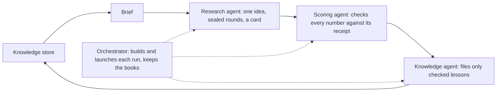
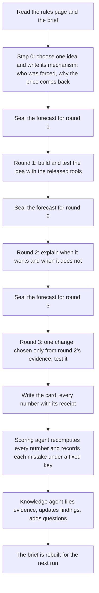
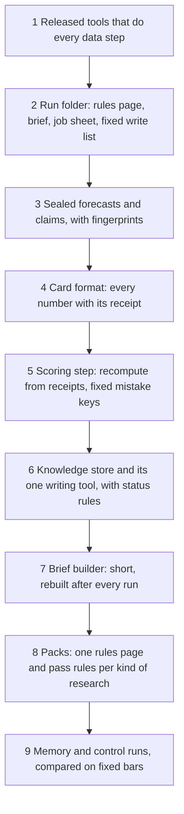

# 7. The agentic learning loop

## 7.1 Introduction

The system's research is done by AI agents. An agent can take an idea, run the tools on it and report what it found. One agent doing one study is useful. What makes an agentic system valuable is that the next agent does better than the last one: it knows what was already tried, which ideas failed and why, which mistakes were made, and which results held up. Without that, every new agent starts from zero, repeats old ideas and repeats old mistakes.

An agent does not remember anything between sessions. Whatever it learned is lost when its session ends, unless it was written down somewhere the next agent will read. Writing things down is not enough on its own either: an agent can write down a lesson that is wrong, or claim a result that its numbers do not support, and the next agent would then learn the wrong thing.

The learning loop is the part of the system that solves both problems. It decides how research is split into runs, how each run is checked, and how only checked lessons reach the next run. This chapter explains what the loop is, how it works, and how to build it.

## 7.2 The concept

**The learning loop is a fixed cycle in which one agent does a piece of research, a second agent checks it from its evidence, a third agent files what was learned, and the next research agent starts from that filed knowledge.**

Terms used in this chapter:

- **Run:** one piece of research by one fresh agent: one idea, taken through a fixed set of rounds, ending in a written card.
- **Round:** one step of a run with one question, for example "does the idea work at all?", "when does it work?", "does one change make it better?".
- **Forecast:** before each round, the agent writes down what it expects the result to be, with a range, and seals it.
- **Seal:** writing something down and recording a short fingerprint of the file, so that any later change can be detected.
- **Receipt:** the saved output of a tool that produced a number. Every number in a run's card points to its receipt.
- **Card:** the run's final report: the idea, the numbers of each round with their receipts, what was learned, and what to test next.
- **Knowledge store:** the shared memory of all runs: evidence rows, findings with a status, questions still open, and changes that helped or failed.
- **Brief:** a short summary of the knowledge store that the next research agent reads before it starts.
- **Pack:** the part of the loop that is specific to one kind of research (alarm design, the market lane, strategy design): its rules page, its rounds, its pass rules and its store columns. The cycle itself is the same for every pack.

Three properties follow. Knowledge enters the store only after an agent other than its author has checked it. Every claim was written down before its result existed, so a run cannot fit its story to its numbers afterwards. And the cycle is the same for every kind of research, so improving the loop once improves every pack that uses it.

## 7.3 How it works

A run goes through the same steps every time.

**The rounds.** Each pack sets its rounds and its pass rule for each round, in numbers, before any run starts. A round either meets its rule or it does not; a run does not change the rule after it sees the result. Round 3 may change exactly one thing, and the reason for the change must come from evidence the run was allowed to use for choosing, never from the months it is judged on.

**The roles.** The research agent never checks its own run. The scoring agent reads only the card and the receipts, recomputes every number with its own code, and records each mistake under a fixed key (for example, "a claim stronger than its numbers"), so that repeated mistakes can be counted across runs. The knowledge agent writes to the store only through one tool, which refuses a row that fails its checks; a claim that the scoring agent marked as too strong becomes an open question, never a finding. The orchestrator builds each run's folder, launches the agents, and is the only agent allowed to open months kept back for the final test.

**Findings and their status.** A finding is a statement about what works, with the evidence rows that support it. It starts as a hypothesis and moves to supported, confirmed or refuted only by rules applied by the tool, based on how many independent runs agree and how strong the evidence is. A refuted finding goes on a "do not retry" list in the brief, unless a new run says exactly what it changes.

**Memory and control.** Some runs read the brief (memory runs) and some do the same task without it (control runs). Comparing the two is how the system measures whether the loop actually teaches anything (Chapter 11).

### A worked example: four versions of one study

The example below comes from the market lane: a study that tries to drop the bad fires inside a group of alarm fires by reading the state of the market at each fire. Its test is strict. Each of seven months is held out in turn, the rule is fitted on the other six, and the result is compared with dropping the same number of fires at random in the held-out month. A version passes only if it beats random dropping across the alarm families, month by month, and does so in both halves of the period.

| version | what the run tried | result against random dropping | what the next run learned from it |
|---|---|---|---|
| first version (no loop yet) | one fixed set of market readings for every alarm family | did not pass | a single set does not suit every family |
| loop run 1 | readings chosen separately for falls and for rises | passed in round 3, but not in both halves of the period | the gain was real but not stable |
| loop run 2 | each family judged by the side of the market its own rule does not already fix | passed and stable; average gain +2.80 | families whose rule already demands a market-wide fall gain nothing from a market-wide reading (filed as a finding) |
| loop run 3 | the same, with one reading no longer counted twice | passed and stable; average gain +3.20 | the gain came from removing the double count, not from the new idea (filed honestly as such) |
| control run, no brief | the same task, without the knowledge store | did not pass; average gain +0.18 | (control runs feed no knowledge) |

Each memory run started from the previous run's checked lessons and improved on it. The control run, given the same task and tools but no brief, did not come close. One study is not proof that the loop works, which is why the system measures it over a series of runs (Chapter 11), but it shows the cycle doing what it is built for.

### A worked example: one finding

A finding as it sits in the knowledge store, in plain words:

| field | value |
|---|---|
| statement | inside alarm families whose rule already requires a market-wide fall, a market-wide reading of forced selling did not drop the bad fires better than random |
| kind | a market state |
| status | hypothesis |
| evidence | evidence rows from two versions, in both rounds, each with its receipt |
| next test | judge those families by the coin's own state instead |

The next research agent reads this in its brief, does not spend a run repeating it, and starts from the next test it names.

## 7.4 How to build it

The components below are listed in the order they are best built, because each depends on the ones before it.

1. **Released tools.** The research agent never computes a number by hand. Every data step is a call to a tested, released tool, so every number can be reproduced.
2. **A run folder.** Each run gets one folder with its rules page, its brief (memory runs only), a job sheet with the exact commands, and a list of the only files it may write.
3. **Seals.** Forecasts and claims are written before each round and fingerprinted. Anything changed after its seal is detected.
4. **The card.** A fixed format in which every number cites the receipt it came from.
5. **The scoring step.** A separate agent recomputes every number from the receipts with its own code and records mistakes under fixed keys.
6. **The knowledge store.** Evidence, findings, questions and changes, written only through one tool that checks every row and applies the status rules.
7. **The brief.** A short page built from the store after every run: what was tried, what helped which families, what failed and must not be retried, and the open questions.
8. **Packs.** For each kind of research, one rules page that sets its rounds, pass rules and store columns. The cycle stays the same; only the pack changes.
9. **Memory against control.** A planned series of runs with and without the brief, compared on bars written before the series starts.

## 7.5 What the loop makes possible

With the loop in place, research becomes cumulative. A new agent starts from everything that was checked before it, avoids ideas already refuted, and is told which mistakes earlier agents made most often. The same cycle can drive alarm design, the market lane and strategy design, each with its own pack. And because every lesson has its evidence rows, a human owner can read why the system believes what it believes.

## 7.6 Conclusion

The learning loop turns a series of separate agent sessions into one research programme that learns. It works because of a few strict rules: forecasts and claims are sealed before results exist, a different agent checks every number from its evidence, only checked lessons enter a shared store, and the next agent reads a short brief built from that store. The approach follows the idea of agents that improve by writing down and reusing their own experience [1, 2, 3], combined with the discipline of writing a study's plan before seeing its data [4] and of scoring forecasts against outcomes [5].

## References

1. Shinn, N., Cassano, F., Gopinath, A., Narasimhan, K., and Yao, S. (2023). Reflexion: language agents with verbal reinforcement learning. *Advances in Neural Information Processing Systems 36*. https://arxiv.org/abs/2303.11366
2. Wang, G., Xie, Y., Jiang, Y., Mandlekar, A., Xiao, C., Zhu, Y., Fan, L., and Anandkumar, A. (2023). Voyager: an open-ended embodied agent with large language models. https://arxiv.org/abs/2305.16291
3. Zhao, A., Huang, D., Xu, Q., Lin, M., Liu, Y.-J., and Huang, G. (2024). ExpeL: LLM agents are experiential learners. *Proceedings of the AAAI Conference on Artificial Intelligence*, 38. https://arxiv.org/abs/2308.10144
4. Nosek, B. A., Ebersole, C. R., DeHaven, A. C., and Mellor, D. T. (2018). The preregistration revolution. *Proceedings of the National Academy of Sciences*, 115(11), 2600-2606.
5. Brier, G. W. (1950). Verification of forecasts expressed in terms of probability. *Monthly Weather Review*, 78(1), 1-3.
