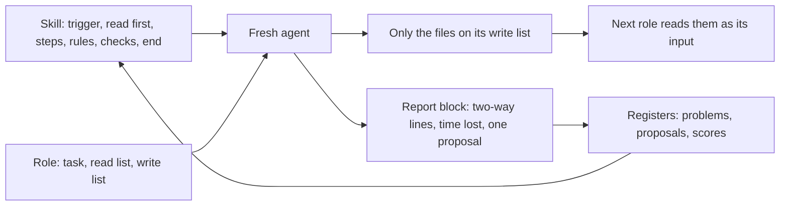
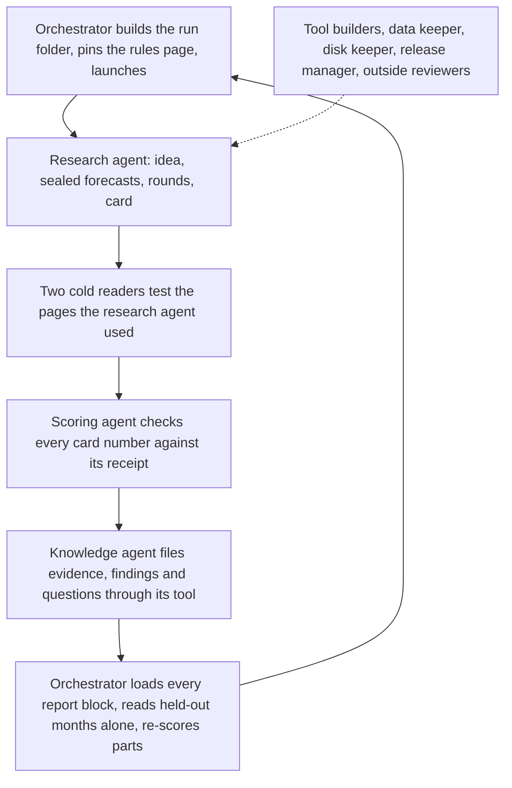
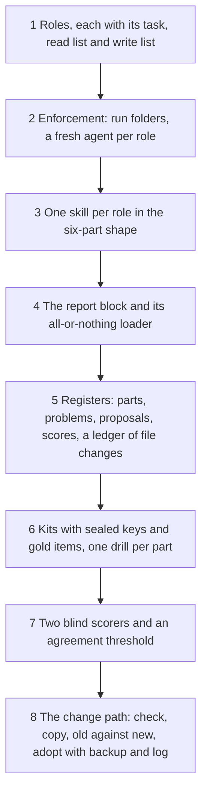

# 8. Agentic roles and skills

## 8.1 Introduction

The system's research, checking, filing, tool building and upkeep are all done by AI agents: language models that read files, run tools and write files until a task is done. Many agents work on the system every day, most for less than an hour, and none remembers anything from an earlier session.

Two problems follow. The first is trust. An agent that checks its own work shares the blind spots that produced it, and it has a stake in the answer. A published study of multi-agent systems found that many of their failures come from agents that step outside their role, or from checks that are missing or done badly [3]. The second is repeatability. An agent told only "check this run" will check it differently from the next agent given the same words.

This chapter describes how the system answers both: work is split into roles with fixed read and write lists, and each role comes with a written procedure, its skill. It also explains how work passes between roles and how a skill is changed without making it worse.

## 8.2 The concept

**A role is one fixed job with a fixed list of what it may read and write; a skill is the written procedure an agent loads before it takes a role; every role is held by its own fresh agent, and every agent holds exactly one role.**

Terms used in this chapter:

- **Fresh agent:** an agent started with an empty memory for one task, so it carries nothing from another role.
- **Skill:** a short procedure for one role: a trigger (when to load it), the files to read first, the steps, the rules it must never break, the checks, and how to end.
- **Write list:** the exact files a role may write.
- **Report block:** fixed lines every agent writes at the end of its task: lines that could be read two ways, time lost, and at most one proposed change.
- **Kit:** a planted task with a sealed answer key, used to test a role or a skill. Its **gold items** are answers whose correct score is known in advance.
- **Blind scorer:** an agent that scores kit answers without knowing which version of a skill produced them.

Three properties follow. A result is always checked by an agent that did not produce it. What one role knows cannot leak into another, because each agent sees only its own read list. And because every role ends with the same report block, the procedures themselves are measured and improved from the agents' experience of using them.

## 8.3 How it works

### One agent per role, one role per agent

One agent per role means no agent judges its own work: the research agent never scores its run, the scoring agent never files knowledge, and the orchestrator never scores a change it drafted. This is separation of duties from security engineering: a critical action needs more than one party, so one party's mistake or interest cannot pass unseen [4, 5].

One role per agent means a fresh agent for each role, even when one agent could do two. An agent that has just written a card cannot read it as a stranger would, and a control run (a run without the knowledge store, used to measure the store's value; Chapter 7) must never hear what a memory run found. Fresh agents also keep each context short, which is why multi-agent research systems give each worker its own context and a bounded task [1], and why simple agents with clear tools often beat one agent asked to do everything [2].

### The roles and what each may read and write

| role | what it does | reads | writes |
|---|---|---|---|
| orchestrator | builds, launches and watches each run; fixes and logs failures | its state page, its skill, the loop page | state page, logs, registers; the only role that reads the months kept back for the final test |
| research agent | takes one idea through the rounds, writes the card | pinned rules page, job sheet; in memory runs also the brief | only the files the rules page lists |
| cold reader | reads a working page with no context, lists lines that read two ways | exactly the pages under test | one report file |
| scoring agent | checks a finished run from its receipts, records mistakes under fixed keys | run folder, receipts, the brief the research agent saw | scoring sheet, mistake list, evidence rows |
| knowledge agent | turns a scored run into knowledge; checks proposals, never adopts them | card, scoring sheet, evidence rows | the knowledge store, through its one tool only |
| drill agent, blind scorer | answers or scores one kit task | only the files the task names | exactly one file |
| tool builder | builds a tool in a playground copy; a separate checker writes independent tests | the design, released inputs | the playground copy, never the release |
| data keeper | keeps raw data and the stores built from it, fills holes | raw data, stores, settings | stores and settings; raw data is never deleted |
| disk keeper | frees disk space | listings, the keep list, the inside of each candidate | deletes that pass every rule; never raw data, code or releases |
| release manager | the only role that installs a release | the tool, its tests, every page about it | the release and its index; a release stops when any page is behind |
| outside reviewer | an agent from another model family; reviews, never builds | the tool and its evidence | a review, blockers first |

An outside review blocks for five reasons only: a wrong number, a label that does not mean what it says, future data in the inputs, a way around a gate, or a missing build or test step. Everything else waits for the next version, and a version gets at most two rounds.

### Skills

A skill is the procedure an agent loads before it starts a role, in the same spirit as an agent's library of named, reusable procedures called when the situation matches [6], and the packaged instructions coding agents load only when a task needs them [7]. Every skill has the six parts named above, stays under a size budget of about 3 kilobytes, and points to the pages that hold the detail instead of copying them, so each rule lives in one place.

### Handing work over

Work passes between roles in files, never in conversation. Each role writes only its write list and the next reads only its read list, so nothing reaches a role by accident. A long-running role that needs something posts an ask with an identifier, a due time and a "done when" line; the answer, or a delivery time, comes within 15 minutes, and silence climbs a fixed ladder to the orchestrator. An agent handing its role to a new agent leaves a state page (goal, scope, where the work stands, next step, sentences easy to misread), and the new agent's first task is to reproduce the last result.

Every agent ends with the same report block, which a tool loads into the registers whole or not at all:

| line | what it records |
|---|---|
| problem | a quoted page line that reads two ways, contradicts another, is out of date, misses a step or is unclear; both readings, or the fix |
| time lost | minutes, on what, and why |
| proposal | at most one: the part, the change, the score it should move, the drill that would show it, the evidence |

Before writing problem lines, each agent goes back over every rule it acted on and asks whether a careful agent reading only that line could have done something else. A line it had to settle for itself counts, even when it is sure it settled it right.

### Improving a skill

An agent proposes a change in its report block. The knowledge agent checks it: the quoted line is real, the idea new, one part touched, measurable and safe. A proposal about the knowledge agent's own skill goes to a fresh checker; one that touches money, live trading, deletes or the held-out months goes to the owner. The orchestrator drafts the change on a copy. Old and new are run on the same kit by fresh agents, and two blind scorers score both against the sealed key; they must agree (an agreement measure of at least 0.80 [8]) and score the gold items exactly. The change is adopted only if the score rises, or the defect is gone, and no other part it touches scores lower; adoption keeps a backup and logs the change with fingerprints before and after. A problem that comes back counts as a failed fix, and the next fix must be one level stronger: wording, then a rule, then a tool that refuses to go on, then a redesigned step.

### A worked example: one run, role by role

One real memory run of the alarm-design series, in order. The idea was a squeeze in which short sellers are forced out, traded against the move, with a floor on how far the market itself had risen.

| order | role | what it wrote |
|---|---|---|
| 1 | orchestrator | the run folder, the pinned rules page with its fingerprint, the job sheet, the brief |
| 2 | research agent | 10 sealed forecasts, three rounds and a placebo, and the card: best round +2.15 points over the standard comparison rule after 15 minutes, t-statistic 3.89, on 319 waves (one market move counted once) |
| 3 | two cold readers | 28 and 29 lines on the rules page and job sheet that could be acted on two ways |
| 4 | scoring agent | 46 check rows, every card number matched to its receipt; 8 mistake rows, 3 of them claims stronger than their numbers; 14 evidence rows handed on |
| 5 | knowledge agent | 39 store operations through its tool: 12 evidence rows, 2 refused as already filed, 3 new findings with status set by the tool, 4 new questions |
| 6 | orchestrator | the five report blocks loaded, the held-out read done alone, the touched parts re-scored |

### A worked example: one skill

The scoring agent's skill, about 350 words, in plain words:

| part | what it says |
|---|---|
| trigger | load it when launched to score a finished run; never as that run's research or knowledge agent |
| read first | the scoring step page, the proof rules, the previous run's scoring sheet as the example |
| steps | score every card number against its receipt; score the forecasts (Brier score, the squared error of a forecast probability [9]); record each mistake under its fixed key; hand on one evidence row per graded round and split |
| rules | never change the run; never read the held-out months; write only the files the launch lists |
| checks | a number with no receipt scores zero; a number that differs from its receipt is a mismatch, besides any overclaim; say what could not be checked |
| end | the report block, in its own file |

### A real case: what separating roles caught

In the run above, the card said the pay "sat in the moderate band" of market rises. The scoring agent, reading only the card and receipts, found the split inside that band flat (t-statistic minus 0.06), with the card's own causes section still calling it a question. It recorded a claim stronger than its numbers, and the knowledge agent, by its skill, filed it as an open question with the honest numbers, never as a finding.

This was not rare: of the 16 runs assessed in this form, 15 had at least one such claim. The pattern held one level up. When the orchestrator once scored drill answers itself, two blind scorers marked them lower (5.5 of 9 where it had given 7), so no agent now scores its own change. And a tool an inside reviewer had passed came back from an outside reviewer with five blockers, among them a cost table built from later data.

The four learning-loop skills improved the same way. Across six rounds of cold readers, the lines readers could act on two ways fell from 20 to 13, 8, 8, 6 and 0. Two fresh agents given only the four skills then answered 20 takeover questions; two blind scorers gave 19.5 and 18.5, agreed fully, and scored the gold items exactly. Of about 270 proposals agents logged in two days, about 70 were rejected at the check and only a handful adopted after a drill.

## 8.4 How to build it

1. **Roles.** Write down every role with its task, read list and write list; put every judgment in a role other than the one judged.
2. **Enforcement.** One folder per run, one fresh agent per role, any write outside the list refused or flagged.
3. **Skills.** One short skill per role, pointing to the pages that hold the detail.
4. **The report block.** One line format for every agent and a loader that takes it whole or names every bad line.
5. **Registers.** The process's parts, reported problems and proposals, a score per part, and a ledger of every file change.
6. **Kits.** A drill per part, with its sealed key and gold items built before any agent runs it.
7. **Blind scoring.** Two scorers who do not know which version they score, with the agreement threshold set in advance.
8. **The change path.** Adopt a change only on a better fair score, with a backup and a logged change.

## 8.5 What it makes possible

Any fresh agent can take any role and do it as the last one did, because the procedure is written and tested rather than remembered. No result reaches the knowledge store, a release or the owner without passing an agent that did not make it. The procedures improve from evidence, since every agent reports where they were unclear or slow and a change is adopted only after a fair test. The same roles serve alarm design, strategy design and the market lane; only the pack of rules changes (Chapter 7).

## 8.6 Conclusion

Roles held by separate fresh agents turn separation of duties [4, 5] into a working research process and answer the failures that studies of multi-agent systems report most often: agents leaving their role, and checks missing or wrong [3]. The orchestrator hands bounded tasks to workers with their own context [1, 2]. Skills give each role a written, reusable procedure in the spirit of a skill library [6, 7], and the change path, with sealed keys and blind scorers who must agree [8], keeps them improving without letting their authors grade themselves.

## References

1. Hadfield, J., Zhang, B., Lien, K., Scholz, F., Fox, J., and Ford, D. (2025). How we built our multi-agent research system. Anthropic Engineering. https://www.anthropic.com/engineering/multi-agent-research-system
2. Schluntz, E., and Zhang, B. (2024). Building effective agents. Anthropic Engineering. https://www.anthropic.com/engineering/building-effective-agents
3. Cemri, M., Pan, M. Z., Yang, S., Agrawal, L. A., Chopra, B., Tiwari, R., Keutzer, K., Parameswaran, A., Klein, D., Ramchandran, K., Zaharia, M., Gonzalez, J. E., and Stoica, I. (2025). Why do multi-agent LLM systems fail? https://arxiv.org/abs/2503.13657
4. Saltzer, J. H., and Schroeder, M. D. (1975). The protection of information in computer systems. *Proceedings of the IEEE*, 63(9), 1278-1308.
5. Clark, D. D., and Wilson, D. R. (1987). A comparison of commercial and military computer security policies. *Proceedings of the IEEE Symposium on Security and Privacy*, 184-194.
6. Wang, G., Xie, Y., Jiang, Y., Mandlekar, A., Xiao, C., Zhu, Y., Fan, L., and Anandkumar, A. (2023). Voyager: an open-ended embodied agent with large language models. https://arxiv.org/abs/2305.16291
7. Anthropic (2025). Equipping agents for the real world with Agent Skills. Anthropic Engineering. https://www.anthropic.com/engineering/equipping-agents-for-the-real-world-with-agent-skills
8. Hayes, A. F., and Krippendorff, K. (2007). Answering the call for a standard reliability measure for coding data. *Communication Methods and Measures*, 1(1), 77-89.
9. Brier, G. W. (1950). Verification of forecasts expressed in terms of probability. *Monthly Weather Review*, 78(1), 1-3.
