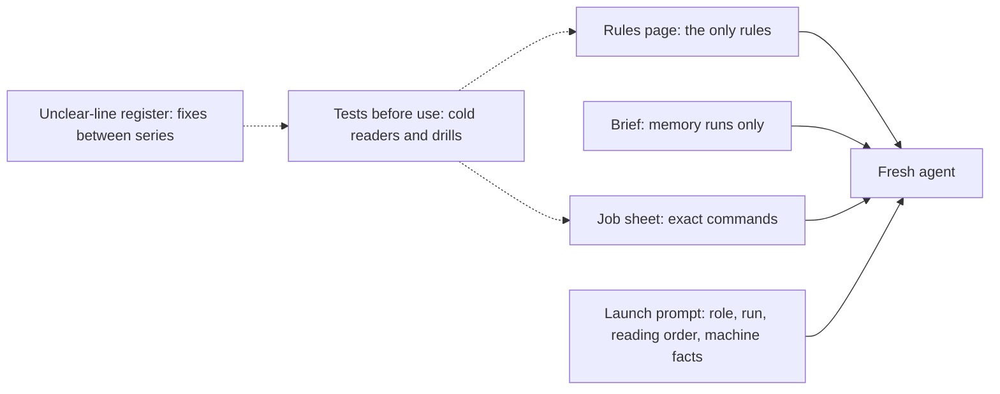
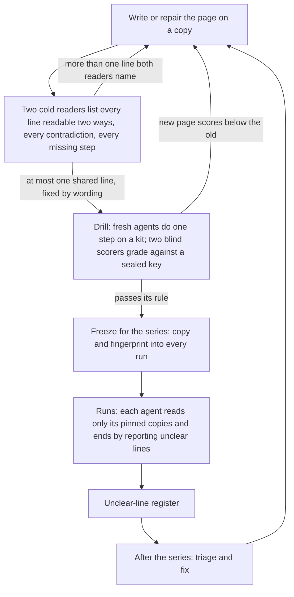
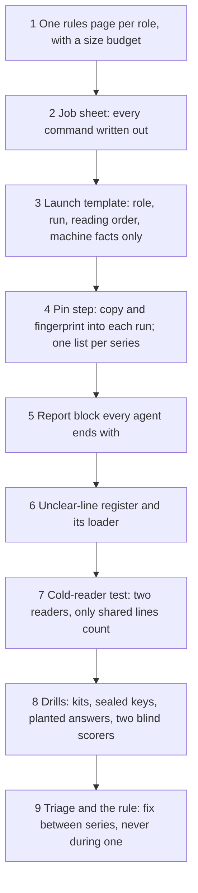

# 9. Agentic prompting

## 9.1 Introduction

Every piece of research in this system is done by a fresh AI agent (Chapter 7). A fresh agent knows nothing when it starts; everything it does comes from the few pages it is given at launch. If a line on a page can be read two ways, the agent does not stop to ask. It picks one reading and carries on, and the run is then built on a choice nobody made on purpose.

This is common: over half of a large set of real search questions had more than one reasonable meaning [4], and coding agents given under-specified tasks mostly fail to notice what is missing [5]. Here the research agent works alone, so the pages must be clear before the run starts. Length is a second problem: models use long inputs less reliably than short ones, and facts in the middle of a long input are missed most often [3].

This chapter explains how the system starts a fresh agent from a few short pages, keeps them fixed while runs use them, and tests and repairs them.

## 9.2 The concept

**Agentic prompting is the way the system starts a fresh agent from a few short, fixed pages that were first tested on other fresh agents, so that every agent in a series reads the same instructions and reads them the same way.**

Terms used in this chapter:

- **Rules page:** the one page holding a run's rules: what to read, which months may be used, the rounds and pass rules, the files the agent may write, what to do when a tool refuses. It wins over any other page.
- **Brief:** the short summary of the knowledge store (Chapter 7). Only memory runs receive it.
- **Job sheet:** the exact commands for every step of a run, written out in full, so the agent copies them instead of composing them.
- **Launch prompt:** the short message that starts the agent: its role, its run, the order in which to read the pages, and facts about the machine. Never a rule.
- **Pin:** a copy of a page placed in the run's own folder, with a fingerprint of its exact bytes, so the run reads that copy only and any change is detected.
- **Series:** a planned set of runs that are compared with each other (Chapter 11).
- **Cold reader:** a fresh agent that reads a page without being told what it means and lists every line that could be acted on in two ways.
- **Drill:** a small test in which fresh agents do one step of the real work on a prepared set of inputs (a kit), graded against an answer key sealed before any agent starts.
- **Unclear-line register:** the shared list of every line any agent has reported as unclear, with the words quoted, both readings and a proposed fix.

Three properties follow. There is one source of rules, so no agent has to choose which page to obey. The pages are fixed and fingerprinted, so runs in one series read the same words. And every page was read by fresh agents before a real run depended on it, so most unclear lines are found by a tester, not by a research agent halfway through a study.

## 9.3 How it works

The picture shows the life of a page: written, tested, pinned into the runs of a series, and repaired only after the series ends.

**A few pages, each with one job.** A research agent reads its rules page, then its brief if it is a memory run, then its job sheet. The launch prompt adds one item: a finished earlier run of the same kind, as a guide to file formats only, never as a source of numbers or ideas. A control run is never shown a memory run's work, since that would hand it the memory it is meant to go without. The rules page says what must be true; the job sheet says how to make it true, command by command. Each rule then appears once, and a command can be corrected without touching a rule. This follows Anthropic's advice to brief the model as a capable newcomer with no context [1] and to give it the smallest set of information that does the job [2].

**Short and pinned.** Each page has a size budget; the rules page of the alarm-design runs is under a hundred lines, with tables for the rounds and pass rules. When a run is built, the orchestrator copies each page into the run's folder and records its fingerprint; the agent reads only that copy, never the live page. Before a series, every page, template and tool it uses is fingerprinted in one list, rechecked at each run's start; any difference stops the series. A fix found during a series is written down and applied after it ends, unless a tool crash blocks every run. Otherwise two runs in one series could read different instructions, and comparing them would say nothing about the brief.

**Facts, never rules, in the launch prompt.** The launch prompt carries what is true of the machine: that an old path prefix means the home folder, which form of a shell command this machine needs, which job runner is the live one, how to wait for a job. The agent cannot know these, and they do not change the study. The prompt says the rules page wins over everything, the prompt included: a rule slipped into a launch prompt would be one no reader tested and no fingerprint covered.

**Every agent reports what was unclear.** Every agent ends with the same short report block: each unclear line quoted exactly, with both readings and a fix, and any time it wasted. The orchestrator loads the blocks into the register, so each problem lands on the page that caused it.

### Cold readers

A cold reader is given exactly two pages, the rules page and the job sheet as pinned for one run, plus the report format, and is told to open nothing else. It runs nothing. It goes line by line, table cells included, and asks: could a careful agent who read only this line do two different things? It marks lines with two readings, pairs of lines that cannot both be followed, and steps the page asks for without giving what they need. Being sure which reading is meant is no reason to leave a line out: the fix makes the line say it, so no later agent has to work it out again.

Two readers work without seeing each other's report, and a line counts only when both name it. This is usability inspection, where each independent inspector finds a share of the problems and a second one adds and confirms [6], combined with the cognitive walkthrough, which asks at each step whether the user will know what to do [7], with an agent as the user.

On one real run of the alarm-design series, the two cold readers marked 50 and 47 lines, and 33 lines were marked by both. Across ten runs, single readers marked between 17 and 50 lines each, most with two readings, the rest missing steps and contradictions.

### A worked example: three real lines read two ways

These are real lines from the rules page of the alarm-design runs, each marked by cold readers on several runs.

| line on the rules page | reading A | reading B | fix proposed by the readers |
|---|---|---|---|
| "kept-vs-removed gap t >= 2.0" (round 3: fires a filter keeps against fires it drops) | signed: kept minus removed at least +2.0 | either direction: size of t at least 2.0 | "kept minus removed gap t >= +2.0" |
| ">= 300 waves in each of the two states" (round 2: the high and low halves of a split) | counted on the 15 minute result only | counted at both 15 minutes and 1 hour | "in each of the two states on the 15 minute line" |
| "Two failed tries on one step: stop" (when a tool refuses) | counted inside one working folder; a new folder after a fix starts at zero | counted across all of a round's working folders | "two stops on the same step of the same round, counted across its working folders" |

Each reading changes whether a round passes or a run stops. The third line shows repair across editions. Readers of an earlier edition asked what counts as a try at all; the next edition defined it (a job that ends in a refusal, not a resubmission after a time-out); readers of that edition then found the folder question. Each fix removed one reading, and the next readers found the next.

### Drills

A cold reader checks whether a page can be read two ways; a drill checks whether agents who read it do the work right. A drill takes one step of the real work (choosing an idea, sealing a forecast, writing a card) and builds a kit of the inputs that step would see, with the past result hidden. The key is sealed before any agent starts, and each item names the page that should teach it. Fresh agents of two models do the step, some on the old pages and some on the draft. Two blind scorers grade all answers mixed and unlabelled, together with two planted answers of known score, one good and one bad. The scoring counts only if both planted answers land within one point of their known totals and the scorers agree at an alpha of at least 0.80, a standard bar for agreement between coders [10]. If not, the disputed key line is given one meaning, sealed again, and the answers rescored.

The table is real: the drill on the research agent's pages, four fresh agents per version doing three steps of a run.

| measure | old pages | first draft (job sheet replaces a long run prompt) | second draft (its new error fixed) |
|---|---|---|---|
| share of the sealed key met | 98 percent | not comparable: the scoring failed its own check | 100 percent, against 97 percent for the old pages in the same round |
| unclear lines per research agent | about 15 (7 from the old run prompt alone) | about 10 | about 8.5 |
| tokens per research agent | about 182 thousand | about 146 thousand | about 155 thousand |
| agreement of the two scorers | 0.97 | under 0.80 when rescored | 0.97 |
| new problems | none | all four agents hit one new error in the job sheet | none |

The first draft's scoring did not count: the good planted answer missed its known total, and a mixed rescoring traced every disagreement to one key item that could itself be read two ways. That item was given one meaning and sealed again before the second draft was scored. The test is held to the same rule as the pages.

### Triage between series

In its first weeks the register collected about 2,400 rows, around 1,000 of them lines with two readings. After a series, a tool sorts every open row by whether its quoted words are still on the live page, already gone, or not checkable. A line is fixed when two or more agents reported it, or when one report is a blocker: a wrong number, a false label, use of future data, a way around a check, or a missing step. A question of rule design, such as where a pass bar sits, is not reworded away; it goes to the knowledge agent's proposal check or to the owner. A wording fix is drafted on a copy and read by two new cold readers; a change to what an agent must do is drilled old against new. Either goes live only between series. A page that does not improve after two repairs gets a redesign, or a tool that refuses the mistake, rather than more words.

## 9.4 How to build it

The components below are listed in the order they are best built, because each depends on the ones before it.

1. **One rules page per role,** within a size budget.
2. **A job sheet** with every command in full, its values filled in when the run is built.
3. **A launch template** per role: run, folder, reading order, machine facts, and a line saying the rules page wins.
4. **A pin step** that copies and fingerprints every page into the run, plus one list per series, rechecked at each run's start.
5. **A report block** every agent ends with: unclear lines quoted, wasted time, at most one proposal.
6. **The register,** with a loader that refuses an incomplete block; rows are never edited, a correction is a new row.
7. **The cold-reader test:** a prompt that limits the reader to the pages under test and asks for every line, even ones it is sure of; a page passes with at most one shared line.
8. **Drills:** a kit, a sealed key naming the page behind each item, two planted answers, two models, old and new pages, two blind scorers.
9. **Triage and the freeze rule:** what gets fixed, and that fixes wait for the end of a series.

## 9.5 What it makes possible

Because every agent in a series reads the same fixed pages, a difference between memory and control runs can be put down to the brief, not to a page that changed in between (Chapter 11). Because pages are tested first, most misreadings cost a tester a short reading, not a research agent an hour. Because every agent reports unclear lines in the page's own words, the pages improve from use, with evidence for each fix. And because rules live in one place and launch prompts carry only facts, a new kind of research reuses the same launch and test machinery with a new rules page (Chapter 7).

## 9.6 Conclusion

A fresh agent is only as good as the pages it starts from. This system gives it few pages, each with one job: one rules page, a brief for memory runs, a job sheet with exact commands, and a launch prompt that adds facts and never rules. The pages are short because long inputs are used less reliably [2, 3], and pinned because a series compares runs that must read the same words. They are tested the way usability practice tests an interface, with independent inspectors and a step-by-step walkthrough [6, 7], and tried in use and revised the way checklists are in aviation and surgery [8, 9]. Lines with more than one meaning are common and agents rarely notice them [4, 5]; the system finds them with cold readers, fixes them between series, and keeps each fix in a register with its evidence.

## References

1. Anthropic. *Be clear and direct*. Claude documentation, prompt engineering. https://docs.claude.com/en/docs/build-with-claude/prompt-engineering/be-clear-and-direct
2. Anthropic (2025). *Effective context engineering for AI agents*. Anthropic Engineering. https://www.anthropic.com/engineering/effective-context-engineering-for-ai-agents
3. Liu, N. F., Lin, K., Hewitt, J., Paranjape, A., Bevilacqua, M., Petroni, F., and Liang, P. (2024). Lost in the middle: how language models use long contexts. *Transactions of the Association for Computational Linguistics*, 12, 157-173.
4. Min, S., Michael, J., Hajishirzi, H., and Zettlemoyer, L. (2020). AmbigQA: answering ambiguous open-domain questions. *Proceedings of the 2020 Conference on Empirical Methods in Natural Language Processing*, 5783-5797.
5. Vijayvargiya, S., Zhou, X., Yerukola, A., Sap, M., and Neubig, G. (2025). Ambig-SWE: interactive agents to overcome underspecificity in software engineering. https://arxiv.org/abs/2502.13069
6. Nielsen, J., and Landauer, T. K. (1993). A mathematical model of the finding of usability problems. *Proceedings of the INTERACT '93 and CHI '93 Conference on Human Factors in Computing Systems*, 206-213.
7. Wharton, C., Rieman, J., Lewis, C., and Polson, P. (1994). The cognitive walkthrough method: a practitioner's guide. In J. Nielsen and R. L. Mack (eds.), *Usability Inspection Methods*, 105-140. Wiley.
8. Degani, A., and Wiener, E. L. (1993). Cockpit checklists: concepts, design, and use. *Human Factors*, 35(2), 345-359.
9. Gawande, A. (2009). *The Checklist Manifesto: How to Get Things Right*. Metropolitan Books.
10. Hayes, A. F., and Krippendorff, K. (2007). Answering the call for a standard reliability measure for coding data. *Communication Methods and Measures*, 1(1), 77-89.
