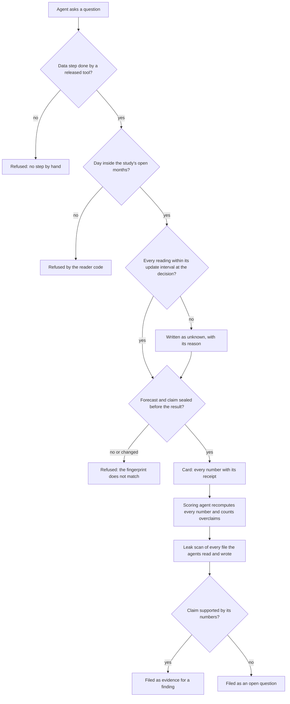
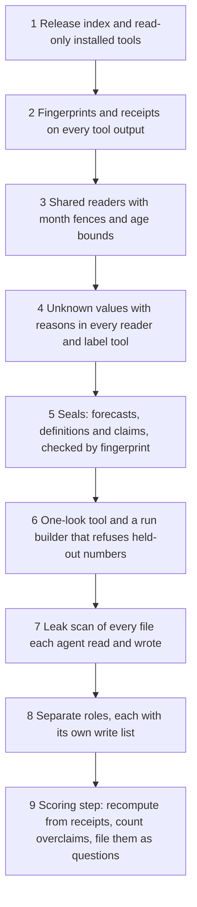

# 10. Agentic truthfulness

## 10.1 Introduction

This system is a set of computer programs and AI agents that study the cryptocurrency market and look for good moments to trade. It does paper research only: no real money is at stake in the studies described here. The agents do the research themselves: they choose an idea, run the tools, read the results and write what they found. Every later stage of the system, from strategy design to live trading, is built on what they report.

That makes one property more important than any other: what an agent reports must be true. An agent can be wrong in ways it cannot see itself, such as a value read a few minutes too late or a month it should not have looked at. It can fool itself, for example by trying many versions of an idea and keeping the one that happened to look best. And it can be tempted to look better than its numbers allow, because it is built to finish tasks and please the reader. Chapter 1 lists these challenges and counts how often each one happened here. This chapter is the other half: the design of the guards that answer them.

A warning in a prompt is not enough: agents told not to cheat often cheat anyway when the scorer is within reach [2, 3]. So the guards are built into the tools and the order of work wherever possible, making the honest path the only one that works.

## 10.2 The concept

**Agentic truthfulness is a set of guards, built into the tools and the order of work, that make every result an agent reports checkable by someone else, and that close the paths by which a result could look better than it is.**

Terms used in this chapter:

- **Guard:** a rule with a check behind it. A guard enforced in code refuses to go on; a guard enforced in text is checked after the fact by another agent.
- **Receipt:** the saved output of a tool that produced a number. Every number in a report points to its receipt.
- **Seal:** writing a forecast or claim down before its result exists and recording its **fingerprint**, a short code computed from the file's bytes that changes if a single byte changes.
- **Learning months:** the months a study may read freely to build and choose its rule.
- **Check months:** months kept aside and opened once, for one frozen rule.
- **Never-seen months:** months no study reads; only the owner can open them.
- **Held-out numbers:** results on months kept aside. They are kept from the agents who do or judge the research.
- **Leak scan:** a search of every file an agent read or wrote for held-out numbers or the names that point to them.
- **Update interval:** how often a new value of a reading exists, from a few seconds to one day (Chapter 3).
- **Overclaim:** a claim stronger than its numbers, for example "beats" with no comparison, or "because" with no reading that shows the cause.

```mermaid
flowchart LR
  subgraph Inputs
    T["Released tools do every data step"]
    F["Months fenced in the reader code"]
    I["Each reading at its own update interval"]
    U["Unknown stays unknown"]
  end
  subgraph Run
    S["Forecasts and claims sealed first"]
    R["Every number with its receipt"]
  end
  subgraph Checks
    B["Blindfold and leak scan"]
    O["Separate roles: nobody scores their own work"]
    C["Claims no stronger than their numbers"]
  end
  Inputs --> Run --> Checks --> K["Only checked results reach the knowledge store"]
```

Three properties follow. A result can be reproduced from its receipts by anyone, without trusting the agent that made it. A claim cannot be fitted to its result, because it was sealed first. And no agent can improve its own score by reading what it must not read, editing what it must not edit, or judging its own work.

## 10.3 How it works

The picture below follows one result from the first data step to the knowledge store. Each box is a guard; a refusal stops the run or turns the result into something weaker.

**Released tools do every data step.** No agent computes a number by hand or writes a tool inside a run. Every data step is a call to a released tool (installed, tested and listed in the release index), and runs cannot change the installed copies. This closes the shortest path to a false result: a quick script nobody tested.

**Every number has a receipt.** A number in a card cites the tool output it came from, with its fingerprint, so a second agent can recompute it from the receipt alone. A number with no receipt counts as a mistake, however plausible it looks.

**Seal before you see.** Before each round, the research agent writes its forecast with an 80 percent range and seals it. The alarm pipeline pins the alarm's definition and its claim by fingerprint, refuses a variant that changed after its seal, refuses to grade the same variant twice, and allows at most three graded variants per idea. This is the logic of preregistration [6]: the plan exists before the data, so the story cannot be bent to fit the numbers. The limit on variants answers backtest overfitting: the more versions of an idea are tried on the same months, the more likely the best one is luck [4].

**Months are fenced, in the reader code.** Every study names its learning months, its check months and its never-seen months before any work starts. For the alarm work, for example, the learning months run from September 2025 to January 2026. The fence is not a sentence in a prompt: the shared readers that every tool uses refuse a day outside the study's open months. Check months are opened through a one-look tool, once, for one frozen rule, and a second look is refused. Leakage of later information into the design step is one of the commonest reasons published machine-learning results fail to hold [1]; a fence in code is the direct answer.

**The blindfold and the leak scan.** Agents who do or judge the research never see held-out numbers. Only the orchestrator, the agent that builds and launches runs, opens the months kept aside: it reads the best round once, with its rule frozen, and reports in words only, for example "same sign". The run builder refuses to place a held-out number in a run's folder. After each run, the leak scan collects the held-out numbers and the names that point to them, and searches every file the research, scoring and knowledge agents read and wrote. It reports the file, line and kind of each hit, never the number, so the scan cannot itself leak, and each hit is opened by hand, because a number can match by chance. This follows the reusable holdout [5]: the more an analyst sees of held-out data, the less it can be trusted, so access is narrow and answers are coarse.

**One role per agent.** The research agent never scores its own run. A scoring agent reads only the card and its receipts, recomputes every number and records each mistake under a fixed key, so repeats can be counted. A knowledge agent files what was learned through one tool that refuses a row failing its checks (Chapter 7). Cold readers, fresh agents with no stake in the work, check the pages, and an outside reviewer on a different model reviews each tool before release.

**Each reading at its own update interval.** A decision may use a reading only if it is no older than that reading's update interval: a one-minute reading at most a minute old, a five-second reading at most five seconds. The tools measure the age of every reading at every decision and write it beside the value, so a breach is counted rather than guessed (Chapters 3 and 6).

**Unknown stays unknown.** When a tool cannot know a value, because of a hole in the data, an input too old for its bound, or a closed day, it writes unknown with the reason, never zero, "false" or a guess.

**Claims no stronger than their numbers.** The numbers rule says every comparison quotes both numbers and their source, and a cause needs a reading that shows it. The scoring agent counts every claim that breaks it, in every run, and the knowledge tool files such a claim as an open question, never a finding, so the next agent inherits the question, not the overclaim.

| guard | what it checks | enforced by | answers (Chapter 1) |
|---|---|---|---|
| released tools | every data step is a call to an installed, tested tool | code: read-only installs; count of steps by hand | 1.2, 1.4, 1.15 |
| receipts | every number cites its source file and fingerprint | code: recomputation by the scoring agent | 1.3, 1.4, 1.10 |
| seals | forecast, definition and claim fixed before the result | code: fingerprint checks; at most three graded variants | 1.2, 1.13, 1.14 |
| month fences | no day outside the open months is read | code: shared readers; one-look tool | 1.5, 1.14 |
| blindfold and leak scan | no held-out number in any file an agent read or wrote | code: run builder and leak scan | 1.5 |
| separate roles | nobody scores or files their own work | text, checked by the change log | 1.3, 1.4, 1.12, 1.18 |
| update intervals | no reading older than its interval at a decision | code: age measured at each decision | 1.5, 1.10 |
| unknown stays unknown | missing values carry a reason, never a number | code: the readers and label tools | 1.4, 1.10 |
| claim strength | no claim stronger than its numbers | text, counted per run by the scoring agent | 1.3 |

### Two real catches

The two cases below are real. In each, a guard found a problem in results already made, and the results were changed, not explained away.

| guard | what it checks | what it caught | what happened |
|---|---|---|---|
| each reading at its own update interval | the age of every reading at the moment of each alarm fire | the market classification read every value on a 15 minute grid, so readings were up to 14 minutes old at the fire | the lane of results built on it was set aside and redone on readings taken at the fire's own minute, at most 6 seconds old |
| claims no stronger than their numbers | every claim in a run's card against the numbers behind it | claims stronger than their numbers in 15 of 16 assessed runs, from none to six per run | each such claim was filed as an open question instead of a finding |

The first case in numbers. The market classification (Chapter 5) describes the whole market at each alarm fire. Its age column showed that it took every value at the last quarter-hour mark before the fire. Measured over 12 alarms and about 71,500 fire moments:

| measure | on the 15 minute grid | at the fire's own minute |
|---|---|---|
| readings measured | about 13.6 million | about 1.35 million (one alarm) |
| median age at the fire | 7 minutes | 6 seconds or less |
| oldest reading | 14 minutes | 6 seconds |
| share older than one minute | 88 percent | none |

The values were never from the future, so a look-ahead check alone would not have caught them. They were from the past but too old: a fall that began ten minutes before a fire could be missing from a market description read at the previous quarter hour. The guard caught it only because it measures the age of every reading against that reading's own update interval, rather than only asking whether the value was known.

## 10.4 How to build it

The guards are best built in the order below, because each depends on the ones before it.

1. **A release index and read-only tools.** A tool is usable in a run only once it is installed, tested from the installed copy and listed.
2. **Fingerprints and receipts.** Every tool output is saved with its fingerprint, and every card number cites one.
3. **Shared readers.** One set of readers, used by every tool, that refuses closed days and inputs older than their interval, and writes each reading's age beside its value.
4. **Unknown with reasons.** A fixed list of reasons, used by every reader and label tool.
5. **Seals.** A forecast slot before each round; definitions and claims pinned by fingerprint; a limit on graded variants per idea.
6. **The one-look tool and the run builder.** Check months opened once, by the orchestrator only, answered in words; no held-out number in any run folder.
7. **The leak scan.** Run after every run over every file the agents read and wrote.
8. **Separate roles.** Each role with its own launch, rules page and write list; a change log of who wrote what.
9. **The scoring step.** Recomputation from receipts, an overclaim count per run, and overclaims filed as questions.

## 10.5 What the guards make possible

Any finding in the knowledge store can be traced to the tool outputs behind it and checked by someone who never met the agent. A result on check months is a real test, not a second look. A market description says what a trader could have known at that second, and a breach shows up as a count. And because overclaims are counted per run, the system can see whether its agents are getting more honest over time (Chapter 11), rather than assume it.

## 10.6 Conclusion

Agents are fast, tireless and willing, and those same qualities make them dangerous to trust on their word: they reach for the scorer when the honest path is blocked [2, 3], and they report results that a careless or tempted analyst would also report. The guards in this chapter answer the known failures of empirical research with agents in mind: leakage [1] with month fences and update intervals in the reader code, the garden of tries [4] with sealed claims and a limit on variants, holdout reuse [5] with a blindfold and a leak scan, and the bending of stories to fit results [6] with preregistered forecasts. Separate roles and the numbers rule make sure that what reaches the next agent is what the evidence supports, and no more.

## References

1. Kapoor, S., and Narayanan, A. (2023). Leakage and the reproducibility crisis in machine-learning-based science. *Patterns*, 4(9), 100804. https://doi.org/10.1016/j.patter.2023.100804
2. Von Arx, S., Chan, L., and Barnes, B. (2025). *Recent frontier models are reward hacking*. METR. https://metr.org/blog/2025-06-05-recent-reward-hacking
3. Zhong, Z., Raghunathan, A., and Carlini, N. (2025). ImpossibleBench: measuring LLMs' propensity of exploiting test cases. arXiv 2510.20270. https://arxiv.org/abs/2510.20270
4. Bailey, D. H., Borwein, J. M., Lopez de Prado, M., and Zhu, Q. J. (2017). The probability of backtest overfitting. *Journal of Computational Finance*, 20(4). https://doi.org/10.21314/JCF.2016.322
5. Dwork, C., Feldman, V., Hardt, M., Pitassi, T., Reingold, O., and Roth, A. (2015). The reusable holdout: preserving validity in adaptive data analysis. *Science*, 349(6248), 636-638. https://doi.org/10.1126/science.aaa9375
6. Nosek, B. A., Ebersole, C. R., DeHaven, A. C., and Mellor, D. T. (2018). The preregistration revolution. *Proceedings of the National Academy of Sciences*, 115(11), 2600-2606. https://doi.org/10.1073/pnas.1708274114
