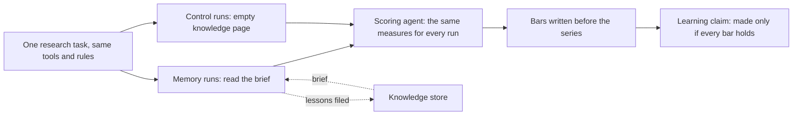
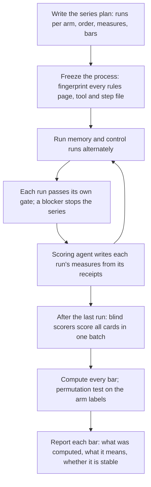
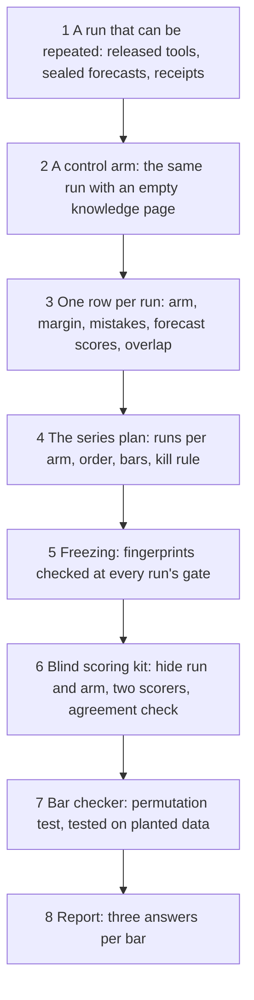

# 11. Measuring learning

## 11.1 Introduction

The learning loop (Chapter 7) is built so that each research agent starts from what earlier agents checked and filed. Building it is one thing; knowing that it works is another. A research agent that reads a brief may do better than one that does not, or it may only feel better informed. Its good result may come from the brief, or from a lucky idea, an easier task, a fixed tool, or a calmer week of data. An agent can also learn the wrong thing: a brief can steer every new run back to the same few ideas, so that results look steady while nothing new is found.

The system therefore tests "the agents learn" like any other claim: with a planned experiment, bars fixed before the data exist, and a test that tells a real difference from luck. This chapter explains how the experiment is designed, what it measures, how a difference is judged, and what a learning claim needs.

## 11.2 The concept

**Measuring learning means running the same research task many times, half of the runs with the knowledge brief and half without it, interleaved in a planned series, and comparing the two groups on measures and bars written before the first run.**

Terms used in this chapter:

- **Memory run:** a run in which the agent reads the brief, the adopted prompt additions and earlier memory runs' results; the knowledge agent then files what it learned.
- **Control run:** the same task, tools, rules page and rounds, with an empty knowledge page. Nothing it finds enters the knowledge store or any later prompt.
- **Arm:** the group a run belongs to: memory or control.
- **Series:** a planned block of runs, with the number of runs per arm and their order fixed in advance.
- **Yardstick:** the plainest alarm of the same kind and side, with no extra condition, graded the same way after the same costs; in this series, one that fires on forced selling alone. Every run is compared with it on the same months.
- **Lead:** how much more often the alarm's side wins the race (a move of two trading costs its way before one cost against it, here within 15 minutes) than at matched ordinary moments (Chapter 6), minus the same difference for the opposite side, in percentage points, counted once per wave (Chapter 13).
- **Margin:** a run's best lead minus the yardstick's lead. A positive margin means the run found something better than the plain alarm.
- **Repeated mistake:** a mistake the scoring agent records under a fixed key (Chapter 7) that an earlier run already made.
- **Rediscovery:** a run whose final alarm largely fires on the same waves as an alarm found before, or sits one threshold away from it.
- **Bar:** a pass rule in numbers, written before the series starts and never changed after a result.

## 11.3 How it works

### The series plan

A series is written down before its first run: ten runs, six memory and four control, in a fixed order that alternates the arms (memory, control, memory, memory, control, and so on). A memory run starts only after the one before it has been curated; control runs may run beside it, because they read nothing.

Inside the series the process is frozen. Every rules page, step file and tool is fingerprinted before the first run, and each run's gate checks the fingerprints again; a change stops the series, and fixes wait until it ends. Otherwise a better later result could come from a better tool rather than from learning.

### Five things to measure

Learning can show in several ways, so the series measures five, each from the run's receipts.

**Better results than the plain yardstick.** The margin is the main outcome. A run's best round must beat the yardstick by a stated amount, and the memory arm must beat the control arm on the average margin. Comparing with a fixed yardstick, rather than with zero, keeps the question honest: an alarm that only matches what the system already knew has not taught it anything.

**Fewer repeated mistakes.** The scoring agent records each mistake under a fixed key, so the system can count how often a run makes a mistake that an earlier run already made. If the brief works, memory runs should repeat fewer old mistakes than control runs, and later memory runs no more than earlier ones.

**Better calibrated forecasts.** Before each round the research agent seals a forecast: its expected lead, an 80 percent interval, and the probability that the round passes its rule. The forecast error is the gap between the expected and actual lead. The probabilities are scored with the Brier score, the average squared distance between the stated probability and the outcome, 0 or 1 [3]; the intervals are scored by how often the actual result falls inside them, which should be close to 80 percent. An agent that learns about its task should forecast it better.

**Better reasoning, scored blind.** A good number can come from poor thinking. After the last run, two fresh scoring agents score every run's card on a fixed reasoning rubric of 16 points: did the agent keep rival explanations alive, choose a test that could prove it wrong, forecast before seeing data, and so on. The cards are scored in one batch, with the run and its arm hidden, so the scorers cannot favour one arm. The two scorers must agree closely (an agreement statistic of at least 0.80 [7]) before their scores count.

**Fewer re-discoveries of old ideas.** Each run's final alarm is compared with every earlier alarm by the share of waves they have in common. A run that re-finds an old alarm has spent its effort on known ground. The series asks for at least three distinct alarms, with less than half their waves shared with any earlier alarm, among the memory runs' best results.

Two further checks guard against learning that only fits the months the agents can see: after each memory run the orchestrator reads its best round once on months the research agent never saw, and only the sign leaves that step; after the series, the best distinct alarms are opened once on later closed months.

### Judging a difference: the permutation test

With ten runs, far from bell-shaped, an ordinary formula is unsafe, so the series uses an exact permutation test [2, 4]. If the brief made no difference, the labels "memory" and "control" would be arbitrary, and any way of assigning four of the ten runs to the control arm would be as likely as the real one. There are 210 such ways. For each, the test computes the difference in average margin; the p-value is the share of the 210 that give a difference as large as the real one or larger. The bar asks for p below 0.10, which means at most 20 of the 210. The smallest p this series can ever give is 1 in 210, about 0.005, which is why a small series can show a difference but never an overwhelming one.

When several measures are tested, the chance that one of them passes by luck grows with their number. The series handles this by requiring every bar to hold together, not any one of them; where separate claims are made for separate measures, the standard tool is a step-down correction such as Holm's method [5].

### Why one good run proves nothing

Single runs vary far more than the effects the series looks for, because each run picks its own idea, good or bad for reasons the brief did not cause. In the series so far, the margins of memory runs range from +11.43 to -7.52 points, and of control runs from +3.79 to -10.16. A single memory run at +11 next to a single control run at +4 would look like clear proof, and it would mean almost nothing. The same caution applies to checks that look strict: the held-out sign check asks for the same sign in at least 4 of 6 memory runs, but a coin flip achieves that 34 percent of the time, so it can only warn, never prove.

### Why the arms are interleaved

If all memory runs came first and all control runs later, any change over time would be mixed into the comparison: a tool fixed in between, a different load on the machine, a model update, a better way of launching runs. Controlled experiments in industry run their variants at the same time for exactly this reason [1]. Alternating the arms in a fixed order spreads such drift across both, so that what remains between them is the brief.

### What a learning claim needs

A claim that the agents learn may be made only when the planned series is complete, the process stayed frozen and clean throughout, and every bar holds. Each bar is reported as three separate answers: what was computed, what it means, and whether it is stable. A pass on a weak bar, such as late memory runs against early ones on three runs each, is reported as a reading, not as proof. And the series carries a kill rule: if memory runs neither improve across the series nor beat the controls, the learning design is changed, not tuned, and a new series starts.

### A worked example: the filter study

Chapter 7 describes a study in the market lane where two memory versions reached average gains of +2.80 and +3.20 over random dropping of fires, while a control run with the same task and no brief reached +0.18. That is a large and encouraging difference. It is also one study, with one control run, so under the rules of this chapter it is a promising reading, not a measured learning effect.

### A worked example: the series so far

The table below is real. It was computed, read-only, from the one row per run that the series keeps, for the runs of the current series that have finished: three memory runs and four control runs out of the planned six and four. It is a reading of an unfinished series, not a proof, and no bar is computed on it.

| measure | memory runs (3) | control runs (4) |
|---|---|---|
| average margin over the yardstick at 15 minutes, points | +3.21 | -0.31 |
| average repeated mistakes per run | 3.3 | 2.5 |
| average forecast error of the predicted lead, points | 3.00 | 4.42 |
| runs whose final alarm re-found an old alarm | 3 of 3 | 4 of 4 |

Read plainly: the memory runs are ahead on the margin by about 3.5 points, but a permutation test on these seven runs (35 ways to relabel them) gives p of 10 in 35, about 0.29, far from the bar. Memory runs repeated slightly more old mistakes than controls, not fewer. Their forecasts were closer on average, but each arm's average is driven by one run that missed by 8 and 12 points. And every run in both arms ended on an alarm close to one found before; one memory run ended on an alarm whose numbers matched, to the second decimal, one an earlier memory run had already found. On these runs, the brief has not yet stopped agents from walking back to known ground. That is exactly the kind of result the series exists to show, before anyone claims that the system learns.

## 11.4 How to build it

1. **A repeatable run.** Every number comes from a released tool with a receipt, and forecasts are sealed before each round (Chapter 7).
2. **A control arm.** The run builder produces the same run with an empty knowledge page and refuses to give a control any brief or earlier result; a control that cites the knowledge store is a gate bypass.
3. **One row per run.** Arm, best lead, yardstick lead, margin, repeated mistakes, forecast error, Brier score, interval coverage, largest overlap with earlier alarms (the share of waves shared; the novelty check of Chapter 13 counts shared fires), rediscovery. Every bar is computed from these rows alone.
4. **The series plan.** Runs per arm, order, every bar in numbers, stop rules and kill rule, fingerprinted before the first run.
5. **Freezing.** Each run's gate re-checks every fingerprint; a change stops the series, which restarts from the first position.
6. **A blind scoring kit.** It hides run and arm, gives all cards to two fresh scorers in one batch, and checks their agreement.
7. **A bar checker.** One tool computes every bar, including the permutation test, and is itself tested on a planted difference it must find and a null it must not.
8. **The report.** Each bar as three answers, one line per run, and the kill line.

## 11.5 What it makes possible

With this in place, the system can say whether its learning loop helps, and on which measure, instead of assuming it. A change to the brief can be tested in a new series against the same control. A loop that improves numbers while narrowing ideas shows in the rediscovery measure, and one that improves numbers while reasoning gets worse shows in blind scoring. And an outside reviewer can repeat every bar from the run rows alone.

## 11.6 Conclusion

Whether agents learn is a claim about a difference between two groups of runs, and it is measured the way controlled experiments measure any difference [1]: the same task, with and without the treatment, interleaved in time, with the outcome and its bars fixed before the data exist. The arm labels are tested with an exact permutation test [2, 4], forecasts are scored against outcomes [3], reasoning is scored blind by scorers who must agree [7], and several measures must all hold together, the concern that corrections for multiple comparisons address [5]. The agent memory methods the loop builds on reported their gains against agents without memory [6, 8]; this chapter applies the same comparison to the system's own research, and accepts that a short series may show that the loop has not yet taught its agents what it was built to teach.

## References

1. Kohavi, R., Tang, D., and Xu, Y. (2020). *Trustworthy Online Controlled Experiments: A Practical Guide to A/B Testing*. Cambridge University Press. https://doi.org/10.1017/9781108653985
2. Ernst, M. D. (2004). Permutation methods: a basis for exact inference. *Statistical Science*, 19(4), 676-685. https://doi.org/10.1214/088342304000000396
3. Brier, G. W. (1950). Verification of forecasts expressed in terms of probability. *Monthly Weather Review*, 78(1), 1-3.
4. Good, P. (2005). *Permutation, Parametric and Bootstrap Tests of Hypotheses* (3rd ed.). Springer.
5. Holm, S. (1979). A simple sequentially rejective multiple test procedure. *Scandinavian Journal of Statistics*, 6(2), 65-70.
6. Shinn, N., Cassano, F., Gopinath, A., Narasimhan, K., and Yao, S. (2023). Reflexion: language agents with verbal reinforcement learning. *Advances in Neural Information Processing Systems 36*. https://arxiv.org/abs/2303.11366
7. Hayes, A. F., and Krippendorff, K. (2007). Answering the call for a standard reliability measure for coding data. *Communication Methods and Measures*, 1(1), 77-89. https://doi.org/10.1080/19312450709336664
8. Zhao, A., Huang, D., Xu, Q., Lin, M., Liu, Y.-J., and Huang, G. (2024). ExpeL: LLM agents are experiential learners. *Proceedings of the AAAI Conference on Artificial Intelligence*, 38. https://arxiv.org/abs/2308.10144
