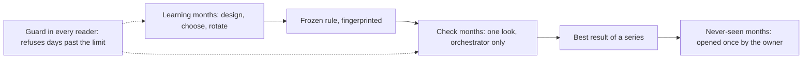
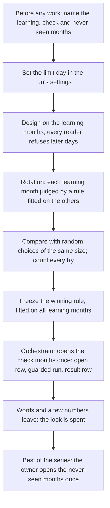
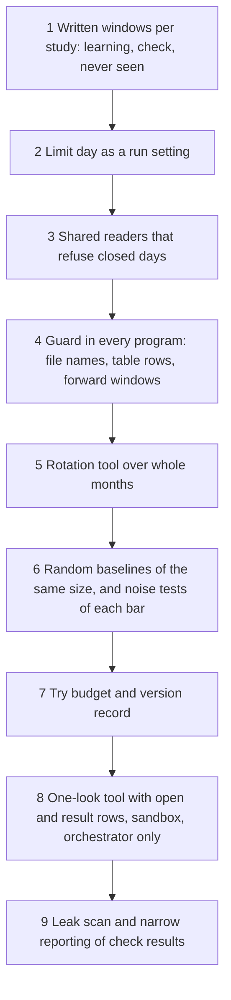

# 12. The methodology: learning, check and never-seen months

## 12.1 Introduction

Every study in this system asks whether a rule that marks moments in the market (an alarm, a filter, a strategy) does better than chance, after costs. The only evidence is history, about a year of market data, and history can be used up. Each time an agent tries a rule on a set of months, sees the result and tries again, the months teach it something about their own noise. After enough tries, the best rule fits those months because it was chosen on them, and on new months it fails.

AI agents make this worse. They try ideas fast, read whatever files are in reach, and report their best attempt with confidence (Chapter 1, "luck read as skill"). A sentence in a prompt such as "do not look at April" does not stop an agent that opens a file with April in it.

The methodology keeps part of the history unused. Before a study starts, it fixes which months may be used to design, which are kept for one honest test, and which no study may read. It enforces that split in code, counts the tries, and compares every result with random choices of the same size. This chapter explains the split, how it is enforced, and how to build it.

## 12.2 The concept

**Every study splits time before it starts into learning months, where rules are designed and chosen; check months, opened once for one frozen rule; and never-seen months, opened only by the owner; and the code that reads data refuses any day the study may not read.**

Terms used in this chapter:

- **Learning months:** the months a study may read freely, to design ideas, choose readings and set thresholds.
- **Check months:** later months kept aside. They are opened once, for one rule that was frozen beforehand, and the result is final.
- **Never-seen months:** the latest months, which no study reads. Only the owner of the system can open them, once, for the best result of a whole series.
- **Limit day:** the last day a study may read. It is a setting of each run, never a date typed into code.
- **Rotation:** inside the learning months, each month is judged by a rule fitted on the other months, in turn.
- **Frozen rule:** a rule whose every part (readings, thresholds, exits) is written and fingerprinted, so any later change is detected.
- **One look:** the single opening of the check months for one frozen rule. After it, the look is spent.
- **Random baseline:** the same action taken at random with the same size, for example dropping the same share of fires, as the bar a rule must beat.
- **Try:** one graded version of an idea; each try on the same months is another chance to be lucky.

Three properties follow. A result on the check months is a real test, because nothing about them shaped the rule. The fence is in the readers, so an agent cannot cross it by mistake or curiosity. And the never-seen months stay a clean reserve for the final decision, however often a series uses its check months.

## 12.3 How it works

### The split, named before the work

The windows are written before any result exists, and only the owner moves them. For the alarm work, research agents design on 10 September 2025 to 31 January 2026; February and March 2026 are each memory run's own check, read once by the orchestrator; the best rule is then graded on all of September to March. April to July 2026 are the check months for a series' best ideas, and August to November 2026 are never seen. For the filter study below, the learning months are September 2025 to March 2026 and the check months April to July 2026.

### Rotation: an honest first check inside the learning months

A rule scored on the months it was fitted on looks better than it is. Rotation, a form of cross-validation [3], gives a fairer first estimate without spending the check months. Each month in turn is held out: the readings and the cut are chosen on the other months and applied, unchanged, to the held-out month. Months are held out as whole blocks, which keeps the moments of one market episode together; for time series, blocked cross-validation of this kind has been found to choose models soundly [4].

Rotation has a limit: every version of an idea is rotated over the same learning months, so the best rotation score is itself a choice made on them. Rotation ranks versions; only the check months test the winner.

### Why a check month is used only once

If a rule fails on the check months and is changed and checked again, the check months have taught the design, and a later pass means little. A holdout reused while the analyst sees each answer stops being a holdout; to stay valid its use must be narrow and its answers coarse [2]. Choices made after seeing data create many hidden comparisons even when only one test is formally run [5]. So each frozen rule gets one look, and the outcome is final: a rule that fails is not repaired and re-checked; a new idea goes back to the learning months.

### The fence, in code

The split is enforced in three layers, so no single slip opens a closed window.

**Every reader refuses later days.** The shared reader code that every research tool uses refuses the check months as "out of sample" and the never-seen months by name. The one exception is an armed look: a job may read the check months only while a register holds an open row for that job and no result row yet.

**A guard around every research program.** Each run carries one setting, its limit day. A guard loaded into every program of the run refuses to open a file whose name holds a day or month after the limit, unless an allow list names that exact file with its fingerprint. A second check refuses a table holding any row past the limit, stopping at the first such row. A third finds rows whose outcome window (the moment plus the span its outcome is measured over) crosses the limit, because such an outcome also leaks later months.

**The operating system as a last wall.** During a look, the run also works inside an operating-system sandbox that refuses reads past the check window, which catches readers that bypass the guard.

### The one-look procedure

Only the orchestrator, the agent that builds and launches the runs, opens check months, and only through one tool.

1. **Checks before the look.** The rule is already graded on all the learning months; its definition fingerprint is the same everywhere it is recorded; the window asked for is exactly the check window; no earlier look exists for this alarm or definition. A window reaching into the never-seen months is refused by name. Any failed check stops the tool before the look is spent.
2. **The look.** The tool writes an open row in a register, runs the grade with the look armed under the guard and sandbox, and writes a result row with a decision word (pass, needs more months, stop).
3. **After the look.** The result row spends the look; a second look is refused as "already opened".

What leaves the look is narrow: words and a few agreed numbers, for example whether the gain kept its sign. Check-month results go only to the series' result rows, never to the knowledge store or a prompt, and a leak scan searches every file the research, scoring and knowledge agents read for them (Chapter 10).

### Tries count against a result

The best of many tries on one history usually does worse afterwards. The probability that the chosen variant is an overfit can be estimated [6], and a Sharpe ratio (return per unit of risk) can be deflated for the number of variants tried [1]. In finance, where thousands of signals have been tested, a new one needs a t-statistic (the size of an effect against its noise) near 3 rather than the usual 2 [7].

The system answers in three ways. The alarm procedure allows at most three graded variants per idea and refuses to grade one variant twice. Every version of a study is a row in its version record, so the number of tries is known when a result is judged. And a run whose design result passes but whose own check fails is read as search memory, not learning.

### Comparisons against random choices of the same size

Dropping a third of the fires changes the average even at random. So every result is compared with random choices of the same size: an alarm's lead against matched ordinary moments (Chapter 6), a filter's gain against 99 random drops of the same share inside each month, memory runs against control runs by a permutation test (Chapter 11). Bars are also tested on noise: in the filter study, families of pure noise passed one bar in 26 percent of trials with four families and 13 percent with twelve, so that bar is never accepted alone.

### A worked example: the filter study's rotation

The filter study asks whether a second round can drop the bad fires inside a group of alarm fires by reading the market and the coin at each fire. The table below shows its real design: seven learning months, each held out once, and the check months reserved for one winner.

| fold | month judged | months used to choose readings and the cut | what is computed |
|---|---|---|---|
| 1 | September 2025 (from the 10th) | October 2025 to March 2026 | gain in September: lead of the kept fires minus lead of all fires |
| 2 | October 2025 | September 2025, November 2025 to March 2026 | gain in October |
| 3 | November 2025 | September, October 2025, December 2025 to March 2026 | gain in November |
| 4 | December 2025 | September to November 2025, January to March 2026 | gain in December |
| 5 | January 2026 | September to December 2025, February, March 2026 | gain in January |
| 6 | February 2026 | September 2025 to January 2026, March 2026 | gain in February |
| 7 | March 2026 | September 2025 to February 2026 | gain in March |
| all | the seven gains, weighted by waves | the same for 99 random drops of the same share in each month | the out-of-month gain and its place among random drops; bars repeated on September to December alone and on January to March alone |
| check | April to July 2026 | none: the one winning version, fitted on all seven months and frozen | opened once by the orchestrator; pass if the pooled gain is above zero and at least 60 percent of alarm families gain |
| never seen | August to November 2026 | none | not read |

The first version shows what rotation catches. On months it was not fitted on, the filter raised the lead in five of six alarm families but badly hurt the sixth, worse than 98 of 99 random drops, and the pooled gain missed its bar (p 0.19). Leaving out the bad family would have passed (p 0.031), but that is choosing after the result, so the version did not pass. About ten versions were tried on the same seven months, which is why the plan states that only the April to July test is clean.

### A real case: a result that did not hold

In the system's first series of alarm runs, alarms were designed and judged on September to December 2025, and then read on later months.

| stage | alarms |
|---|---|
| passed their bars on September to December 2025 | 15 |
| held on later months | 5 |
| did not hold | 10 |

Ten of the fifteen looked like an edge on the months they were chosen on and not afterwards. A pass on the months a rule was chosen on is weak evidence, and the split, the one look and the count of tries exist for that reason.

## 12.4 How to build it

1. **Written windows.** Each study's plan names its learning, check and never-seen months before any result exists.
2. **A limit day as a setting.** Never a constant in code, so new months are a settings change.
3. **Shared readers** that every tool uses, refusing days past the limit and naming the never-seen months.
4. **The guard** in every program of a run: closed-day files, rows past the limit and outcome windows that cross it are refused; exceptions only by exact file and fingerprint.
5. **Rotation** over whole learning months, with the bars repeated on each half of the period to test stability.
6. **Random baselines** of the same size from fixed seeds, and each bar run on pure noise to learn how often it passes by chance.
7. **A try budget** per idea and a version record of every try.
8. **The one-look tool**: checks, open row, guarded and sandboxed grade, result row, refusal of a second look; orchestrator only.
9. **Narrow reporting** of check results, and a leak scan of every file agents read.

## 12.5 What it makes possible

A pass on the check months means something: the rule was frozen before those months were read, by agents who could not read them. Research agents still explore freely on the learning months, and rotation tells them which versions deserve a look. Memory and control runs can be compared on months neither arm saw. And the owner keeps never-seen months for the final decision, untouched by any study.

## 12.6 Conclusion

The methodology protects the system's only evidence from being used up by its own search. Time is split before any study into learning, check and never-seen months; the split is enforced by the readers, a guard in every program and an operating-system sandbox, not by instructions; the check months are opened once, by the orchestrator, for one frozen rule; every try is counted; and every result is measured against random choices of the same size. Each piece answers a known failure: reused holdouts [2], forking paths [5], backtest overfitting and its deflation for the number of tries [1, 6], and the higher bar that multiple testing demands in finance [7], while rotation over whole months [3, 4] gives an honest first check without spending the months kept aside.

## References

1. Bailey, D. H., and Lopez de Prado, M. (2014). The deflated Sharpe ratio: correcting for selection bias, backtest overfitting, and non-normality. *Journal of Portfolio Management*, 40(5), 94-107. https://doi.org/10.3905/jpm.2014.40.5.094
2. Dwork, C., Feldman, V., Hardt, M., Pitassi, T., Reingold, O., and Roth, A. (2015). The reusable holdout: preserving validity in adaptive data analysis. *Science*, 349(6248), 636-638. https://doi.org/10.1126/science.aaa9375
3. Arlot, S., and Celisse, A. (2010). A survey of cross-validation procedures for model selection. *Statistics Surveys*, 4, 40-79. https://doi.org/10.1214/09-SS054
4. Bergmeir, C., and Benitez, J. M. (2012). On the use of cross-validation for time series predictor evaluation. *Information Sciences*, 191, 192-213. https://doi.org/10.1016/j.ins.2011.12.028
5. Gelman, A., and Loken, E. (2013). The garden of forking paths: why multiple comparisons can be a problem, even when there is no "fishing expedition" or "p-hacking" and the research hypothesis was posited ahead of time. Manuscript, Department of Statistics, Columbia University.
6. Bailey, D. H., Borwein, J. M., Lopez de Prado, M., and Zhu, Q. J. (2017). The probability of backtest overfitting. *Journal of Computational Finance*, 20(4), 39-69. https://doi.org/10.21314/JCF.2016.322
7. Harvey, C. R., Liu, Y., and Zhu, H. (2016). ... and the cross-section of expected returns. *Review of Financial Studies*, 29(1), 5-68. https://doi.org/10.1093/rfs/hhv059
