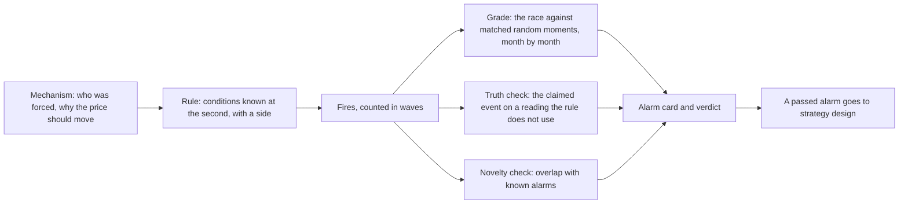
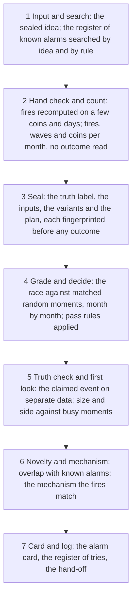
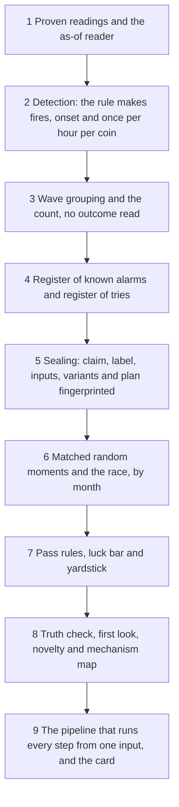

# 13. Alarm design

## 13.1 Introduction

The system looks for good moments to trade cryptocurrency. Before it can decide how to trade, it needs a way to find the moments worth looking at. An alarm is that first step. It is a rule that watches every coin, second by second, and marks the moments when something unusual is happening.

Finding unusual moments is easy. Finding moments that mean something is hard. A rule built by trying many conditions until one looks good will nearly always find something that looks good on past data and fails afterwards. A rule that fires on the same market move on fifty coins at once can look like fifty successes when it is really one. A rule can also mark a moment that is real but too late: the move it detects has already happened, and nothing is left for a trader.

Alarm design is the part of the system that guards against these traps: what an alarm must claim before any result is seen, how its fires are counted, how it is graded against ordinary moments, and how its claim and its novelty are checked. Tools run these steps in a fixed order; a research agent writes the idea and reads the results. This chapter explains what an alarm is, how the process works, and how to build it.

## 13.2 The concept

**An alarm is a written rule that marks moments on a coin, using only what was known at the second each moment happened, and says which way the price should go next: the move comes back (a fade) or it goes on (a follow).**

Terms used in this chapter:

- **Fire:** one moment the rule marks: one coin at one second, with its side, fade or follow.
- **Mechanism:** the written reason the alarm should work: who was forced to trade, and why the price should move afterwards.
- **Wave:** fires on any coin within 30 minutes of each other, counted as one event (Chapter 6).
- **Matched random moments:** for each fire, three ordinary moments chosen to resemble it but not marked by the alarm; the alarm is always judged against them.
- **The race:** for each fire and each random moment, does the price move two round-trip trading costs the alarm's way before it moves one cost against it, within 15 minutes or one hour?
- **Lead:** how much more often the alarm's side wins the race than at the random moments, minus the same figure for the opposite side, in percentage points.
- **Yardstick:** the lead of the plainest alarm of the same kind and side, with no extra condition, graded the same way after the same costs; for the alarm below, one that fires on the price move alone. A new alarm must beat it to add anything.
- **Truth check:** a test of whether the event the alarm claims really happened, on a reading the rule does not use and never on price.
- **Novelty check:** how many of the alarm's fires are fires of an alarm already known. The learning loop's run table also records the share of waves shared with the nearest earlier alarm (Chapter 11).
- **Alarm card:** the alarm's final record: claim, mechanism, rule, counts, grades, checks and verdict.

An alarm is not a trading strategy. It answers "is this happening?", not "how do I make money?". An alarm can be true, detecting exactly what it claims, and still leave nothing to earn after it fires. The system therefore grades an alarm twice, once on whether its claim is true and once on whether its side wins against ordinary moments, and leaves the money test to strategy design, which a later edition of this document describes.

## 13.3 How it works

### Mechanism first

Every alarm starts with a short written claim, sealed before any data is read. It names who is forced to trade and what they must do: a trader whose leveraged position is closed by the exchange must sell into the bids, at once, whatever the price. It says why the price should still move after the fire, and why faster traders have not already taken that move. It states the side, the expected number of waves per month, and the event it claims to detect.

Starting from the mechanism, not from the data, keeps an alarm from being a pattern found by searching. Forced trading is a well-studied source of price moves that later reverse. When traders must sell to meet margin calls, their selling drains liquidity, and the falling price forces further selling: a liquidity spiral [2]. When funds are forced to sell for reasons that carry no information about value, prices are pushed away from value and come back afterwards [3]. Crypto perpetual futures, where positions are closed automatically at fixed margin levels, produce large chains of such forced closes [4]. An alarm built on a mechanism like this can be checked step by step; one without a mechanism cannot.

### One event per wave

A sharp market fall can make one rule fire on fifty coins within minutes. Counted as fifty independent results, those fires would overstate both the average and the confidence. The system therefore groups fires into waves: a fire more than 30 minutes after the previous one, on any coin, starts a new wave, and every count, average and luck test uses waves as the unit. On a single coin, the rule fires only at the start of an event and then waits before it can fire again (one hour in the example below). This is the system's answer to a problem every study of overlapping events faces: outcomes that share the same market moment are not independent and must not be weighted as if they were [5].

### The pipeline

Once the claim is sealed, the research agent writes one input: the idea, the rule, the side, the claim and the months to read. A pipeline of tools then runs every step in a fixed order and records each step's numbers, copied from the tool's own output, never typed. The steps fall into seven groups.

**Input and search.** The register of known alarms is searched for the same idea and the same rule, so an old idea is not tried again under a new name.

**Hand check and count.** The fires are computed a second time, independently, on a few coins and days, and the two must agree. The count of fires, waves and coins per month reads no outcome, so the rule can be adjusted on it without seeing whether it works. A useful alarm has about a thousand waves over the research months; a month counts only with at least 30.

**Seal.** The truth label, the inputs, each variant and the plan are fingerprinted before any outcome is read. A gate accepts only inputs whose definitions are proven (Chapter 4). Every graded variant enters a register of tries, so the number of attempts is always known.

**Grade and decide.** Each fire and its three matched random moments run the race, on both sides, at 15 minutes and one hour. Costs are built into the race, so a rule that only finds moves smaller than the cost cannot pass. The race is a fixed form of the triple-barrier label: a profit barrier, a loss barrier and a time limit [5]. The first pass rule needs a lead of at least 3 points in at least two of every three counted months. The second adds a luck bar: a pooled t-statistic of at least 3, not the usual 2, because with many rules tried a t of 2 is found by chance far too often [6]. The alarm must also beat the yardstick, the plainest alarm of the same kind and side, graded the same way after the same costs.

**Truth check and first look.** The truth check asks whether the claimed event happened at the fires more often than at matched random moments, on a reading the rule does not use and that is not price. The card says whether the alarm detects an event under way or predicts one. Where the rule's own inputs can move the label mechanically, the check is repeated with that effect removed. The first look, run only after a pass, asks whether the moment offers enough movement, and which way, against equally busy random moments.

**Novelty and mechanism.** The novelty check measures what share of the alarm's fires are also fires of a known alarm on the same side. At 50 percent or more the alarm is a copy; from 40 to 50 percent it is near; below 40 percent it is new. A tool then matches the fires against a written map of mechanisms and records which one they fit.

**Card and log.** The pipeline writes the alarm card, logs the result in the register of tries and hands the alarm on.

### Grading is not money

The grade never puts one fixed profit target and stop on all fires: that tests one arbitrary trade, not the alarm. The full money test, with real entries, exits and exchange costs, belongs to strategy design. An alarm that passes is a candidate; one whose claim is true but whose side does not win is kept as context, a warning that something is happening, not a trade.

### The three rounds of an alarm run

In the learning loop (Chapter 7), an alarm run takes one idea through three rounds, each with its own sealed claim and a forecast written before the grade. Round 1 grades the first rule. If that rule adds a condition to a known set, a paired control is graded too: the same rule without the new condition, to show what the condition adds. After each round, the waves are split by market state, to ask why the alarm works in some markets and not others. Later rounds grade a revised rule chosen from that evidence. An idea may have at most three graded versions, all kept in the register of tries. The run ends with its best round, compared with the yardstick.

### The forced-selling family: a real alarm

The example below is real: one alarm graded by the pipeline on the seven research months. Its rule fades a sharp fall of a coin when three things happen together: traders holding leveraged long positions are forced out on Binance (forced long sales in the last 15 minutes above the coin's own 90th percentile), positions are leaving on a second exchange, Hyperliquid (its open interest, the total of open positions, is falling), and the forced sales make up a high share of all aggressive selling (above the coin's own 80th percentile). The fall itself must be in the coin's own top 1 percent of 15-minute moves. The mechanism: the selling is mostly forced, not informed, so the price should come back once the forced sellers are gone.

| line | value | what it means |
|---|---|---|
| side | fade | the alarm bets that the fall comes back |
| fires and waves counted | about 6,800 fires on 52 coins in about 1,300 waves; up to 60 fires in one wave | one wave can hold many coins, which is why waves, not fires, are counted |
| lead at 15 minutes | +11.93 points (t 4.97) | after a fire, the fade won the race about 12 points more often than at matched random moments, beyond what the opposite side gained; the t is well above the bar of 3 |
| lead at 1 hour | +11.59 points (t 4.83) | the same advantage holds over a longer window |
| waves graded | 1,127 | the number of independent events behind the lead |
| months passing | 7 of 7 | the lead met the monthly rule in every research month, not only on average |
| yardstick | +5.88 points at 15 minutes (t 3.42), 5 of 7 months | the plain fall alone; the alarm roughly doubles it |
| truth check | Binance open interest fell by at least 0.5 percent in 10 minutes at 29.5 percent of fires against 5.2 percent of matched random moments; gap +0.24 (interval +0.22 to +0.27) on 1,191 waves | the claimed event, forced exits seen on a second reading that the rule does not use, is real; the gap stays at +0.23 with the rule's own flow removed |
| first look | needs more months (side) | the side is promising, but not yet established by that test |
| mechanism | forced out | the fires match the mapped mechanism of forced long exits |
| novelty | copy: 64 percent of its fires, same side, are fires of a known alarm | most of what this alarm finds, an alarm already kept finds too |

The three rounds of this run, from its card:

| round | change | lead at 15 minutes | t | months passing | waves |
|---|---|---|---|---|---|
| 1 | the rule above | +11.93 | 4.97 | 7 of 7 | 1,127 |
| 2 (the paired control) | forced share removed | +10.73 | 4.56 | 6 of 7 | 1,218 |
| 3 | forced share threshold raised from the 80th to the 90th percentile | +9.72 | 3.60 | 6 of 7 | 853 |

The run learned three things. The forced share adds about 1.2 points of lead and the seventh month over the legs alone. The stricter threshold removes about a quarter of the waves and turns March negative. And the lead decays from about +28 points in September to about +3 in February and March, so the later months are the weak spot. The verdict follows the evidence: the claim is true and the side wins, but the alarm is mostly a copy of one already kept, so its value is the small amount it adds, not a new discovery.

### Failures already made

The rules above come from mistakes already made. An alarm that fired a median of 40 seconds after the peak of forced selling detected the event perfectly and left nothing to trade. Thousands of fires turned out to be a few hundred market events. Some results held only because of two crash days, so tables also show results without them. Comparisons with calm moments flattered every alarm, so random moments are matched on activity.

## 13.4 How to build it

The components below are listed in the order they are best built, because each depends on the ones before it.

1. **Proven readings,** each read as of the fire's second (Chapters 4 and 6).
2. **Detection:** a tool that turns a rule into fires with a side, at the onset of each event, with a waiting time per coin.
3. **Waves and the count,** before any outcome is read.
4. **Registers:** one of known alarms, searched before a new one starts, and one of tries, written before each result exists.
5. **Seals** on the claim, label, inputs, variants and plan, so any later change is visible.
6. **Matched random moments and the race,** with costs inside it, both sides, two windows, month by month [1, 5].
7. **Pass rules,** the yardstick and the luck bar, written once and applied by a tool.
8. **The checks:** truth, first look, novelty and the mechanism map.
9. **The pipeline and the card:** every step from one input, a named reason at every stop.

## 13.5 What it makes possible

Every new idea is tested the same way, against the same random moments and yardstick, and every attempt is counted. An agent gets a result it cannot bend, because the claim, rule and plan were sealed before the outcome existed. The novelty check stops the system rediscovering its own alarms. A passed alarm reaches strategy design with its mechanism, its labelled fires and its weak months already known.

## 13.6 Conclusion

An alarm is a rule that detects a forced event and says which way the price should go. Alarm design makes the claim come first, counts one event per wave, grades the side against matched random moments with costs inside the race, month by month, and checks the claimed event on separate data. The method follows the event study, which measures each event against a normal benchmark [1], and the triple-barrier labelling and overlap weighting of financial machine learning [5]. It rests on the economics of forced trading and liquidity [2, 3, 4], and its bar for luck follows the warning that a strategy found among many tries needs a much higher standard of proof [6].

## References

1. MacKinlay, A. C. (1997). Event studies in economics and finance. *Journal of Economic Literature*, 35(1), 13-39.
2. Brunnermeier, M. K., and Pedersen, L. H. (2009). Market liquidity and funding liquidity. *Review of Financial Studies*, 22(6), 2201-2238.
3. Coval, J., and Stafford, E. (2007). Asset fire sales (and purchases) in equity markets. *Journal of Financial Economics*, 86(2), 479-512. https://doi.org/10.1016/j.jfineco.2006.09.007
4. Garcia Seuma, R. M. (2026). Where does the criticality live? Early-warning signals are event-heterogeneous across seven crypto-perpetual liquidation cascades. arXiv preprint. https://arxiv.org/abs/2607.27070
5. Lopez de Prado, M. (2018). *Advances in Financial Machine Learning*. Wiley.
6. Harvey, C. R., and Liu, Y. (2015). Backtesting. *Journal of Portfolio Management*, 42(1), 13-28.
