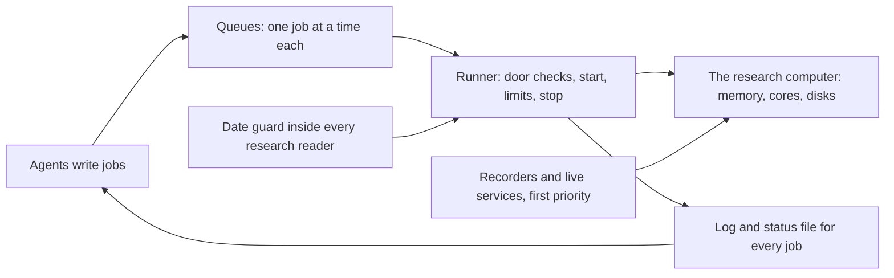
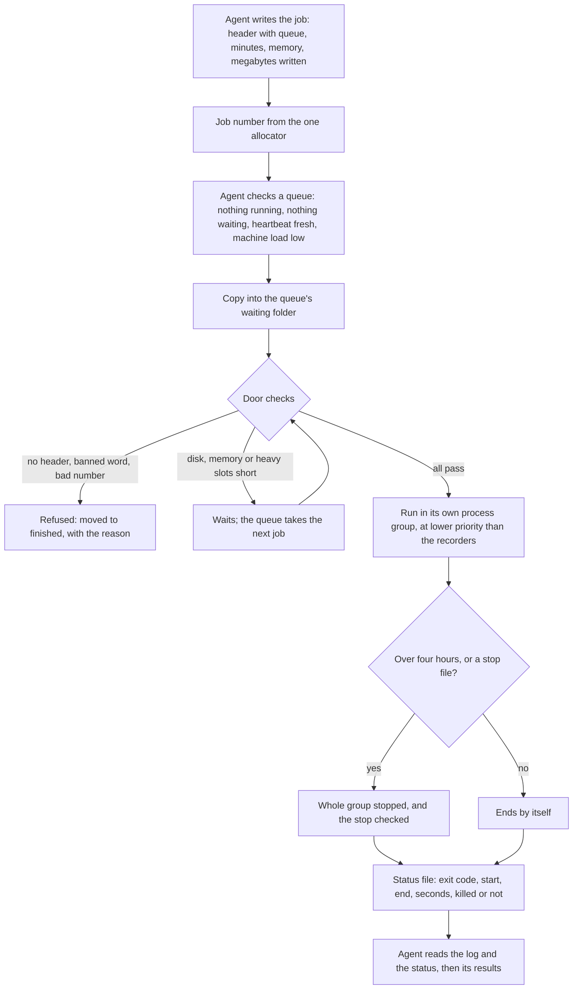
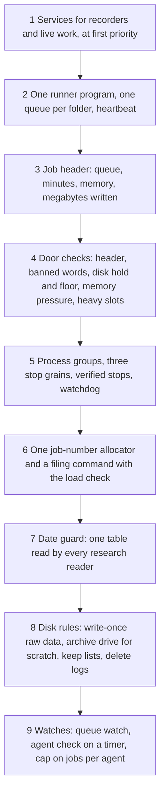

# 15. Infrastructure and runs

## 15.1 Introduction

Everything in this system runs on one research computer. The recorders that write the market data (Chapter 2) run on it day and night. The nightly builds that turn the raw data into metrics (Chapter 3) run on it. The research jobs of every agent, the tests of every tool and the releases (Chapter 16) run on it too. Several AI agents work at the same time, and each of them can start work on the machine.

Sharing one machine this way is cheap, but it has three dangers. The first is that one heavy piece of work starves the rest: a large job takes the memory, the machine starts swapping memory to disk, everything slows down, and a recorder that falls behind loses market data that can never be recorded again. The second is that an agent does something it should not: deletes a file, rewrites raw data, changes the code history, or reads days of data a study is not allowed to see. The third is that work disappears quietly: a job that never ends, an agent that stops answering, a disk that fills up until every job fails.

Agents forget rules between sessions (Chapter 1) and many act at once without seeing each other, so care alone is not enough: the infrastructure puts the rules into the machinery itself. This chapter describes how work is filed and run, what limits every job declares, which actions are refused, how disk space is kept, and how running agents are watched.

## 15.2 The concept

**Every piece of data work on the research computer is a written job that declares its time, memory and disk, passes a check of its text, waits in one queue, and is started, limited and stopped by a runner, never by the agent that wrote it.**

Terms used in this chapter:

- **Job:** a short text file of commands, with a header that says what it is, which queue it goes to, how long it should take, how much memory it needs at most, and how many megabytes it writes.
- **Queue:** a folder the runner watches. A job is filed by copying it into the queue's waiting folder. There are about 38 queues, each with its own runner.
- **Runner:** a small program that takes one job at a time from its queue, checks it, runs it, writes its log and its status, and moves it to the finished folder.
- **Door checks:** the checks a runner makes before it starts a job: the header, the banned words, free disk, memory pressure and the number of heavy jobs already running.
- **Heavy job:** a job that declares more than 4 GB of memory, or declares none. Only a fixed number of heavy jobs may run at once across all queues.
- **Banned word:** a command a job text may not contain, such as delete, change the code history, act as administrator, shut down, or wait for a fixed time.
- **Date guard:** the one table of date windows that every research reader asks before it returns a day of data.
- **Scratch:** the working files a job writes while it runs, kept on a large archive drive, not on the computer's own disk.
- **Heartbeat:** a line each runner rewrites every two seconds, so anyone can see it is alive.

Three properties follow. An agent never needs the power to run long work itself, so it can be given almost none (least privilege [3]). Every limit is written in the job before it runs, so the machine can refuse or hold a job before it does harm. And every job leaves a log and a status file, so what ran, for how long and with what result can always be checked afterwards.

## 15.3 How it works

**Why jobs at all.** An agent reaches the computer through a sandbox in which nothing it starts outlives one call. Long work can therefore only run outside the agent. The runner is that outside hand: the owner starts it once, and from then on an agent drops a job file into a queue and reads the log when it ends.

**Declared limits.** Every job declares its expected minutes, its peak memory and the megabytes it writes, in its first ten lines. The memory figure is the measured peak of the same step plus 20 percent; the write figure is measured from the run folders after a first run plus 20 percent. A missing or malformed figure is refused at the door: a job that does not say what it writes cannot be priced against the disk. Declarations are checked against reality: one job declared 16,000 MB of memory under a measured peak of 22,335 MB, and four release jobs declared 40 MB of writes but wrote about 350 MB each. Both became written lessons with new rules.

**Door checks.** Disk is guarded by two numbers. Under the first (about 12 GB free) nothing starts at all. The second (about 11 GB) is per job: if free space minus the job's declared writes would fall under it, that one job waits and the queue moves on to the next, so a small job never waits behind a large one. Memory is guarded by the operating system's own pressure level, not by the "free memory" figure, which on this machine is filled with cache by design; at critical pressure no job starts. A heavy job must also take one of a fixed number of heavy slots, shared by all queues.

**Banned words.** The runner strips comments from the job text and refuses any job that contains a command to delete, change the code history, act as administrator, shut down or restart the machine, or write raw bytes to a device. Team rules add fixed waits and time-outs written into the job text, because measured fixed waits once took 210 of the 262 seconds of one job. Commits to the code history go through one wrapper only, and only on one queue, so two commits can never collide.

**One queue at a time, never behind another team.** Each queue runs one job at a time. The parallelism comes from having many queues, not from running several jobs in one. Before filing, an agent checks that the chosen queue has nothing running, no real job waiting and a fresh heartbeat, and that the machine's load is below a set level. A small job never sits behind another team's long job. Job numbers come from one allocator only: an agent that used a copy of the allocator once claimed 37 numbers that other agents already held.

**Stopping.** A job can be stopped alone, a whole queue can be stopped, or every queue at once. The global stop is "sticky": no runner starts while it exists. Every job runs in its own process group, and a stop reaches the whole group, then checks that the processes are really gone. In one real case a job reported as stopped had kept running underneath for another 2 hours 37 minutes. A fixed watchdog stops any job after four hours. Inside a job, a heavy command can be wrapped in a memory guard that reads the memory of the whole process tree twenty times a second and stops the group at its cap. A queue watch flags runners with old heartbeats, jobs running past their declared minutes, and waiting jobs that could move to a free queue.

**Priority for the recorders.** The recorders and the live services run as system services, not as runner jobs, and every runner job starts at a lower scheduling priority, so the operating system serves the recorders first. A long job chain that refiled itself was once stopped by the four-hour watchdog and the live chain was down for 35 minutes; since then, anything that must run continuously is a service.

**The date guard.** Every research reader asks one table of date windows, by purpose, before it returns a day: learning months are readable, check months only through one armed look per design, and never-seen months are refused to every purpose (Chapter 12). No reader keeps its own copy, so a study cannot widen its own window.

**Disk rules.** Raw data, whatever its source, is never edited and never deleted, on any drive, because every other file can be rebuilt from it; it is treated as write-once storage, the practice regulators require for trading records [4]. Before any delete list is drawn up, the candidates are opened and searched for raw data, archive indexes included; a folder's name and an owner's answer are not enough. This rule came from a removal of about 1 TB of old archives in which seven subfolders could not afterwards be proven free of raw data. Run outputs and scratch live on a large archive drive, with a budget per run; the computer's own disk keeps only reviewed final files. A delete receipt states both the file sizes and the disk space actually freed, because the two differ: one receipt said about 59 GB removed while the drive gained about 153 GB.

**Cleaning scratch.** Each agent cleans only its own finished scratch, and does it itself, without waiting for anyone. It keeps a written list: all result files and receipts, and the stores of the last two finished runs, because a later step reads them again (deleting them once broke six later splits). It deletes only working files of finished jobs, and writes the list of what it deleted into a log. Deletes anywhere else go through the data keeper and the owner.

**Watching agents.** The orchestrator checks every running agent every three minutes: its time log, its stop files, its jobs on the machine and the checks of its current round (Chapter 7). An agent that goes silent is stopped and replaced by a fresh agent that resumes from the same run folder. In one real case an agent went quiet 30 minutes after its last export; it was stopped and a resume agent finished the run. Two others once stalled for three to four hours overnight before anyone noticed; a check on a timer sees such silence within minutes.

### A worked example: one job's life cycle

The table follows one real research job, a split of a finished alarm round by one market reading, from writing to result.

| step | what happens | real values |
|---|---|---|
| declare | the agent writes the header | queue named; 15 minutes; 3,000 MB memory; 50 MB written; one core; "never deletes" |
| number | the number is claimed from the one allocator | one new number, unique across all agents |
| banned-word check | comments stripped, text searched | no banned word; accepted |
| queue | the agent picks a free queue | nothing running, nothing waiting, heartbeat fresh |
| door checks | disk, memory, heavy slots | 153,849 MB free, minus 50 MB, far above the 11,264 MB floor; memory pressure normal, 51,773 MB free; 3,000 MB is under the 4,096 MB heavy line, so a light job, no slot needed |
| run | started at lower priority than the recorders | ran 9 seconds; the tool refuses to write into a folder that already exists |
| status file | written by the runner, not the job | exit 0; 9 seconds; not stopped |
| result | the agent reads the log and its new folder | one new output folder; the job declared 15 minutes and used 9 seconds |

### A real case: the burst

One morning one research team filed about 30 runner jobs across many free queues while another team's jobs also ran. Every job passed its own door checks; nothing limited the total.

| moment | what was measured |
|---|---|
| before | about 149 GB free on the computer's own disk |
| the burst | about 30 jobs from one team, plus another team's; machine load about 44, where the filing rule allows new jobs only under 16 |
| memory | about 29 GB of memory pushed out to swap on disk |
| disk | free space fell to about 123 GB: about 26 GB lost |
| recovery | a sweep of temporary files older than one day removed about 24 GB; free space back to about 146 GB |
| new rule | at most 2 runner jobs at once per agent; agents that only design run their filtering locally and file no jobs |

The lesson is that per-queue limits do not add up to a machine limit. Each queue ran one job, as designed; the danger came from one agent using many queues at once. The cap on jobs per agent closes that gap, and the load check before filing is now written into the filing command itself, because one release job was filed at load 18.85 and started within a second, too fast to withdraw.

## 15.4 How to build it

1. **Services first.** Run the recorders and live processes as system services with their own limits, above the priority of any research work.
2. **One runner program.** One script, given its queue folder as its argument, with waiting, running and finished folders, a log per job and a heartbeat. Never a second copy of the script.
3. **The header.** Fix the header lines and make the runner read them; a missing or malformed number is a refusal, never a guess.
4. **Door checks.** Make every limit a constant in the runner, so a job can never raise the line it is measured by. Prove each with a planted job (a banned word, no write figure, a fake low disk, a fake critical memory level) that must be refused or held.
5. **Stops.** Run each job in its own process group, stop the group, then confirm the processes are gone. Keep a global stop that cannot be cleared by accident.
6. **Numbers and filing.** One allocator for job numbers, and one filing command that checks the queue and the machine load in the same step as it files.
7. **The date guard.** One table of date windows, read by purpose by every research reader, changed only by a new edition on the owner's word.
8. **Disk rules.** Make raw data write-once by rule and by tooling; send scratch to the archive drive; give each agent a keep list and a delete log.
9. **Watches.** A read-only queue watch, an agent check on a timer, and a cap on runner jobs per agent and on agents at once.

## 15.5 What it makes possible

With these parts in place, many agents can work on one machine at once without starving the recorders or each other. Every number in the research can be traced to a job with a log, a status and its declared limits. An agent can be given the power to do research without the power to delete, rewrite history or read forbidden days. And when something goes wrong, the machine holds the record of what ran, which is how each lesson above was found and turned into a rule.

## 15.6 Conclusion

The research computer is shared by recorders, builds, research and agents, and the infrastructure keeps that sharing safe by moving every rule into the machinery: declared limits checked at the door, banned commands refused, one job per queue, stops that are verified, a single date table, write-once raw data, and agents watched on a timer. This follows how large clusters admit work: jobs declare their resources and are refused or stopped when they exceed them [2]. It applies the engineering view that overload must be handled by limits rather than hope, and that repeated manual work should be removed by automation [1]. It gives every program the least power it needs [3], and it treats raw data the way regulated firms treat their records: written once and never erased [4].

## References

1. Beyer, B., Jones, C., Petoff, J., and Murphy, N. R. (eds.) (2016). *Site Reliability Engineering: How Google Runs Production Systems*. O'Reilly Media. Chapters "Eliminating Toil" and "Handling Overload". https://sre.google/sre-book/table-of-contents/
2. Verma, A., Pedrosa, L., Korupolu, M., Oppenheimer, D., Tune, E., and Wilkes, J. (2015). Large-scale cluster management at Google with Borg. *Proceedings of the Tenth European Conference on Computer Systems (EuroSys 2015)*. https://research.google/pubs/large-scale-cluster-management-at-google-with-borg/
3. Saltzer, J. H., and Schroeder, M. D. (1975). The protection of information in computer systems. *Proceedings of the IEEE*, 63(9), 1278-1308.
4. U.S. Securities and Exchange Commission. *Rule 17a-4: Records to be preserved by certain exchange members, brokers and dealers*, 17 CFR 240.17a-4, paragraph (f)(2): electronic records kept in a non-rewriteable, non-erasable format, or with a complete time-stamped audit trail. https://www.law.cornell.edu/cfr/text/17/240.17a-4
