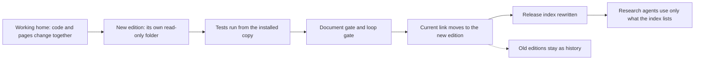
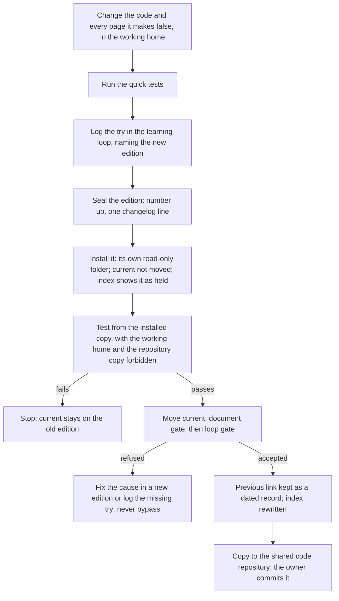
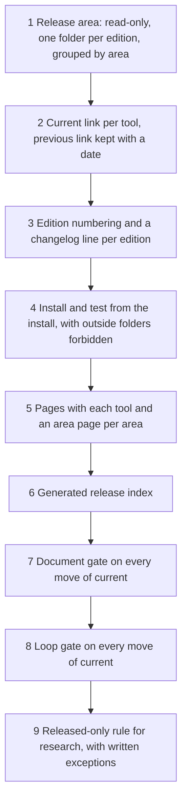

# 16. Releases and versioning

## 16.1 Introduction

Every number in this system comes from a tool. A research agent does not compute anything by hand: it calls a tool, the tool writes a receipt, and the receipt is what the scoring agent checks (Chapter 7). That only works if everyone agrees on which tool, in which edition, produced the number. If two agents use two different copies of the same tool, their results cannot be compared. If an agent uses a copy that is still being changed, its result may not be reproducible a day later. And if an agent cannot tell which tools exist, it will build one that already does.

The last problem is not hypothetical. Early in the project an agent spent about two hours building a tool to measure one property of an alarm's fires. The measurement already existed in a released tool. Two pages of documentation said that nothing of that kind had been released yet, and the agent believed the pages instead of looking at the folder. The folder was right and the pages were wrong.

A team of AI agents makes all three problems worse: agents start fresh each session, trust whatever pages they find, change code quickly, and many work at once. The release system is the part that decides, for every agent at every moment, what is released, which edition is current, and whether its pages can be trusted. This chapter explains what it is, how it works and how to build it.

## 16.2 The concept

**A tool counts as released only when it is installed in the release area with its tests passing from the installed copy, its pages updated in the same edition, and its row in the release index; nothing else makes it released, and nothing else takes that away.**

Terms used in this chapter:

- **Release area:** one folder tree, read-only once written, that holds every released tool, package, skill and template, grouped by area (alarm tools, strategy tools, metric production, live tools and so on). The rule: released means installed, whatever a readme says.
- **Edition:** one complete, numbered copy of a tool in its own read-only folder inside the release area. An edition is never edited after it is installed. A change is always a new edition.
- **Current:** a link inside each tool's folder that points at one edition. Moving the link is what makes a new edition the one agents use. The previous edition stays where it was, as history.
- **Held edition:** an edition that is installed and tested but not yet current, for example because a running service still depends on the edition before it.
- **Working home:** the place where a tool is developed. It is never used by research unless a run says so explicitly.
- **Pages:** the documents that travel with a tool: the readme (what it does now), the tool card (commands, refusals, how to read the output), the command list and data dictionary, the changelog, the architecture page, and the area page that tells an agent which tool answers which question.
- **Release index:** one generated page at the top of the release area that lists every released tool with its area, current edition, held editions, path, card and the number of document gaps. Agents read it first. Nobody edits it by hand.
- **Document gate:** a check that refuses to move current when any page is behind the code.
- **Loop gate:** a check that refuses to move current when any try in the learning loop was run but not logged.

Three properties follow. The state of the system can be read from the release area alone, so an agent never has to guess what is released. Every result can name the exact edition that produced it, and that edition never changes afterwards. And a release cannot outrun its documents or its learning record, because the gates refuse it.

## 16.3 How it works

A release is one fixed sequence. The installation, the tests and the move of current run together as one job on the job queue (Chapter 15), so no step can be skipped or done by hand.

**Tests from the installed copy.** A tool that passes its tests in the working home has proved only that the working home works. The tests that count run from the installed edition, with the working home and the repository copy both made unreadable, so that a tool which quietly reads a file outside its own edition fails. The installed folder is read-only, so a tool whose tests need to write runs them from a writable copy that is first proved identical to the install, file by file.

**Pages change with the code.** Every edition must carry true pages. The document gate checks what a program can check: that the readme and the card name the new edition, that neither says the tool is "not released", that the readme or card changed when the code changed, that the readme or card has a section on how to change the tool, and that the area page exists and names the tool. Any fault refuses the move, lists each fault, and leaves current where it was. The gate cannot tell whether a sentence is true, so a reviewer or a fresh agent still reads the card [3].

**The loop gate.** Every change to a tool is a try, and every try must be logged in the learning loop (Chapter 7). The loop gate runs the loop's own check before current moves: a code edition with no logged try naming it is refused, and so is any release while the loop's record of tries has a run with no logged row. Editions that change only pages pass without a try row. The gate deliberately looks at the whole record, not only the tool being released: a debt anywhere stops releases everywhere, so it cannot be left for later.

**Old editions stay as history.** Nothing is deleted. Each move of current keeps the previous link under a dated name, so the release area holds a full record of which edition was current when, and any past result can be traced to the edition that made it. There are more than 250 such records across the release area today. An edition found to be wrong is marked as withdrawn and kept. The only hand move of current that is allowed is a rollback: pointing the link back to the edition before.

**Services pin an edition.** A service that runs all day names an exact edition folder, not current, so moving current restarts nothing. A nightly job reads current once when it starts and keeps that edition for its whole run. This is why an edition can be held: one faster edition of the alarm tools stayed held because the service that files their jobs, and one job template, still named the edition before it; moving current would have made those jobs refuse.

**Documents-only editions.** When pages are behind but the code is right, a documents-only edition is made from the installed edition (not the working home, which may be ahead), with the code byte-identical and only the last place of the number raised. Its proof is a byte comparison of every file that is not a page against the edition before, which replaces rerunning the tests, because nothing they test has changed.

**Research uses only released tools.** A research run calls tools through a fixed list of commands, each pointing at a released edition. A later edition of the alarm design pack removed every command that still pointed at a working home. A working copy, or an unreviewed tool built in the research playground, may be used only when the run says so in writing; its result is never a pass on its own, and it is checked again once the tool is released.

**Skills, packages and templates.** The same rules cover the team's skills (the instruction pages agents load) and its templates. For these the job proves that the source, the repository copy and the installed copy are byte-equal, then rewrites the index and checks that the item has its row.

### A worked example: one real release

The example below is real. It is one edition of the metric register, the tool that holds the list and the card of every metric the nightly build writes (Chapter 4). The edition added about 2,480 readings of the context producer to the register as candidates: about 1,670 with a store that holds their values and about 810 that so far exist only as a card. The 1,508 rows already in the register stayed byte-identical, for 3,992 rows in all.

| step | what was checked | result |
|---|---|---|
| change and quick tests | new rows added; old rows compared byte for byte | old 1,508 rows identical |
| try logged | one row in the learning loop naming the new edition | logged |
| install, held | new read-only edition folder beside the old ones; current not moved | installed; index showed it as held |
| check from the install | the tool's own consistency check, run from the installed copy | passed |
| unit tests from the install | working home and repository copy forbidden | passed |
| copy to the code repository, first try | the job named a target folder that was not the same area | refused; refiled with the right folder |
| copy to the code repository, second try | the new edition folder and its link | copied |
| document gate | edition named in readme and card, area page names the tool | passed |
| loop gate, first try | every try in the learning loop has a logged row | refused: two earlier tries had no row |
| the missing rows | the agent that ran those tries added them; the loop's check on each | both passed, no problems |
| loop gate, second try | the same check | passed |
| move current | previous link kept as a dated record; index rewritten; document check of the whole index | current moved; document check clean |

### A worked example: the blocked release

The loop gate's refusal in the example above is worth reading on its own, because it shows the gate doing what it is built for. The register edition itself was fine and its own try was logged. The refusal came from somewhere else: two tries made two days earlier by a different research agent, in a control run of the learning loop, had produced entries in the record of tries but no logged row. The research pipeline had refused to log them at the time because they reused the identifier of an earlier try, and nobody had noticed.

| time (UTC) | what happened |
|---|---|
| 08:39 | the move of current is refused: no valid row in the loop for two earlier tries; the register stays on its previous edition |
| 08:41 | the releasing agent names the two tries and asks whoever ran them to log them |
| 08:45 | the agent that ran them adds both rows, each naming its entry in the record of tries; the loop's check on each passes |
| 08:46 | the release job is filed again; current moves; the index is rewritten |

From refusal to release took about seven minutes, and it cleared a debt the system would otherwise have carried silently: two tries the knowledge store did not know about. A similar case two days earlier was larger. Six grading runs had no logged row, and the gate refused the releases of seven tools at once. The releasing agent asked, waited fifteen minutes with no answer, and then added the six rows itself from the runs' existing receipts, without rerunning anything. In both cases the fix was to log what had happened, never to bypass the gate.

The document gate has refused in the same way. In one batch of strategy tools, four passed and went ahead; the fifth was held back because its readme had no section on how to change it and its area page did not name it. It went through once both pages were fixed.

## 16.4 How to build it

The components below are listed in the order they are best built, because each depends on the ones before it.

1. **A release area.** One tree, grouped by area, in which every edition gets its own folder that becomes read-only once written. Nothing in it is ever edited or deleted.
2. **The current link.** One link per tool that points at the current edition. Each move keeps the old link under a dated name, so rollback is one step and history is complete.
3. **Edition numbers.** A number per edition in which the last place changes for pages only and higher places for code. Unlike semantic versioning [1], the number is not a promise about compatibility; it is a name for an immutable folder, and the changelog says what changed.
4. **Install and test.** One job that installs the edition held, runs the tool's check, its unit tests and one real run from the installed copy with every outside folder forbidden, and stops on the first failure. Every installed file is checked against the fingerprint recorded when the edition was sealed, so the bytes that were tested are the bytes that run; this is the aim of reproducible builds [2].
5. **Pages and area pages.** A fixed set of pages per tool, and one page per area that names every tool and the question it answers. A new agent should find any tool from the area page in one step.
6. **The release index.** A program that walks the release area and writes the index: every tool, its edition, held editions, path, card and document gaps. It is rewritten by every install and every move of current, and never by hand.
7. **The document gate.** The checks above, run inside the move of current. A refusal moves nothing and names each fault.
8. **The loop gate.** The learning loop's own check, run inside the move of current, refusing while any try is unlogged.
9. **The released-only rule.** Research commands point only at released editions. Any exception is written into the run and rechecked once the tool is released.

The whole sequence is one deployment pipeline in the sense of continuous delivery: every change takes the same automated path from code to release, and the path itself refuses a change that is not ready [3].

## 16.5 What it makes possible

Any agent can answer "does this exist, and which edition is it?" from one page, and the answer is right because the page is generated from the folders. Every result can name the edition behind it, and that edition can be run again unchanged months later. Pages can be trusted, because a release with stale pages cannot become current. The learning loop's record stays complete, because a missed log blocks the next release. Many agents can release in parallel, since each edition is separate and services pin the edition they run. And the owner can see what changed, when and why, from the changelogs and the dated links.

## 16.6 Conclusion

Releases are where research code becomes something the rest of the system may rely on. The system's answer is strict and simple: a tool is released only when it is installed, tested from the install, documented in the same edition and listed in the index; old editions stay as history and current is only a link; and two gates refuse any release whose pages are behind the code or whose tries were not logged. Version numbers name editions [1], the bytes that were tested are the bytes that run [2], and every change takes the same automated path to release [3]. The gates exist because machine learning systems gather hidden debt in exactly the places they cover: undeclared dependencies on unreleased code, configuration that drifts from its documentation, and experiments nobody recorded [4].

## References

1. Preston-Werner, T. *Semantic Versioning 2.0.0*. https://semver.org/
2. Reproducible Builds project. *Definitions*. https://reproducible-builds.org/docs/definition/
3. Humble, J., and Farley, D. (2010). *Continuous Delivery: Reliable Software Releases through Build, Test, and Deployment Automation*. Addison-Wesley.
4. Sculley, D., Holt, G., Golovin, D., Davydov, E., Phillips, T., Ebner, D., Chaudhary, V., Young, M., Crespo, J.-F., and Dennison, D. (2015). Hidden technical debt in machine learning systems. *Advances in Neural Information Processing Systems 28*, 2503-2511.
