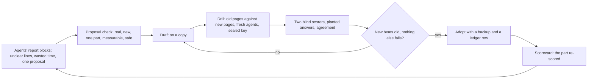
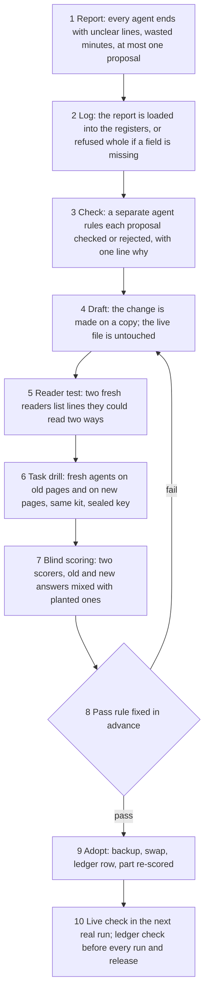
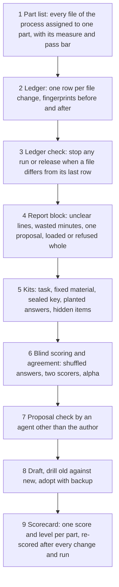

# 17. Process improvement

## 17.1 Introduction

The learning loop (Chapter 7) makes the research better: each research agent starts from the checked lessons of the runs before it. But the loop is itself made of parts that people and agents wrote: a rules page the research agent follows, step pages for each round, templates for forecasts and cards, prompts that launch each role, and tools that build runs, check rounds and keep the registers. If the rules page can be read two ways, every research agent that reads it may take the wrong reading. If a template asks for the wrong number, every forecast is scored against the wrong event. A loop built on weak parts teaches the wrong things very reliably.

These parts change all the time, because agents report unclear lines, slow steps and better ideas after every run. Two risks follow. A change that looks like an improvement may make things worse, and nobody would know, because the next runs differ in many other ways too. And a change can slip in unrecorded, so nobody can say what was different about the pages a run read.

Process improvement is the part of the system that handles both risks. It treats every part of the process as something that can be tested, scored and changed only on evidence, separately from the research the loop produces. This chapter explains what it is, how it works, and how to build it.

## 17.2 The concept

**Process improvement is a fixed procedure in which every part of the process is tested with fresh agents on a kit whose answers were sealed in advance, scored by two blind scorers who must agree, and changed only when a draft beats the live version on the same test, with every change to every file recorded.**

Terms used in this chapter:

- **Part:** one piece of the process with its own job, for example the research agent's rules page, the forecast step, the card template, the round checker or the speed of a run. The process is split into 34 parts in 13 categories.
- **Drill:** a small test of one part. Fresh agents, who have never seen the change or the earlier answers, do a real task of the role using only the part's documents.
- **Kit:** everything a drill needs: the task, material copied from a finished run, and an answer key.
- **Answer key:** the items a good answer must contain, each worth a point and each naming the document that should teach it, sealed before any agent runs.
- **Planted answers:** one good and one bad answer written by the kit builder with known scores, item by item. They are mixed in with the real answers to check the scorers.
- **Hidden items:** key items that are kept back and used only every few rounds, so that a part cannot be tuned to pass its own test.
- **Blind scorer:** a fresh agent that scores shuffled answers against the key without knowing their source.
- **Agreement:** how closely two scorers' points match, measured by Krippendorff's alpha [3, 4]. A value of 0.80 or more means the key can be trusted; below that, the key is fixed before any result counts.
- **Scorecard:** one score and one level per part (not measured, weak, works, proven, strong), each with what is good, what to improve, and the drills behind it. A proven part has passed its bar in blind drills; a strong part has also passed its hidden items and been confirmed in a live run within its speed target.
- **Draft:** a copy of a live file with the proposed change; the live file is untouched until the draft passes.
- **Ledger:** one row for every change to every file of every part, with fingerprints of the file before and after.
- **Proposal:** a change suggested by an agent at the end of its work, in a fixed report block.

Three properties follow. No change is judged by the agent that proposed it or the agent that drafted it. Every change is tested on the same task, the same material and the same key as the version it replaces, so the difference in score belongs to the change. And every file a run reads can be traced to a ledger row, so the exact process behind any run is known.

## 17.3 How it works

A change moves through the same steps every time.

**Reports and proposals.** Every agent ends its output with the same short block: the lines it found unclear, contradictory or out of date, each quoted with both readings; the minutes it lost and why; and at most one proposal, naming the part, the change, the score it should move and the drill that would show it. A line that two or more agents hit is fixed first.

**The proposal check.** A proposal is never adopted by the agent that made it. A separate agent checks five things: it is real (the quoted words are in the file), it is new (not a repeat of one already rejected), it touches one part, it is measurable (it names its drill and the score it should move), and it is safe (it contradicts no other rule). A proposal about the checking agent's own instructions goes to a fresh agent instead. Anything that touches money, live trading, deletions or the months kept back for the final test goes to the human owner. Rejected proposals stay in the register, so the same idea is not proposed again without new evidence. In two days of drilling, about 270 proposals were logged; about 70 of them, a quarter, were rejected at the check, and only a handful were adopted after their drills.

**Three kinds of change.** A rule, tool or score change is drilled old against new before it goes live. A wording change goes live after a reader test. An emergency fix during a live run goes in at once, never into a copy a running agent already holds, and is drilled afterwards. Each stays open until a drill that started after it verifies it.

**The reader test.** Two fresh agents read the draft cold and list every line they could read two ways, every stale line and every missing fact. A line counts only when both readers quote the same words, which filters out one reader's slip. A page passes when at most one agreed line is left and it can be fixed by wording alone. On the research agent's rules page, the agreed lines fell over four rounds from eleven to one.

**The task drill and blind scoring.** The drill is a small controlled experiment of the kind used in online testing [2]: the same task, the same material and the same sealed key, run by fresh agents on the old pages and on the draft, usually two models with two agents each per side. Two blind scorers then grade all the answers together, shuffled under neutral ids with the two planted answers among them. The scoring counts only if both planted answers land within one point of their known totals and the two scorers agree at alpha 0.80 or more. If not, the key is the problem: each disputed key line is given one meaning, sealed again, and the answers are rescored.

**The pass rule.** Written before the round: the draft scores at least as well as the old pages, the targeted defect is gone, no key item is met by fewer than half the agents, cost rises by no more than a fifth, and no drill of another part the change touches scores lower.

**Adoption and the ledger.** The live file is copied to a backup, the draft is swapped in, and one ledger row is written per changed file with its fingerprints before and after. The part is re-scored. Before every run is built and before every release, a ledger check compares every part file with its last ledger row and stops if any file's bytes differ, so no change to a prompt, rule, template or tool can reach a run unrecorded. An audit lists every change still waiting for its verifying drill.

**Keeping parts strong.** Every run re-scores the parts it touched. A problem that returns after its fix counts as a failed fix, and the next fix must be one level stronger: from wording, to a rule, to a tool that refuses the mistake, to a redesign of the step.

### A worked example: one drill of the forecast step

This example is real. Before each round the research agent seals a forecast, including the probability that the round passes its rule. A first blind round on the forecast drill found that none of four fresh agents started that probability from a count of similar past rounds that passed, as the key required; all four derived it from their own forecast number instead. The cause was traced to three lines that together read as "start from a past forecast number" rather than "count how many similar rounds passed": one on the rules page, one in the forecast template, and one in the scoring kit, which also defined the outcome as beating a benchmark rather than passing the full rule. A drafting agent changed copies of those files, and the drill was run again, old pages against new.

| | old pages | new pages |
|---|---|---|
| fresh agents | 4 (two models, two each) | 4 (two models, two each) |
| key | 22 items, sealed before any agent ran | the same key |
| scorer one: total over the four answers | 83 of 88 | 88 of 88 |
| scorer two: total over the four answers | 84 of 88 | 88 of 88 |
| agents that started the probability from a counted share | 0 of 4 | 4 of 4 |
| planted answers (known 22 and 12) | scored exactly by both scorers | scored exactly by both scorers |
| agreement between the two scorers | alpha 0.96 over all ten answers | |

The ten answers, four old, four new and two planted, were scored together without labels, so neither scorer knew which pages an answer came from. The new pages passed the rule, the change was adopted with a backup of each live file and four ledger rows, and a second blind round on the fixed pages scored 43 of 44 with agreement 1.00, which made the forecast drill proven.

### A worked example: part of the scorecard

A few rows of the scorecard as it stood after one day of fair re-scoring, in plain words:

| part | score | level | why |
|---|---|---|---|
| the research agent's rules page | 12 of 12 | proven | blind re-score on six agents, agreement 0.86, planted answers exact; strong still needs hidden items |
| the card template | 10 of 10 | proven | both blind scorers full marks, agreement 1.0 |
| the third round step | 4.75 of 6 | weak | scorers agree (0.905) but agents fall short of the bar of 5 on the placebo design |
| live forecasts | 14 of 19 rounds | works | intervals held the real result in 14 of 19 live rounds, under the 80 percent target |
| the full launch prompt | 12.5 of 13 | weak | its content is right, but at 226 KB it is about twenty times the size of the page it carries |
| speed of a run | 42.1 minutes | weak | over the 40 minute target |
| the improvement procedure itself | 123 of 143 | works | 123 of 143 logged changes matched to a verifying drill |

Across all 34 parts, 22 were proven, 7 worked and 5 were weak. The weakest part in each category is the next one to improve.

## 17.4 How to build it

The components below are listed in the order they are best built, because each depends on the ones before it.

1. **A part list.** Every file the process uses belongs to one part, with its measure, its drills and its pass bar. A file not in the list is not used in a run.
2. **A ledger.** One append-only row per file change, with fingerprints before and after, the reason, who found the need and the verifying drill, starting from a baseline row per file.
3. **A ledger check.** A tool that fails when any part file differs from its last ledger row, run before every run build and release.
4. **The report block.** A fixed ending for every agent's output, and a loader that refuses an incomplete block whole.
5. **Kits.** For each part, a kit built before any agent runs: the task, recorded material, a sealed key, a good and a bad planted answer, and hidden items.
6. **Blind scoring.** A step that shuffles real and planted answers under neutral ids, and an agreement tool that computes alpha and sends answers where scorers differ by more than a point to a third scorer.
7. **The proposal check.** A separate step by an agent that did not write the proposal, with a written verdict.
8. **Draft, drill and adopt.** A pass rule written before each round, and an adoption step that keeps a backup, swaps the file, writes the ledger rows and re-scores the part.
9. **The scorecard.** The latest score and level per part, rolled up by category, so the weakest part in each is always visible.

## 17.5 What it makes possible

With this in place, the process can change every day without losing track of itself. A weak line found by one agent becomes a tested fix for every later agent, and a change that only looked good is caught before it reaches a run. Because every part has a score from a fair test, effort goes to the weakest parts first. Because every file is in the ledger, any run can be traced to the exact pages it read, so a change in results can be tied to a change in the process or ruled out. The same procedure serves every pack of the learning loop (Chapter 7).

## 17.6 Conclusion

Process improvement keeps the learning loop's own machinery honest. It follows the plan-do-check-act cycle that Shewhart introduced and Deming taught [1]: a change is planned on a copy, tried in a drill, checked against the version it replaces, and only then acted on. The check is a controlled comparison in the sense of online controlled experiments [2], with the same task and key on both sides and a pass rule fixed in advance. Its scores are trusted only when two blind scorers agree at the level that content analysis treats as reliable [3, 4], and planted answers with known scores check the scorers, in the same spirit as calibrating model-based graders against known answers [5, 6]. Every change, adopted or rejected, leaves a record, so the process that produced any result can always be shown.

## References

1. Deming, W. E. (1986). *Out of the Crisis*. Cambridge, MA: Massachusetts Institute of Technology, Center for Advanced Engineering Study.
2. Kohavi, R., Tang, D., and Xu, Y. (2020). *Trustworthy Online Controlled Experiments: A Practical Guide to A/B Testing*. Cambridge University Press. https://doi.org/10.1017/9781108653985
3. Hayes, A. F., and Krippendorff, K. (2007). Answering the call for a standard reliability measure for coding data. *Communication Methods and Measures*, 1(1), 77-89. https://doi.org/10.1080/19312450709336664
4. Krippendorff, K. (2018). *Content Analysis: An Introduction to Its Methodology* (4th ed.). Thousand Oaks, CA: SAGE.
5. Grace, M., Hadfield, J., Olivares, R., and De Jonghe, J. (2026). *Demystifying evals for AI agents*. Anthropic Engineering. https://www.anthropic.com/engineering/demystifying-evals-for-ai-agents
6. Zheng, L., Chiang, W.-L., Sheng, Y., Zhuang, S., Wu, Z., Zhuang, Y., Lin, Z., Li, Z., Li, D., Xing, E. P., Zhang, H., Gonzalez, J. E., and Stoica, I. (2023). Judging LLM-as-a-judge with MT-Bench and Chatbot Arena. *Advances in Neural Information Processing Systems 36*. https://arxiv.org/abs/2306.05685
