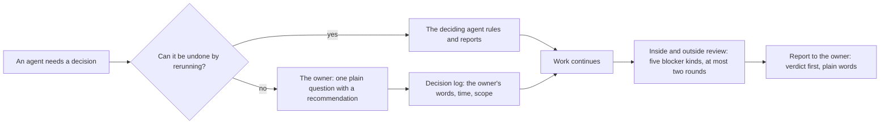
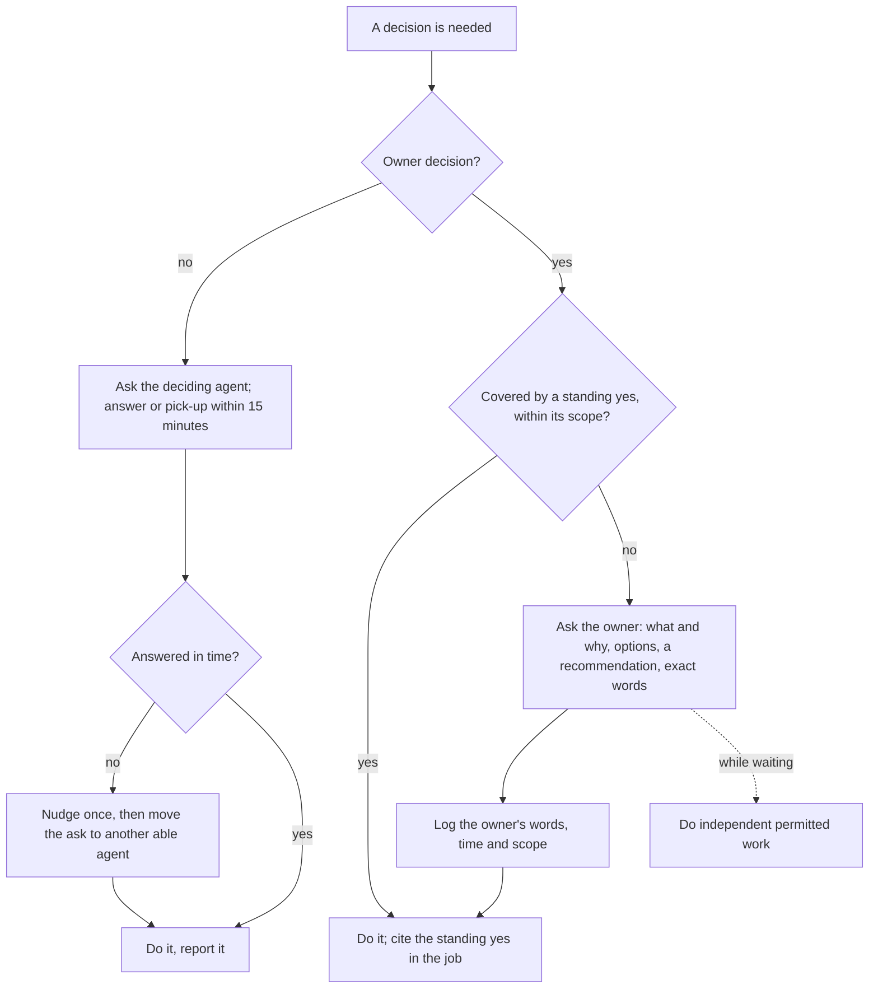
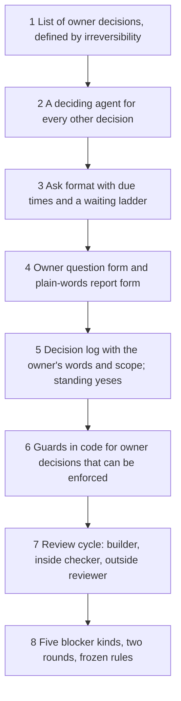

# 18. Owner and governance

## 18.1 Introduction

This system is a set of computer programs and AI agents that study the cryptocurrency market and look for good moments to trade. It does paper research only: no real money is at stake in the studies described here. Many agents work on it at once; one person, the owner, sets the goal and carries the consequences of anything it does in the world.

Two opposite failures threaten such a system. In the first, an agent acts alone on something that cannot be taken back: it deletes data that cannot be downloaded again, reads months kept aside for the final test, publishes what may not be shared, or places a trade. In the second, every agent waits for the owner. The owner is not an expert in the research and is often away from the computer; technical questions put to the owner sit for hours, and the owner is asked to rule on things the owner cannot judge. Both happened here in the early weeks: agents waited for technical yeses the owner could not give, and an agent once wrote into a gate a rule only the owner could set.

Governance draws the line between the two. It says which decisions belong to the owner and why, lets the agents decide and report everything else, fixes how a question is put to the owner and how the answer is kept, and sets how outside reviewers check methods and tools without holding work up forever.

## 18.2 The concept

**Governance is a fixed split of decisions: the owner decides only what cannot be undone, the agents decide everything else and report it, every owner decision is asked in plain words and logged in the owner's own words, and every method and tool is checked by a reviewer who did not build it, under a short list of reasons that may block it.**

Terms used in this chapter:

- **Owner decision:** a decision whose effect cannot be reversed by running a program again.
- **Agent decision:** any other decision. A wrong one costs a run, and the next run can correct it.
- **Standing yes:** an owner decision that covers one kind of action within a stated scope, so the agents do not ask again each time.
- **Ask:** a request from one agent to another, with an identifier, a due time and the answer that would close it.
- **Decision log:** the record of every owner decision: the owner's words, the time and the scope.
- **Inside reviewer:** an agent of the same team, other than the builder, who checks a tool or method.
- **Outside reviewer:** a reviewer from a separate team, with its own model and instructions, who checks the same version and never builds.
- **Blocker:** a review finding that stops a tool or method from being used. Only five kinds qualify.

Three properties follow. Nothing irreversible happens without the owner, and the line is drawn by the nature of the act, not by how important it feels. Nothing reversible waits for the owner, so work does not stop while the owner is away. And no result reaches the owner or a release without passing someone who did not make it.

## 18.3 How it works

### What only the owner decides, and why

The test is one question: can the effect be undone by running a program again? If it can, an agent decides. If it cannot, the owner does.

- **Which months may be read.** Each study learns on some months, is checked once on months kept aside, and never sees a last group (Chapter 12). A month once read cannot be unread: an agent that has seen how a rule did in a month can no longer test it honestly there. Opening check months spends them, so the owner decides when; only the owner can open never-seen months.
- **Money, live trading and going live.** A trade with real money cannot be taken back. So is accepting a data source's terms for that use, since some data licences bar live use of their files.
- **Deletes outside an agent's own working files.** Each agent cleans its own finished working files through a cleaner with a keep list, a dry run and a log (Chapter 1). Anything else needs the owner's yes or a standing rule the owner set. Raw downloaded data is never deleted: every table can be rebuilt from it, but it often cannot be downloaded again.
- **Publishing.** A pushed file, a page shared with outsiders or data sent out cannot be recalled, and data licences limit what may be shared.
- **The goal and the rules that define success.** What the system is for, how long a trade may last and what counts as a result. An agent that lacks such a rule states the facts, marks the rule as waiting for the owner, and asks.

Installs that need the owner's hands, sign-ins and payments are owner acts for a simpler reason: only the owner can do them.

### Everything else: the agents decide and report

Every other decision has a deciding agent: a research lead for method and which run goes next, a tools lead for tools, data and settings, the orchestrator for starting and restarting agents, the data keeper for filing approved deletes. An agent that needs a ruling sends an ask to the deciding agent; the answer, or a pick-up note with an expected time, is due within 15 minutes. Without one, the asker nudges once, the deciding lead moves the ask to another agent at 30 minutes, and at 45 the orchestrator checks whether the silent agent has stopped. A job is filed only on a free job queue, never behind another agent's job. While waiting, an agent does the next independent piece of permitted work. It never asks the owner a technical question.

| decision | who decides | why | real example |
|---|---|---|---|
| which months a study may read | owner | a month once read cannot be unread | the owner sets the learning, check and never-seen months for new strategy work; check months are opened once, for one frozen rule |
| money, live trading, going live | owner | a trade cannot be taken back | no live step is planned until the owner rules, and the data licences were read first |
| deletes outside an agent's own files | owner, or a standing rule the owner set | deleted raw data cannot be rebuilt | raw data ruled untouchable on every drive; approved deletes are filed by the data keeper itself, since handing the owner commands only stalled them |
| publishing and sharing outside | owner | a published file cannot be recalled | for an open release, the methods, metrics and calculations may be shared, the market data never |
| the goal, trade duration, what counts as a result | owner | these define success | trade duration set by the owner at seconds to four hours; an agent that wrote its own range into a gate was corrected |
| which reading to test next, which run goes | research lead agent | a wrong choice costs one run | the next test named in the knowledge brief (Chapter 7) |
| a tool fix, a rerun, a setting | tools lead, or the agent doing the work | checkable and repeatable | a failed check is fixed and rerun without asking |

### Standing yeses

Repeated owner decisions become standing yeses: one for downloads, each posted on the board first, and one for any jobs a stage of work needs, within that stage's months and with no outcomes read. Each job that relies on one cites it, and work outside its scope goes back to the owner. A related rule protects the owner's attention: nothing is launched on an idea the owner is still discussing.

### How a decision is asked and logged

An owner question has a fixed form. It opens with what the thing is and why it matters, in plain words, explaining every term the owner did not use first. It asks one question at a time; pending owner decisions are collected into one block so the owner is interrupted once, but each is answerable on its own. It gives the options with their cost and a committal recommendation. And it gives the exact words to approve, so a short "yes" approves one stated action and nothing more.

A real case: before any code was written for a tool that keeps each alarm's track record, eleven rulings went to the owner, each with a recommendation. One concerned costs. The only cost table had been built from order books recorded after every trade it would price. Option a used it as one fixed reference scenario, every dependent value stamped with the table's fingerprint; option b counted only costs known at the time, which would leave the first four months with no net result, so nothing could ever show a profit. The recommendation was a, stated as a scenario rather than a claim of no look into the future.

The answer is logged in the owner's own words, with the time and scope, in the decision log and in the memory every new agent reads at start. Paraphrase is not enough: a later agent must see exactly what was allowed, so it neither oversteps nor asks again.

### Outside reviews, and what may block

Every tool and research method goes through one cycle: an agent builds it, a separate inside checker reviews it, an outside reviewer reviews the same version, the builder fixes, the outside reviewer re-reviews, and both teams sign the same bytes. Before a research design's first run on real data, an outside sceptic also tries to break it.

A finding blocks only if it is one of five kinds: a wrong number, shown on a case; a false label, a value that does not mean what its name says; a look into the future, including future data inherited from an upstream table; a skipped gate, a way around a check that should refuse; or a missing step of the build or test method (Chapter 16). A rare case nobody could easily foresee is a note; everything else goes to a backlog for the next version. There are at most two rounds per version: round 2 checks the round 1 fixes, what they broke, and the five checks again. After that only a blocker found on real data reopens the version, and the inside reviewer closes it by reading only the changed lines. Rules are frozen for a design in review.

### A real review outcome

The same track-record tool shows why the outside reviewer exists. The inside reviewer passed its scope as ready. The outside reviewer, on the same version, found five blockers.

| what the outside reviewer found | blocker kind | the fix |
|---|---|---|
| the cost table came from order books recorded about a year after the earliest trades it priced | a look into the future | every cost-dependent value stamped with its fixed reference table; the owner ruled how to read costs |
| an edge was treated as free of costs, though the costs of its two legs do not cancel: a gross edge of +0.01 became -0.025 after stress costs, and the test still passed | a wrong number | each observation netted with its own exit before averaging; the case became a test |
| a gap in the price path after an entry was written as a move of zero instead of empty | a false label | a path counts only when complete; otherwise empty, with its reason |
| the verdict's test cases lacked the failing cases | a missing step | every verdict rule got a passing and a failing case |
| an earlier measurement could be reused after its settings changed, because reuse checked only the data | a skipped gate | reuse only when every input and setting is identical |

Round 2 confirmed the fixes and found three smaller faults in the repairs, all in tests that checked the wrong thing. They were fixed, the inside reviewer closed the version on the changed lines, and its own lesson was filed: future data inherited from an upstream table is a look into the future, never a note.

### How the owner is told

Reports follow the same plain-words rule. The verdict comes first, in a short list, with numbers only where their meaning is said; identifiers and fingerprints stay in the records. A status is three separate answers: computed as its rule says, means what its name says, stable enough to use. "Passes" alone is never written, because a passed software check once led the owner to believe descriptions were correct when only their code had been tested. When something breaks, the report owns it: what happened in two sentences, how it was contained, then the detail. A wrong number is never defended. Next steps are always given, time estimates never, and status is never shown by colour alone.

## 18.4 How to build it

1. **The owner list,** defined by the test of reversibility, each item with its reason, so a new case can be sorted without asking.
2. **A deciding agent** for method, for tools and data, and for starting agents. No technical decision is left without one.
3. **Asks and a ladder:** one format with an identifier, a due time and a closing condition; a 15-minute pick-up rule; a nudge, a move and a restart check at fixed times; a tool that lists open asks and flags the late ones.
4. **Two forms for the owner:** a question form (what and why, one question, options, a recommendation, exact words) and a report form (verdict first, plain words, three answers for any status).
5. **The decision log:** every owner answer with its words, time and scope, read by every new agent at start; standing yeses carry their scope and are cited by each job that uses them.
6. **Guards in code where possible:** the cleaner deletes only inside an agent's own working files, with a keep list and a log; the readers refuse months kept aside; publishing needs an owner act. Guards that live only in text are checked by another agent (Chapter 10).
7. **The review cycle:** an inside checker, then an outside reviewer from a different team who never builds; both sign the same bytes.
8. **The limits on review:** five blocker kinds, at most two rounds, a closing check of changed lines only, a backlog for the rest, rules frozen for designs in review.

## 18.5 What it makes possible

The agents work at full speed while the owner is away, and the owner's attention goes only to the few decisions that need it. Every irreversible act traces to an owner answer in the owner's own words. Reviews catch the faults that matter without becoming endless. And the same rules carry over to live trading, where an irreversible act costs money, not a run.

## 18.6 Conclusion

The system's governance rests on one test: decisions that cannot be undone belong to the owner, and all others belong to named agents who decide and report. This is the separation of duties of information security, in which no single party completes a sensitive action alone [1, 2]. The review cycle applies the effective challenge of model risk management, in which models are checked by informed parties independent of their builders [3, 4]. The owner's role matches the governance function of the NIST AI Risk Management Framework, which assigns clear roles and human oversight across an AI system's life [5], and the human oversight of the European AI Act, under which the person overseeing a system must be able to understand its output, override it and stop it [6]. What this system adds is a working rule for one owner and many agents: ask only what cannot be undone, ask it plainly, keep the answer in the owner's words, and block a review only for the five faults that make a result untrue.

## References

1. Saltzer, J. H., and Schroeder, M. D. (1975). The protection of information in computer systems. *Proceedings of the IEEE*, 63(9), 1278-1308.
2. Joint Task Force (2020). *Security and Privacy Controls for Information Systems and Organizations*. NIST Special Publication 800-53, Revision 5, control AC-5 (Separation of Duties). https://doi.org/10.6028/NIST.SP.800-53r5
3. Board of Governors of the Federal Reserve System and Office of the Comptroller of the Currency (2011). *Supervisory Guidance on Model Risk Management*. SR Letter 11-7. https://www.federalreserve.gov/supervisionreg/srletters/sr1107.htm
4. Board of Governors of the Federal Reserve System and others (2026). *Supervisory Guidance on Model Risk Management*. SR Letter 26-2, which replaces SR Letter 11-7 and keeps effective challenge. https://www.federalreserve.gov/frrs/guidance/supervisory-guidance-on-model-risk-management.htm
5. National Institute of Standards and Technology (2023). *Artificial Intelligence Risk Management Framework (AI RMF 1.0)*. NIST AI 100-1. https://doi.org/10.6028/NIST.AI.100-1
6. European Parliament and Council of the European Union (2024). Regulation (EU) 1689 of 2024 laying down harmonised rules on artificial intelligence (Artificial Intelligence Act), Article 14: Human oversight. *Official Journal of the European Union*, 12 July 2024. https://eur-lex.europa.eu/eli/reg/2024/1689/oj
