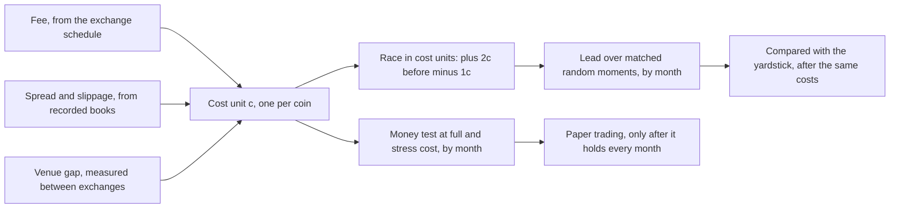
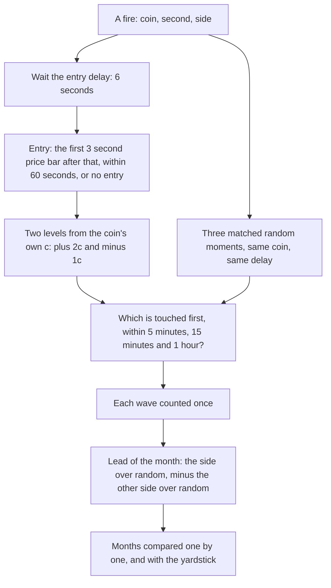
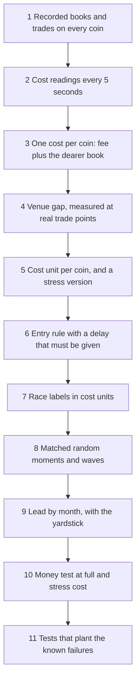

# 19. Costs and realism

## 19.1 Introduction

This system looks for good moments to trade cryptocurrency perpetual futures: contracts that follow a coin's price with no expiry date. Every study ends with the same question: after this kind of moment, does the price move in a useful direction? The honest form of the question adds four words: after paying to trade.

Trading is never free. The exchange charges a fee on each side. A buyer pays a little more than the middle price and a seller receives a little less, because the best offer to sell sits above the best offer to buy; that distance is the spread. A larger order also eats through several price levels of the order book; that extra is slippage. A study that ignores these costs reports moves nobody could keep. The difference between a result on paper and a result in a real account is called the implementation shortfall [1], and it is the most common way a research programme fools itself.

Here the costs are large next to the moves. A round trip (buy, then sell) costs about 0.13 percent on the largest coins and up to about 0.5 percent on the thinnest, while a coin's usual move in one hour is about 0.3 to 0.5 percent. On some coins cost is most of the move. Costs also differ by coin, so a move of 0.4 percent is three costs on one coin and less than one on another.

## 19.2 The concept

**Every result in the system is measured after the trading costs of the coin it trades, in a cost unit equal to that coin's round-trip cost, so that a lead means a lead after costs and coins of different cost are compared on one scale.**

Terms used in this chapter:

- **Basis point (bp):** one hundredth of a percent. All costs are for a round trip of 10,000 US dollars.
- **Fee, half spread, slippage:** the exchange's charge on each side; half the distance between the best buy and best sell prices, paid on each side by a market order; and what an order pays beyond the best price because it must also fill at deeper levels of the book.
- **Venue gap:** the price difference between the exchange whose recorded prices the studies measure and the exchange the system would trade on.
- **Cost unit (c):** one round trip on that coin, all four parts together, in percent of the price.
- **Fire and wave:** a fire is one moment a design marks, one coin at one second; a wave is fires on any coins within 30 minutes of each other, counted as one market event (Chapter 6).
- **Race:** after the entry, does the price reach two cost units in the bet's direction before one cost unit against it?
- **Matched random moments:** ordinary moments on the same coin, at similar activity, nearby days and the same hour, with no fire just before (Chapter 6).
- **Lead:** how much more often a design's side wins the race than its matched random moments, minus the same difference for the opposite side, in percentage points.
- **Yardstick:** the plainest alarm of the same kind and side, with no extra condition, graded the same way after the same costs; also called the plain move.
- **Full cost:** what a money test charges: fee, book cost at the entry hour, venue gap and the funding paid while the position is open.
- **Entry delay:** the seconds between a fire and the moment a trade is assumed filled.

Three properties follow. No result is quoted before costs as if it were a result. Coins of different cost answer the same question on the same scale. And every comparison, with random moments, with the yardstick or between months, pays the same costs on both sides.

## 19.3 How it works

The picture shows one fire passing through the grade.

**Costs are measured, not assumed.**

- The fee is the trading exchange's published taker fee at the lowest volume tier, 0.045 percent a side, so 9 bp a round trip. No discount, rebate or better tier is assumed.
- The book cost (spread and slippage together) is a 10,000 dollar market buy plus a market sell, walked level by level through the book and measured from the middle price. On one exchange it comes from the recorded books, every 5 seconds through the 25 visible levels, then the coin's median over the hours of the day on eleven weekly sample days from October to December 2025 (Chapters 2 and 3). On the trading exchange it comes from snapshots of the live public book. The dearer of the two is taken, so a thin coin is never priced as a deep one; the trading exchange was the dearer on 45 of 51 coins.
- The venue gap was measured at the real entry and exit points of an earlier strategy: a median of 0.016 percent a leg, so 0.032 percent a round trip. A stress gap of 0.144 percent, from the 75th percentile of the worst of three timings, is shown beside it.

The cost unit is the fee and book cost in basis points divided by 100, plus 0.032. A coin with no measured cost is never given an average one: it is graded before costs only, kept out of every after-cost row, and listed by name.

**The race.** After the entry, the grade sets two levels from the coin's own cost unit, two units in the bet's direction and one against, and records which is touched first within 5 minutes, 15 minutes and 1 hour. Both touched inside one 3 second bar counts as against the bet. A hole of more than 60 seconds in the price record makes the result unknown, never a win or a loss. Both directions are graded for every fire: following the move and fading it. The race describes opportunity in cost units; it is not money, which has its own test below.

**Matched random moments, after the same costs.** Each fire gets three matched random moments on the same coin, raced with the same cost unit and the same entry delay. Moments near the design's own fires are left out, and each wave counts once. The lead subtracts twice: the side's win rate minus its random moments' rate, then minus the same difference for the opposite side. The second step matters because a busy moment makes both directions win more often, simply because the price moves more. Subtracting the other side removes that size effect, so only knowledge of the direction remains.

**The yardstick, after the same costs.** A new alarm usually adds conditions to a simple one, such as a sharp fall in which traders were forced out of their positions, plus something more. The plain version is graded in the same run, with the same race, costs, random moments and months. A new idea must beat it by at least 2 points, with a t value of at least 3 and in most months, or it adds nothing over the plain move.

**Month by month, never pooled only.** Every grade is reported for each month, with waves as the unit; a month counts when it has 30 or more waves. A first pass needs a lead of 3 points or more at 15 minutes or 1 hour in at least two of every three counted months. A pooled number can hide one excellent month among bad ones, and crypto markets change character from month to month. The two crash days of October 2025 are reported apart, results are also shown without the five best days, and design months, check months and never-seen months are kept apart (Chapter 12).

**Full cost for money.** When a design becomes a strategy, its money test charges full cost: the fee, the book cost of that coin at that hour of the day (the dearer of two measured tables; about 17.5 bp with the fee at the median coin and hour), the venue gap, and the funding paid or received while the position is open. Funding is the periodic payment between holders of long and short positions. The same trades are charged again at 1.5 and 2 times the book cost and gap. Before a strategy may move to paper trading, it must be positive in every month after full cost, counted by wave, still positive without its five best days, and it must survive the stress cost (strategy design, described in a later edition).

**The cost charged is never a reason to pick a trade.** The charging table is a fixed assumption, and the cost tool refuses to hand it out for selecting trades, so a study cannot quietly pick the coins and hours that look cheap in its own charging table. A rule that wants to avoid expensive moments must use the cost readings known at the fire's second (Chapter 4), which carry their own time stamps.

**The entry delay, and why.** No trade fills at the second a fire happens. The system needs time to see the data, decide and send an order, and the price at the fire's second is already in the past. Grading at that price would credit a design with a move nobody could catch, and would let the outcome count the very trades that caused the fire. So every entry waits 6 seconds, then takes the close of the first 3 second price bar after that, within 60 seconds, or there is no entry. The grading tool requires the delay as an input, so a delay measured in live trading can replace it. An entry minutes after the fire is allowed only with its own written reason, and is compared with random moments that use the same delay.

### A worked example: one coin's cost unit

The values below are real, for AAVE, a mid-sized coin, from the system's table of one cost per coin.

| part | how it is measured | AAVE |
|---|---|---|
| fee | taker fee, 0.045 percent a side, both sides | 9.00 bp |
| book cost (half spread paid twice, plus slippage beyond the best price for a 10,000 dollar buy and sell) | the dearer exchange: 5.74 bp on the trading exchange against 2.88 bp on the recorded one | 5.74 bp |
| venue gap | median measured gap between the two exchanges, round trip | 3.20 bp |
| cost unit c | fee, book cost and gap together | 17.94 bp, so 0.179 percent |

On AAVE the race therefore asks whether the price reaches plus 0.359 percent before minus 0.179 percent.

### A worked example: coins on one scale

The values below are real. The usual 1 hour move is the coin's median absolute move over one hour on the recorded exchange, October to December 2025, taken as the median over the hours of the day.

| coin | cost group | cost unit c | usual 1 hour move | usual move in cost units | a 0.4 percent move in cost units |
|---|---|---|---|---|---|
| BTC | cheap | 0.126 percent | 0.28 percent | 2.2 c | 3.2 c |
| ETH | cheap | 0.127 percent | 0.34 percent | 2.7 c | 3.1 c |
| SOL | cheap | 0.140 percent | 0.43 percent | 3.1 c | 2.9 c |
| AAVE | middle | 0.179 percent | 0.52 percent | 2.9 c | 2.2 c |
| XMR | thin | 0.220 percent | 0.49 percent | 2.2 c | 1.8 c |
| VVV | thin | 0.522 percent | 0.56 percent | 1.1 c | 0.8 c |

The same 0.4 percent move is more than three costs on BTC and less than one on VVV, whose usual hourly move barely pays one round trip. Measured in percent the two moves look equal; in cost units one is a chance and the other a loss.

### A worked example: one fire's race

The example below is illustrative: it shows the rules on one invented fire, not a stored result. An alarm fires on AAVE at 14:32:10 after a sharp fall, and the bet is a fade: buy, expecting the price to come back. The cost unit is 0.179 percent.

| step | value |
|---|---|
| fire | 14:32:10 |
| entry | after the 6 second delay, the first 3 second bar that starts after it ends at 14:32:21; its close, 156.00, is the entry price |
| levels | plus 2c at 156.56; minus 1c at 155.72 |
| after 5 minutes | high 156.31, low 155.80: neither level touched, no result at 5 minutes |
| after 15 minutes | 156.56 touched at 14:41:30, before 155.72: the race is won at 15 minutes |
| after 1 hour | already decided by the first touch: won |
| in cost units | worst move before the target minus 0.7 c |
| its three random moments | one won the 15 minute race, two did not |

One fire proves nothing; a month's lead is built from hundreds of waves. For scale, two real yardsticks graded on September 2025 to January 2026 after the same costs: fading a sharp fall in which long holders were forced out leads by plus 8.09 points at 15 minutes (t 3.70, 1,235 waves, positive in 4 of 5 months), and fading the matching rise by plus 10.99 points (t 5.30, 1,382 waves, 5 of 5 months). A new idea on the falling side must reach at least plus 10.09 points.

## 19.4 How to build it

The components below are listed in the order they are best built, because each depends on the ones before it.

1. **Recorded books and trades**, with arrival times and holes marked, never filled (Chapter 2).
2. **Cost readings.** Producers compute, every 5 seconds, the half spread and the cost of walking a fixed order through the book, each with its own card (Chapters 3 and 4). These are the readings a rule may use at a fire.
3. **One cost per coin**: the published fee plus the dearer of two exchanges' book costs, from medians over the hours of the day. A coin without a measured cost gets none.
4. **The venue gap**, measured at real entry and exit points, with a median for normal use and a high percentile for stress.
5. **The cost unit**: one number per coin for grading, plus its stress version.
6. **The entry rule**: a fixed delay, the first priced bar after it within a time limit, and no entry when there is none. The delay is a required input, never a hidden constant.
7. **Race labels** for every fire and both sides, with the same-bar rule and unknown for holes.
8. **Matched random moments and waves**, labelled the same way (Chapter 6).
9. **The lead by month**, with the yardstick graded in the same run.
10. **The money test**: a cost tool that charges fee, hourly book cost, venue gap and funding, again at 1.5 and 2 times, and refuses to give its charging table out for selection.
11. **Tests** on planted price paths with known answers: a profit with its sign flipped must show as a loss; a target and stop in one bar must count as the stop; a hole must give unknown; a coin without cost must stay out of every after-cost row.

## 19.5 What it makes possible

Because every result is in cost units, a fall on BTC, a fall on a thin coin and a new idea against the plain move are compared on one scale, and a lead over random moments is a lead after costs. A losing month is seen, not averaged away. Because the money test charges the full measured cost, a strategy that reaches paper trading has already paid on paper what a real account would pay, so paper trading tests what remains: fills, delays and the market itself.

## 19.6 Conclusion

Costs decide whether a pattern in prices is a trading opportunity. The system measures them rather than assuming them, grades every design in its coin's own cost unit against random moments and the plain move, reports each month on its own, and admits a strategy to paper trading only when every month holds at full and stressed cost. This follows the implementation shortfall view that a paper result must be judged against what trading would really have paid [1]. The cost of a market order is measured as the effective cost of crossing the spread and walking the book, in line with the literature on effective spreads and liquidity measures [2, 3], and kept to a fixed order size because cost grows with size and urgency [4, 5]. Reporting month by month, counting waves and grading the yardstick in every run guard against a backtest that looks good only because many things were tried [6].

## References

1. Perold, A. F. (1988). The implementation shortfall: paper versus reality. *Journal of Portfolio Management*, 14(3), 4-9.
2. Hasbrouck, J. (2009). Trading costs and returns for U.S. equities: estimating effective costs from daily data. *Journal of Finance*, 64(3), 1445-1477.
3. Goyenko, R. Y., Holden, C. W., and Trzcinka, C. A. (2009). Do liquidity measures measure liquidity? *Journal of Financial Economics*, 92(2), 153-181.
4. Almgren, R., and Chriss, N. (2001). Optimal execution of portfolio transactions. *Journal of Risk*, 3(2), 5-39.
5. Kissell, R. (2013). *The Science of Algorithmic Trading and Portfolio Management*. Academic Press.
6. Harvey, C. R., and Liu, Y. (2015). Backtesting. *Journal of Portfolio Management*, 42(1), 13-28.
