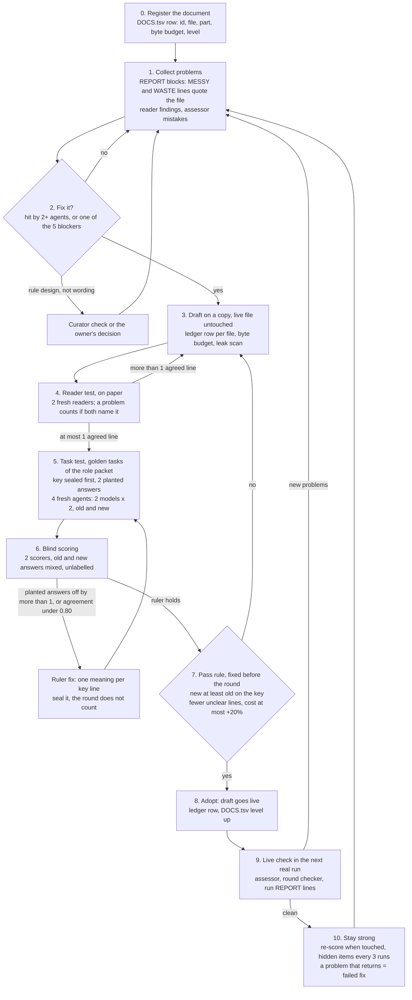

# DOCUMENT PROCESS V1 (SCOUT 2026-11-08, C141): how every document is reviewed, scored and improved
why: the owner 13:21Z "can we have a process page and flow chart on how each document is reviewed, scored and improved so we keep it also in the learning loop folder?"
Research behind it: team/RESEARCH/plans/PLAN_AGENT_DOCUMENTS_20261108.md. General change rules: drills_v2/PROCESS_IMPROVEMENT_V1.md (this page is its document part).
Covers every row of registers/DOCS.tsv: rules pages, launch prompts, skills, step pages, templates, job sheets, the knowledge brief, checklists.
Two rules above all: never score your own change (fresh agents and blind scorers do it), and never change a live file before its draft passed.

## Flow chart

## The steps
0. REGISTER. Each document has one DOCS.tsv row: id, file, part (PARTS.tsv), byte budget, the result of each test, level, next step. A document not in DOCS.tsv is not used in a run.
1. COLLECT. Every agent ends with the REPORT block ({GENERIC}/REPORT_TEMPLATE_V1.md); `reg.py import-report` loads it. Each MESSY line names its file, so problems land on the document that caused them. Reader findings and assessor mistakes land the same way.
2. DECIDE. Fix a problem when 2 or more agents hit it, or when one hit is a blocker (wrong number, false label, look-ahead, gate bypass, missing step; review-blockers rule). A problem that is rule design, not wording (the placebo rule, a pass bar), goes to the curator's proposal check or to the owner; it is not reworded away.
3. DRAFT. Change a copy (drill folder or `<file>_DRAFT`), never the live file. One LEDGER.tsv row per changed file (`reg.py ledger`). Keep the byte budget (shorter beats longer). Run the held-out leak scan (build/leak_scan_v1.py) on the draft.
4. READER TEST (paper). Two fresh agents read the draft cold and list lines they could read two ways, stale lines, missing facts. A line counts only when both quote it. Pass: at most 1 agreed line, fixed by wording; else back to 3.
5. TASK TEST (golden tasks). Fresh agents do the real work of the role using only the documents (role packets: K1 hunter, K2 assessor, K3 curator, K4 orchestrator, registers/PACKETS.tsv).
   - The key is written and sealed (sha16 in the ledger) before any agent runs. Each key item names the document that should teach it.
   - Two planted answers with known scores (a good one and a bad one, counted item by item).
   - 4 agents per side: 2 models x 2 agents, old documents and draft, same task, same key.
   - Measured: key points, unclear lines per agent (from the REPORT block), tokens and minutes.
6. BLIND SCORING. Two fresh scorers grade old and new answers together, mixed and unlabelled (build/blind_kit_v1.py make, then score). The ruler holds when both planted answers score within 1 of their known totals and agreement (alpha) is at least 0.80. If not, the round does not count: give each disputed key line one meaning, seal it as a new key version, score again.
7. PASS RULE (written before the round): the draft scores at least the old on the key, at least 90 pct of key items met over the 4 runs, no item under 50 pct, fewer unclear lines, cost at most +20 pct. Fail: back to 3 with what the agents reported.
8. ADOPT. Copy the draft over the live file (any time except between a run's build and its pin; a running hunter keeps its pinned copy), a ledger row, DOCS.tsv level up. A release of a kit waits on a drill plus a live test and on the owner's word.
9. LIVE CHECK. The next real run uses it; the assessor, the round checker and the run's REPORT lines say whether it held. New problems go back to 1.
10. STAY STRONG. Re-score a document whenever it changes; hidden key items every 3 runs (against tuning to the test); a fixed problem that comes back counts as a failed fix; a document that does not improve after 2 loops gets a redesign (or a tool that refuses the mistake), not more words.

## How a document is scored (one line per document in DOCS.tsv)
| measure | from | good |
|---|---|---|
| key share | task test: points earned on the key items that name this document | at least 90 pct, no item under 50 pct |
| unclear lines | task test: MESSY lines quoting this document, per agent | falling round on round; 0 for a template |
| reader lines | reader test: lines both readers quote | at most 1 |
| live lines | live run: MESSY lines and assessor mistakes on it | 0 that change a number |
| cost | tokens and minutes of the agents that read it | at most +20 pct of the old version |

## Levels
| level | meaning |
|---|---|
| NOT_MEASURED | no test yet |
| WEAK | a test failed, or open blocker lines |
| WORKS | one test passed |
| PROVEN | two drill rounds of 2 agents passed, or one drill plus a live run |
| STRONG | PROVEN, plus hidden items, 2 scorers agreeing at 0.80 or more, a live run and the speed target |

## Example: packet 1, the hunter documents (8 Nov)
- Old documents: 98 pct on the key, about 15 unclear lines and about 182k tokens per hunter; the old run prompt alone gave 7 unclear lines per hunter.
- Draft 1 (job sheet in place of the run prompt): unclear lines about 10, about 146k tokens; all 4 hunters hit one new bug in the job sheet (fixed in draft 2).
- The first scoring did not count: one key line read two ways and a planted answer was not a clean 30; the ruler was fixed and sealed (KEY_V2) before round 2 was scored.
- Records: registers/DRILL_RUNS.tsv rows K1B-*, K1N-*, K1MIX-SCORE; drills_v2/GOLDEN/K1/.
